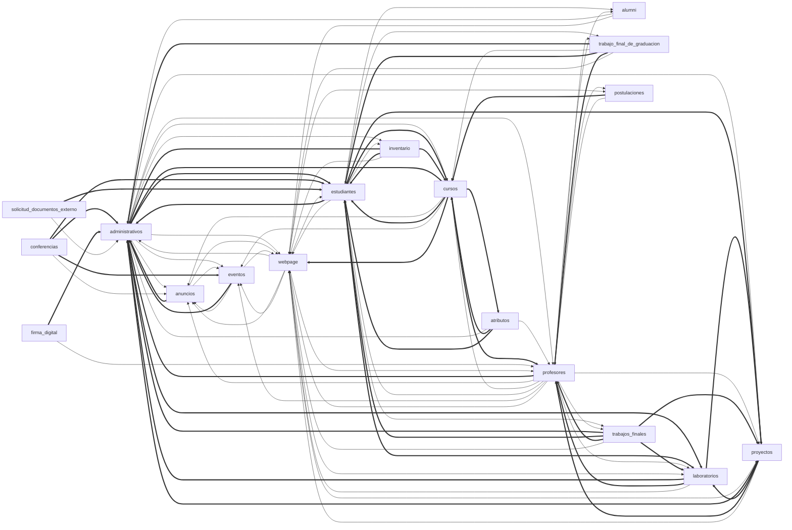

# Levantamiento técnico — Entrega 1 (anexo)

**Proyecto:** Auditoría de diseño de software — EIEInfo (IE0417, UCR)
**Repositorio auditado:** `https://git.ucr.ac.cr/eieinfo/EIEInfo.git`, rama `master`, commit `0b3c575c` (2026-11-04)
**Fecha del levantamiento:** 2026-11-08
**Alcance:** este anexo es materia prima con evidencia para el documento principal de la Entrega 1. No es el informe final.

## Convenciones

- Las rutas son relativas a la raíz del repo auditado (`~/repos/EIEInfo`). `archivo:N` indica la línea N.
- **Secretos:** nunca se transcriben. Se indica archivo, línea y forma (longitud o patrón) como `«ENMASCARADO»`.
- **Datos personales:** no se copian. Solo se describen columnas, conteos y patrones.
- Las cifras salen de comandos o scripts reproducibles, guardados en [`scripts/`](scripts/):
  - `metrics.py`: métricas por app y dependencias. Hace análisis AST y `git log`; no ejecuta código de EIEInfo.
  - `unprotected.py`: busca vistas sin decorador de autenticación.
  - Salida cruda: `scripts/metricas-eieinfo-0b3c575c.json`.
- **"No determinable"** marca lo que el repositorio no permite afirmar.

### Comandos de referencia

```bash
git rev-list --count HEAD                       # 2570 commits en master (2909 con --all)
git log --format=%ad --date=format:%Y | sort | uniq -c
git shortlog -sn HEAD | wc -l                   # 35 autores en master (58 con --all)
du -sh . .git                                   # 161 MB total, 92 MB .git
python3 -I docs/anexos/scripts/metrics.py ~/repos/EIEInfo salida.json
python3 -I docs/anexos/scripts/unprotected.py ~/repos/EIEInfo/src/server
```

---

## 1. Ficha técnica

### 1.1 Lenguaje y runtime

| Elemento | Valor observado | Evidencia |
|---|---|---|
| Python declarado | 3.10 | `.python-version:1` |
| Python efectivo en Docker | **3.11** (inferido). La imagen base `python:buster` no fija versión menor, pero el parche apunta a `.../python3.11/site-packages/...`. | `docker/django/Dockerfile:1`, `docker/django/Dockerfile:45`, `.drone.yml:225` |
| Python según README | "Python(>3.4.3)" | `README.md:40` |
| SO base imagen Django | Debian 10 "buster", ya retirado. Se fuerza el uso de `archive.debian.org`. | `docker/django/Dockerfile:1`, `docker/django/Dockerfile:7` |
| Django | 4.1.3 | `requirements.txt:2`, `docker/django/requirements.txt:2` |
| Django según README | "ver 1.9.1"; el encabezado de `settings.py` dice "Generated by ... Django 1.9.1". | `README.md:39`, `src/server/eieinfo/settings.py:4` |

> La rama 4.1 de Django dejó de recibir soporte de seguridad en diciembre de 2023. Es un dato público del calendario de versiones de Django, no del repo.

### 1.2 Dependencias relevantes, agrupadas por función

Fuente principal: `docker/django/requirements.txt`, que es el que instala la imagen (`docker/django/Dockerfile:20-22`).

| Función | Paquetes (versión) |
|---|---|
| Web / framework | Django 4.1.3, django-extensions 3.2.1, django-polymorphic 3.1.0, django-widget-tweaks 1.4.12, django-select2 6.3.1, django-ckeditor 6.5.1, martor 1.6.14 (Markdown), django-datetime-widget2 0.9.5, django-crontab 0.7.1, django-letsencrypt 4.1.0, django-countries >=7.0, django-wiki (desde git) y sus dependencias (django-nyt, django-mptt, django-sekizai, django-classy-tags, django-js-asset), django-tagging 0.5.0, sorl-thumbnail 12.9.0 |
| Base de datos | mysqlclient 2.1.1 |
| Google / APIs externas | google-api-python-client 1.5.3, oauth2client 3.0.0 (biblioteca obsoleta), facebook-sdk 2.0.0, django-instagram 0.3.2, django-recaptcha 3.0.0, scholarly 1.4.1 (Google Scholar), bibtexparser 1.4.3 |
| PDF / documentos | PyPDF2 1.26.0, pypandoc 1.3.3 (más `pandoc` y `texlive-*` del SO, `Dockerfile:11`), XlsxWriter 3.0.9, openpyxl 3.1.2, pyexcel-xls 0.4.0, vobject 0.9.6.1 |
| Firma digital | **Ningún paquete Python de firma.** La firma la hace la aplicación de escritorio *Firmador Libre* del usuario; el navegador le habla por `localhost:3516` (`firma_digital/models.py:25-29`, `firma_digital/templates/firma_digital/base.html:81-83`). El servidor solo guarda y verifica los PDF. |
| Pruebas | pytest 7.2.2, pytest-django 4.5.2, coverage (sin versión) |
| Linting | flake8 3.5.0, pycodestyle 2.3.0, pyflakes 1.6.0 (todas de 2017–2018) |
| Servidor de aplicación | gunicorn 20.1.0 |

#### Diferencias entre `requirements.txt` (raíz) y `docker/django/requirements.txt`

Comando: `diff <(grep -vE '^\s*(#|$)' requirements.txt | sort) <(grep -vE '^\s*(#|$)' docker/django/requirements.txt | sort)`

| Aspecto | Raíz (`requirements.txt`) | Docker (`docker/django/requirements.txt`) |
|---|---|---|
| django-wiki | `git+https://github.com/rodrigo-garcia-leon/django-wiki@main` (fork personal, rama móvil), línea 46 | `git+https://github.com/django-wiki/django-wiki.git@releases/0.10.1` (upstream), línea 52 |
| django-tagging | `django-tagging==0.5.0` (L4) **y además** `git+…/rodrigo-garcia-leon/django-tagging@feature/add_support_for_django4` (L47): duplicado y en conflicto | Solo `==0.5.0`, compensado con un `sed` sobre `site-packages` (`Dockerfile:45`) |
| pytest / pytest-django | Sin versión (L70-71) | Fijados (7.2.2 / 4.5.2) |
| requests | `2.31.0` (L33) | Ausente |
| Dependencias de wiki (appconf, classy-tags, js-asset, mptt, nyt, sekizai) y django-countries | Ausentes | Presentes |

Otros problemas detectados:

- **Duplicados:** `django-widget-tweaks==1.4.12` aparece dos veces en `docker/django/requirements.txt:6` y `:14`. También `django-tagging` está duplicado en la raíz, L4 y L47.
- **Versiones sin fijar:** `coverage` (`docker/django/requirements.txt:78`, `requirements.txt:72`), `django-countries>=7.0` (`docker/django/requirements.txt:81`), `pytest` y `pytest-django` en la raíz.
- **Paquetes desde git:** 2 en la raíz, apuntando a forks personales con ramas móviles (`@main`, `@feature/...`), y 1 en Docker. La compilación no es reproducible y depende de repositorios de terceros.
- **Parches en caliente sobre dependencias:**
  - `docker/django/Dockerfile:45` y `.drone.yml:225` ejecutan `sed -i 's/smart_text/smart_str/g' .../tagging/models.py`.
  - `src/server/eieinfo/settings.py:19-20` hace monkeypatch de `django.utils.encoding.smart_text = smart_str`.
  - Ambos existen para mantener vivo `django-tagging` en Django 4.

### 1.3 Motor de base de datos y configuración

| Aspecto | Observado | Evidencia |
|---|---|---|
| Motor | MySQL/MariaDB (`django.db.backends.mysql`) | `docker/django/secret_credentials.py:13` |
| Contenedor | `mariadb` **sin etiqueta de versión** | `docker-compose.yml:10`, `docker/db/Dockerfile:1` |
| Credenciales en compose | `MYSQL_ROOT_PASSWORD`, `MYSQL_PASSWORD` y `MARIADB_ROOT_PASSWORD` en claro, con valores triviales de desarrollo («ENMASCARADO», 4 caracteres) | `docker-compose.yml:15`, `:18`, `:19`; duplicadas en `docker/db/Dockerfile:3-7` |
| Inicialización | `docker/db/init.sql` (513 KB; 188 `CREATE TABLE`, 53 tablas con `INSERT`) se copia a `/docker-entrypoint-initdb.d/` | `docker/db/Dockerfile:2` |
| Configuración Django | `DATABASES` vive en `secret_credentials.py`, que se importa al final de `settings.py`. En Docker, ese archivo **está versionado** en `docker/django/secret_credentials.py` y se copia a la imagen. | `src/server/eieinfo/settings.py:528`, `docker/django/Dockerfile:31-32` |
| `.env` | `docker/django/.env` (versionado) define DB_*, MYSQL_*, `DEBUG`, `DJANGO_ALLOWED_HOSTS` y `DJANGO_SUPERUSER_*`. **`settings.py` no lee estas variables**; solo las usa `docker-compose.yml:72` (`env_file`) y el pipeline (`. ./.env`). | `docker/django/.env:1-19`; `grep -cE "os\.environ|getenv"` en ambos `settings.py` → 0 |
| Producción | Las credenciales reales de producción **no están** en el repo. Se espera `src/server/eieinfo/secret/secret_credentials.py`, que está ignorado (`.gitignore:3`). | `README.md:50-74` |
| Zona horaria | `USE_TZ = False`, `TIME_ZONE = 'America/Guatemala'` | `src/server/eieinfo/settings.py:155`, `:161` |

### 1.4 Despliegue

Hay **dos modelos de despliegue** en el repo: producción en el servidor "Faraday" (systemd + nginx, sin contenedores) y un entorno Docker para desarrollo y CI.

#### a) Producción (Faraday), según `conf/` y `README.md`

- `conf/etc/systemd/system/eieinfo.service:10-17`: gunicorn con 3 workers, `--timeout 300`, enlazado a **socket UNIX** `/run/eieinfo.sock`, `--log-level error`, sin `--reload`.
- `conf/etc/systemd/system/eieinfo.socket`: activación por socket.
- `conf/etc/nginx/sites-available/eieinfo`:
  - TLS con Let's Encrypt (L17-18), TLS 1.2/1.3 (L20) y HSTS (L25).
  - `proxy_pass http://unix:/run/eieinfo.sock` (L53).
  - Bloquea `/media/tfg/` (L76).
  - Sirve `/static/` y `/media/` directamente (L71-81).
- **Inconsistencia:** el `README.md:182` dice que gunicorn "escucha en 127.0.0.1:8080". En el `.service` esa línea está comentada (L12) y se usa el socket UNIX. El README además cita `systemd/system/eieinfo.service` (L187), pero la ruta real es `conf/etc/systemd/system/`.

#### b) Docker (`docker-compose.yml` raíz)

| Servicio | Imagen / build | Puertos | Notas |
|---|---|---|---|
| `db` | `docker/db/Dockerfile` (`FROM mariadb`, sin versión) | 3307→3306 | healthcheck (L20-24), volumen `db_volume` |
| `nginx` | `docker/nginx/Dockerfile` (`FROM nginx:trixie-perl`) | 8080→80 | `docker/nginx/default.conf`: upstream `eieinfo_app:8001`, `client_max_body_size 20M`, bloquea `/media/tfg/` |
| `eieinfo_app` | `docker/django/Dockerfile` | 8001, 8000 | `command` (L61-67): activa venv → **`migraciones.sh`** → `gunicorn --workers 3 --bind 0.0.0.0:8001 --timeout 300`. **Sin `--reload`.** `restart: always`. El código se **copia** en la imagen (`Dockerfile:27-29`); el bind-mount del código está comentado (L80-81). |

Scripts de arranque:

- `docker/django/migraciones.sh:5-10`:
  1. **Borra todas las migraciones** (`find ... migrations/*.py -not -name __init__.py -delete`).
  2. Ejecuta `makemigrations`, `showmigrations`, `migrate --noinput` y `collectstatic`.
  3. Corre en **cada arranque** del contenedor (`docker-compose.yml:65`).
- `docker/django/start.sh:8`: alternativa con `runserver 0.0.0.0:8000`, que es el servidor de desarrollo. No la invoca el compose.
- `docker/django/run-ut.sh`: genera fixtures con `dumpdata` de la BD local y corre solo `test administrativos` y `test webpage` (L36, L39). Los demás tests están comentados, con la nota `#Fallan` (L35).
- `docker/django/Dockerfile:33-34` **reemplaza** `src/server/eieinfo/settings.py` por `docker/django/settings.py` dentro de la imagen.

**Gunicorn y "detección de cambios".** La afirmación de la wiki del curso (que gunicorn detecta cambios) no se pudo contrastar directamente, porque la wiki no está en el repo. Lo que sí muestra el repositorio:

- Ningún comando de gunicorn usa `--reload`: `docker-compose.yml:67`, `eieinfo.service:10-17`.
- El código está horneado en la imagen (`Dockerfile:27`) y el volumen de código está comentado (`docker-compose.yml:80-81`), así que aunque existiera `--reload` no vería los cambios del host.
- El propio `docker/README.md:37` contradice la wiki: *"Si se realiza algún cambio en los archivos es necesario realizar un docker compose down y un docker compose up --build para verlo reflejado"*.

### 1.5 CI/CD

#### `.drone.yml` (servidor `drone.eie.ucr.ac.cr`, según `docker/README.md:58`)

- **Disparador:** pushes a `master` (`.drone.yml:9-12`; la rama `docker-faraday` está comentada).
- Monta `/var/run/docker.sock` del host (L28-30, L399-402), así que el pipeline tiene control total del Docker del agente.

| # | Paso | Qué hace | Evidencia |
|---|---|---|---|
| 1 | `greeting` | echo | L19-22 |
| 2 | `build-eieinfo` | `docker compose build` | L25-33 |
| 3 | `run-eieinfo` | `docker compose up` (detached) | L37-46 |
| 4 | `wait-eieinfo` | `sleep 200` (espera fija) | L49-53 |
| 5 | `test-containers-up` | `ping` a db, nginx y app | L56-63 |
| 6 | `test-containers-services` | `nc -zv` a 80, 3306 y 8001 | L66-73 |
| 7 | `setup-eieinfo` | Intercambia `settings.py` por la versión docker, copia `secret_credentials.py`, carga SQL con contraseña en línea de comando (L95-96, «ENMASCARADO»), **borra migraciones**, `makemigrations` y `collectstatic`. **`migrate` está comentado** (L102). | L76-105 |
| 8 | `test-eieinfo-urls` | ~70 `curl` de humo contra nginx, con usuarios de prueba (`--user …:…`). Varias URL están comentadas porque fallan (L123, L128, L130, L147, L157). | L108-203 |
| 9 | `unit-testing-eieinfo` | Genera fixtures con `dumpdata` de la BD del propio pipeline y ejecuta `coverage run ... manage.py test` sobre 11 apps; `coverage report -m`. **No hay umbral mínimo de cobertura.** | L206-276 |
| 10 | `stop-eieinfo` | `compose down`, borra imágenes y volúmenes (`failure: ignore`) | L280-302 |
| 11 | `notify` | Telegram (`appleboy/drone-telegram`). El **token está escrito en claro** en L313 («ENMASCARADO», 71 caracteres incluido un comentario, con forma `NNNNNNNNNN:<35 car.>` de token de bot). No usa `from_secret`. | L305-331 |
| 12 | `mail-notify` | Correo en caso de fallo; usa `from_secret` (correcto) | L334-343 |
| 13 | `deployment` | `appleboy/drone-ssh` a `faraday.eie.ucr.ac.cr`. **El script solo hace `cd info` y `git status`**: todo el despliegue real (backup, `git pull`, migraciones, reinicio) está comentado (L376-393). Además `failure: ignore` (L397). | L346-397 |

**Conclusión del CI:** sí corre pruebas unitarias con cobertura y pruebas de humo HTTP, pero **no despliega**. El paso de despliegue es un *no-op* y el despliegue en Faraday es manual; no hay evidencia del procedimiento.

#### `docker/drone-local/drone.yml`

Es una variante para correr con `drone exec` en local (`docker/README.md:55`). Diferencias con la versión del servidor:

- No tiene `trigger`, build ni despliegue; asume los contenedores ya levantados.
- `setup-eieinfo` ejecuta `migraciones.sh` completo, que borra migraciones y sí aplica `migrate` (L46).
- Mantiene activas URL que en `.drone.yml` están comentadas por fallar (`paginas/econtinua`, `paginas/consultorias`, `paginas/aeie`; L74, L91, L102). Es decir, el pipeline local **fallaría** donde el del servidor no.
- El paso de pruebas termina en `coverage html` en vez de `report` (L203).

### 1.6 Integraciones externas visibles

| Integración | Dónde | Observación |
|---|---|---|
| Google Calendar (cuenta de servicio) | `src/server/eieinfo/GoogleAPI.py:1-33` | `oauth2client.ServiceAccountCredentials` lee un JSON en `eieinfo/secret/` (no versionado) |
| Google Custom Search | `src/server/eieinfo/GoogleAPI.py:37-55`; usado en `webpage/views.py:21` | `urlopen` directo con la API key en la URL |
| Facebook Graph API (publicar anuncios) | `src/server/eieinfo/FacebookAPI.py:5-40`; `anuncios/models.py:10,233`; acciones de admin en `anuncios/admin.py:31` y `eventos/admin.py:15` | Token de página en `secret_credentials` |
| Instagram (scraper) | `administrativos/templatetags/misc_tags.py:113-116` | `django_instagram.scraper` |
| Google Scholar | `proyectos/models.py:190-196` (scholarly 1.x) | Importa publicaciones de profesores |
| Imgur (subida de imágenes del editor martor) | `src/server/eieinfo/settings.py:418-429` | Client ID y API key **escritos en `settings.py` versionado** (L428-429, «ENMASCARADO», 15 y 40 caracteres) |
| reCAPTCHA | `webpage/forms.py:9,90`; `settings.py:494` silencia el check de llaves de prueba | |
| Correo SMTP | `settings.py:342-356` (`smtp.eie.ucr.ac.cr`, SSL 465); envío centralizado en `eieinfo/misc.py:7-48` y `eieinfo/email_service.py` | `EMAIL_HOST_PASSWORD` **escrito en `settings.py:345`** («ENMASCARADO», 10 caracteres, no parece placeholder). `secret_credentials` lo reescribe después (L528). |
| Firma digital (Firmador Libre) | `firma_digital/models.py:25-29`, `firma_digital/templates/firma_digital/base.html:81-83`, `settings.py:555-565` | El navegador habla con el firmador local en `localhost:3516`. `CORS_ALLOWED_ORIGINS` está definido (L562), pero `corsheaders` **no** está instalado ni en `INSTALLED_APPS`, así que ese setting no tiene efecto. |
| ownCloud | `src/server/scripts/owncloud.py:8`, `owncloud_administrativos.py:8`, `src/server/owncloud_config.sh` | Scripts que generan comandos `occ` para crear cuentas; producen y leen CSV con contraseñas (ver §7) |
| LaTeX / pandoc | `eieinfo/misc.py` (`GenerarLaTeX`), `estudiantes/models.py:1008`, `scripts/libro_azul.py` | Generación de cartas en PDF |
| Let's Encrypt | `django-letsencrypt` (`settings.py:90`, `eieinfo/urls.py:60`) y certbot en nginx | |
| Telegram | `.drone.yml:305-331` | Solo CI |
| LDAP | **No hay evidencia** (búsqueda de `ldap`: 0 archivos) | |
| LLM / chatbot | **No hay evidencia en `master`.** Existe la rama remota `origin/feature/chatbot`, no integrada. | `git branch -r` |

### 1.7 `src/clients` y `src/webclients`

- **`src/clients/`** son clientes de "pantallas" informativas, no forman parte del backend:
  - `screens/FullScreen.sh` y su README (2017): Raspberry Pi con Chromium en modo kiosco apuntando a `http://eie.ucr.ac.cr/anuncios/pantallas` (`FullScreen.sh:30`). El README incluye una IP interna de la red (`src/clients/screens/README.md`, tabla final).
  - `docker/`: alternativa en contenedor Ubuntu 22.04 con `firefox-esr -kiosk` hacia la misma URL (`src/clients/docker/Dockerfile:10`). Último commit: 2026-01-14.
  - **Relación con `src/server`:** solo consume la vista pública `anuncios/pantallas` por HTTP.
- **`src/webclients/`** son **8 enlaces simbólicos** (modo git `120000`) hacia `../server/<app>/templates/...` y `../server/eieinfo/static/`. Se crearon en 2016 "para facilitar la depuración" (commit `640c9360`). El último commit es de 2017-01-17 con el mensaje "dev: NOT WORKING, MISSING FILES". Es **código muerto** sin uso en build, CI ni runtime; `grep webclients` no tiene referencias.

### 1.8 Tamaño general

- 59 520 líneas de Python sin migraciones ni `static/` (`find src/server -name '*.py' -not -path '*/migrations/*' -not -path '*/static/*' | xargs cat | wc -l`).
- 18 968 de esas líneas son de pruebas.
- 406 templates HTML.
- `src/server/eieinfo/static` pesa 59 MB, con 3074 archivos versionados, en su mayoría librerías JS/CSS de terceros. Incluye 138 archivos `.svn/` heredados (`git ls-files | grep -c '/\.svn/'`).

### 1.9 Tipo de arquitectura predominante

Es un **monolito Django en capas MVT**, con unas 19 apps instaladas que comparten una única base de datos MariaDB. Despliega como **un proceso gunicorn detrás de nginx**. No hay API REST formal (no hay DRF); el frontend son templates del servidor con jQuery y librerías vendorizadas.

La "modularidad" por apps es **nominal**: el grafo de dependencias (§4) muestra 28 pares de apps con dependencia mutua.

---

## 2. Configuración y settings

### 2.1 Archivos `settings*.py`

`find . -name 'settings*.py'` devuelve:

1. `src/server/eieinfo/settings.py`: 576 líneas, la de producción o "por defecto".
2. `docker/django/settings.py`: 537 líneas. La imagen Docker sustituye al anterior (`Dockerfile:33-34`) y el CI hace lo mismo (`.drone.yml:87-88`).

No hay `settings/base.py` ni separación por entornos. Los dos archivos son **copias divergentes**.

### 2.2 Diferencias clave (`diff src/server/eieinfo/settings.py docker/django/settings.py`)

| Tema | `src/server/eieinfo/settings.py` | `docker/django/settings.py` |
|---|---|---|
| `DEBUG` inicial | `False` (L36), pero se reescribe según el hostname (ver abajo) | `True` (L36) |
| Cambio a producción | `if socket.gethostname() == 'faraday':` (L483). **Cualquier otro host** obtiene `DEBUG = True` y `ALLOWED_HOSTS = ['*']` (L491-493). | El bloque `else` solo cambia la URL raíz; `DEBUG` sigue en `True` |
| `ALLOWED_HOSTS` | 4 dominios UCR (L478) | Los mismos más `'localhost'` y `'http://localhost:8080'` (L499). Este último no es un host válido porque incluye el esquema. |
| `CSRF_TRUSTED_ORIGINS` | 2 orígenes https | Más 2 orígenes http locales |
| `INSTALLED_APPS` | Sin `django_countries` | Con `django_countries` (L93). En la raíz falta, aunque `requirements.txt` raíz tampoco lo trae. |
| Firma digital | `MAX_PDF_SIZE`, `FIRMADOR_LIBRE_PORT`, `DEFAULT_FIRMA_DEADLINE_DAYS`, `CORS_ALLOWED_ORIGINS`, `FIRMA_DIGITAL_UPLOAD_PATH` + `os.makedirs` al importar settings (L536-576) | **Ausentes.** No se hallaron lecturas de `settings.MAX_PDF_SIZE` etc. en el código, así que hoy son settings sin uso. |
| `DATA_UPLOAD_MAX_NUMBER_FIELDS` | 10240 (L549) | Ausente (queda el default de 1000) |
| Sesiones | Default; en Faraday `SESSION_COOKIE_SECURE = True` y `CSRF_COOKIE_SECURE = True` (L485-486) | `SESSION_COOKIE_SECURE = False`, `SESSION_COOKIE_AGE` de 7 días, `USE_X_FORWARDED_HOST` y `SECURE_PROXY_SSL_HEADER` (L525-537) |
| Imgur | Valores reales (L428-429, «ENMASCARADO») | Placeholder `'imgur-client-id'` |
| `ADMINS` | Vacío: todas las entradas están comentadas (L369-373), así que **`mail_admins` no envía nada** | Una entrada activa |
| Logging dev | Simplificado a consola fuera de Faraday (L502-524) | No |

Revisión de puntos solicitados:

- **`SECRET_KEY`:** no aparece en ninguno de los dos `settings.py`; viene de `secret_credentials`.
  - En Docker está versionada en `docker/django/secret_credentials.py:5` («ENMASCARADO», 16 caracteres, con forma de placeholder de desarrollo).
  - En producción **no determinable** (archivo ignorado).
- **Credenciales en settings versionado:** `EMAIL_HOST_PASSWORD` (`settings.py:345`), `MARTOR_IMGUR_CLIENT_ID` y `MARTOR_IMGUR_API_KEY` (`settings.py:428-429`). No se puede determinar si siguen vigentes; deben tratarse como expuestas.
- **`MIDDLEWARE`** (`settings.py:96-104`): el estándar de Django (Security, Session, Common, Csrf, Auth, Messages, XFrame). No hay middleware propio ni CORS.
- **Backends de autenticación:** no se define `AUTHENTICATION_BACKENDS` ni `AUTH_USER_MODEL`. El `ModelBackend` de Django solo se usa para `/admin`, wiki y `conferencias` (`conferencias/views.py:55`). Los portales usan un esquema propio (§5.2).
- **`TEMPLATES`** se define **dos veces** (`settings.py:108` y `:166`); la segunda pisa a la primera.
- **`INSTALLED_APPS`** (`settings.py:44-94`) contiene 19 apps propias. **No están instaladas** `asistencias`, `proyecto_electrico` ni `practica_profesional`, aunque existen como paquetes en `src/server/` (§3).

### 2.3 `.env` y secretos versionados

| Archivo | Contenido (solo claves) | Evaluación |
|---|---|---|
| `docker/django/.env` | `DB_PORT`, `DB_HOST`, `MYSQL_ROOT_PASSWORD`, `MYSQL_DATABASE`, `MYSQL_USER`, `MYSQL_PASSWORD`, `DEBUG`, `DJANGO_ALLOWED_HOSTS`, `DJANGO_SUPERUSER_PASSWORD`, `DJANGO_SUPERUSER_USERNAME`, `DJANGO_SUPERUSER_EMAIL`, `LOG_PATH`, `SHELL`, `PYTHONIOENCODING` | Valores de desarrollo («ENMASCARADO»). El email del superusuario parece una cuenta institucional real. |
| `docker/django/secret_credentials.py` | `SECRET_KEY`, `DATABASES`, `EMAIL_*`, `FROM_EMAIL`, `TO_EMAIL*`, `CALENDAR_ID`, `SEARCH_ENGINE_*`, `FACEBOOK_*`, `RECAPTCHA_*` | La mayoría son placeholders de 16 caracteres. `EMAIL_HOST`, `EMAIL_HOST_USER` y `EMAIL_HOST_PASSWORD` (L31-33) **no tienen forma de placeholder**, y los `*_EMAIL` (L40-43) son direcciones institucionales. |

### 2.4 `.gitignore`

Qué ignora (`.gitignore:1-51`): `eieinfo/files`, `startserver.sh`, **`eieinfo/secret`**, `test.py`, **`src/server/scripts`**, bytecode, basura de editores, `*.log`, `coverage`, `eieinfo/media`, venvs, **`fixtures`** y **todas las migraciones** salvo `__init__.py` (L45-48), además de `node_modules`.

Problemas:

- **Ignorado pero versionado:** `git ls-files -ci --exclude-standard` lista 8 archivos de `src/server/scripts/`, entre ellos `TODO_ACTUALIZADO.csv`, que contiene datos personales (§7). Se versionaron antes de agregar la regla y nunca se sacaron del índice.
- **Debería ignorar y no ignora:** `docker/django/.env`, `docker/django/secret_credentials.py`, `*.sql` con datos (`docker/db/init.sql`, `docker/django/testing.sql`), `*.csv` de cuentas (`src/server/OwncloudProfesores.csv`) y los directorios `.svn/` de `static/`.
- **Ignora lo que no debería:** las migraciones de Django (§1.4 y hallazgo H-03).

---

## 3. Mapa de módulos (apps de Django)

### 3.1 Tabla por app (ordenada por tamaño total)

Método (`scripts/metrics.py`):

- **Modelos:** clases en `models.py` o `models/` cuya herencia llega a `models.Model` o `PolymorphicModel`.
- **LOC:** `wc -l` de `models*.py`, `views*.py` + `views/` y `forms*.py`.
- **Rutas:** número de llamadas `path(`/`re_path(`/`url(` en `urls.py` + `urlpatterns/`.
- **Templates:** archivos bajo `<app>/templates`.
- **Pruebas:** funciones `def test*` en `tests*.py`.
- **Commits 12 m:** `git log --since=2025-11-08 -- src/server/<app>`.
- **Tamaño:** LOC Python de la app (sin migraciones ni `static/`) + LOC de templates.

| # | App | INSTALLED_APPS | Modelos | LOC models | LOC views | LOC forms | Rutas | Templates | Pruebas `test*` | Migraciones versionadas | Último commit | Commits 12 m | Commits totales | Tamaño |
|---|---|---|---|---|---|---|---|---|---|---|---|---|---|---|
| 1 | `profesores` | Sí | 2 | 293 | 5190 | 852 | 150 | 154 | 210 | 0 | 2026-10-29 | 60 | 909 | 24.864 |
| 2 | `administrativos` | Sí | 17 | 1217 | 2428 | 729 | 93 | 74 | 84 | 0 | 2026-08-19 | 38 | 463 | 14.338 |
| 3 | `firma_digital` | Sí | 8 | 503 | 2918 | 0 | 29 | 19 | 456 | 0 | 2026-10-04 | 47 | 64 | 12.249 |
| 4 | `estudiantes` | Sí | 17 | 1347 | 1483 | 670 | 43 | 84 | 36 | 0 | 2026-10-29 | 24 | 502 | 9.002 |
| 5 | `trabajo_final_de_graduacion` | Sí | 8 | 314 | 1352 | 682 | 27 | 27 | 74 | 0 | 2026-08-13 | 13 | 48 | 7.172 |
| 6 | `webpage` | Sí | 8 | 292 | 403 | 99 | 30 | 34 | 91 | 0 | 2026-09-09 | 24 | 247 | 4.507 |
| 7 | `cursos` | Sí | 6 | 887 | 124 | 813 | 5 | 7 | 40 | 0 | 2026-10-29 | 14 | 267 | 3.850 |
| 8 | `solicitud_documentos_externo` | Sí | 5 | 182 | 511 | 150 | 13 | 9 | 79 | 0 | 2026-07-29 | 8 | 8 | 3.848 |
| 9 | `trabajos_finales` | Sí | 6 | 1313 | 113 | 1056 | 3 | 4 | 5 | 0 | 2026-05-23 | 3 | 90 | 3.155 |
| 10 | `postulaciones` | Sí | 7 | 105 | 629 | 179 | 10 | 6 | 26 | 0 | 2026-05-15 | 5 | 13 | 2.850 |
| 11 | `eieinfo` (proyecto) | N/A | 0 | 0 | 0 | 0 | 24 | 9 | 6 | 0 | 2026-08-19 | 33 | 318 | 2.497 |
| 12 | `inventario` | Sí | 9 | 537 | 448 | 547 | 7 | 7 | 1 | 0 | 2026-09-09 | 2 | 107 | 2.409 |
| 13 | `atributos` | Sí | 11 | 156 | 759 | 185 | 15 | 8 | 3 | 0 | 2025-09-30 | 0 | 12 | 2.089 |
| 14 | `alumni` | Sí | 3 | 304 | 286 | 231 | 13 | 14 | 1 | 0 | 2026-06-18 | 8 | 48 | 1.837 |
| 15 | `anuncios` | Sí | 2 | 289 | 91 | 214 | 3 | 4 | 15 | 0 | 2026-09-09 | 7 | 120 | 1.215 |
| 16 | `proyectos` | Sí | 3 | 233 | 155 | 95 | 3 | 3 | 25 | 0 | 2026-09-09 | 6 | 50 | 987 |
| 17 | `asistencias` | **No** | 0 | 0 | 0 | 0 | 0 | 0 | 7 | 0 | 2023-06-14 | 0 | 7 | 830 |
| 18 | `conferencias` | Sí | 2 | 184 | 191 | 12 | 5 | 6 | 5 | 0 | 2026-09-09 | 3 | 88 | 779 |
| 19 | `eventos` | Sí | 1 | 277 | 81 | 178 | 2 | 2 | 0 | 0 | 2026-09-09 | 2 | 84 | 723 |
| 20 | `laboratorios` | Sí | 2 | 151 | 92 | 23 | 2 | 2 | 0 | 0 | 2026-05-15 | 2 | 47 | 499 |
| 21 | `proyecto_electrico` | **No** | 0 | 0 | 0 | 0 | 0 | 0 | 2 | 0 | 2023-06-18 | 0 | 4 | 318 |
| 22 | `scripts` (no es app) | N/A | 0 | 0 | 0 | 0 | 0 | 0 | 0 | 0 | 2019-04-29 | 0 | 21 | 287 |
| 23 | `practica_profesional` | **No** | 0 | 0 | 0 | 0 | 0 | 0 | 0 | 0 | 2023-06-18 | 0 | 2 | 0 |

Notas de lectura:

- **`profesores` concentra la mayor parte de la responsabilidad del sistema.**
  - Tiene 5190 LOC de vistas repartidas en 13 módulos (`profesores/views/`) y 150 rutas (`profesores/urlpatterns/`, 13 archivos).
  - Solo define 2 modelos propios. `Profesor` hereda de `Funcionario`, que está en `administrativos` (`profesores/models.py:48`).
  - Sus vistas cubren dominios de otras apps: asistencias, inventario, laboratorios, práctica profesional, proyecto eléctrico, TFG y consejo asesor.
- **`administrativos` es el núcleo de datos.** Define `Funcionario` (polimórfico), `Ciclo`, `Lugar`, `Horario`, `Roles`, `Comision`, `Jefatura`, etc. (`administrativos/models.py:173-1194`).
- **`trabajos_finales` concentra lógica en `forms.py`** (1056 LOC) y apenas 113 de vistas: la lógica de negocio está en la capa de formularios.
- **Migraciones versionadas: 0 en todas las apps** (`git ls-files | grep '/migrations/' | grep -v __init__` → vacío).

### 3.2 Los 20 archivos `.py` más grandes (sin migraciones)

| LOC | Archivo |
|---|---|
| 6151 | `src/server/firma_digital/tests.py` |
| 3679 | `src/server/profesores/tests.py` |
| 2918 | `src/server/firma_digital/views.py` |
| 2117 | `src/server/profesores/views/consejo_asesor.py` |
| 1853 | `src/server/administrativos/tests.py` |
| 1829 | `src/server/solicitud_documentos_externo/tests.py` |
| 1352 | `src/server/trabajo_final_de_graduacion/views.py` |
| 1347 | `src/server/estudiantes/models.py` |
| 1313 | `src/server/trabajos_finales/models.py` |
| 1289 | `src/server/trabajo_final_de_graduacion/tests.py` |
| 1217 | `src/server/administrativos/models.py` |
| 1056 | `src/server/trabajos_finales/forms.py` |
| 978 | `src/server/profesores/views/trabajos_finales.py` |
| 887 | `src/server/cursos/models.py` |
| 852 | `src/server/profesores/forms.py` |
| 830 | `src/server/asistencias/tests.py` (app no instalada) |
| 813 | `src/server/cursos/forms.py` |
| 759 | `src/server/atributos/views.py` |
| 729 | `src/server/administrativos/forms.py` |
| 682 | `src/server/trabajo_final_de_graduacion/forms.py` |

Los archivos de producción más grandes son `firma_digital/views.py` (2918) y `profesores/views/consejo_asesor.py` (2117). Son candidatos a análisis de complejidad en la Entrega 2.

### 3.3 Apps sin cambios en más de 2 años (último commit antes de 2024-11-08)

| App | Último commit | Estado |
|---|---|---|
| `scripts/` | 2019-04-29 | Ignorado por `.gitignore:5` pero versionado; contiene CSV con datos personales |
| `asistencias` | 2023-06-14 | Solo `README.md`, `tests.py` (830 LOC, 7 pruebas) e `__init__.py`; no instalada. La funcionalidad real vive en `profesores/views/asistencias.py` y `estudiantes/views/asistencias.py`. |
| `proyecto_electrico` | 2023-06-18 | Solo README, `tests.py` e `__init__.py`; no instalada. La lógica está en `trabajos_finales` y `profesores/views/trabajos_finales.py`. |
| `practica_profesional` | 2023-06-18 | Solo README e `__init__.py`; no instalada. La lógica está en `estudiantes/views/practica_profesional.py` y `profesores/views/practica_profesional.py`. |
| `src/webclients/` | 2017-01-17 | Enlaces simbólicos sin uso (§1.7) |

`atributos` está **casi inactiva** (último commit 2025-09-30, 0 commits en 12 meses), pero no supera los 2 años.

---

## 4. Dependencias entre apps

Método:

- **AST** sobre todo `.py` de producción de cada app (sin `tests*.py`, `migrations/` ni `static/`).
- **Import:** `from <app>...` o `import <app>` hacia otra app de `src/server`.
- **FK:** argumentos de `ForeignKey`, `OneToOneField` o `ManyToManyField` que resuelven a un modelo de otra app, sea por cadena `'app.Modelo'` o por nombre de clase importada.
- `eieinfo` (núcleo del proyecto: `misc.py`, `GoogleAPI.py`, `FacebookAPI.py`, `email_service.py`) se excluye del fan-out porque es una utilidad común.
- Lo importan 13 apps: administrativos, alumni, anuncios, conferencias, cursos, estudiantes, eventos, firma_digital, profesores, solicitud_documentos_externo, trabajo_final_de_graduacion, trabajos_finales y webpage.

### 4.1 Lista de adyacencia y grado de acoplamiento

| App | Fan-out (sin `eieinfo`) | Fan-in | Depende de ("(FK)" = además hay relación de modelo) |
|---|---|---|---|
| `administrativos` | 9 | **16** | anuncios, cursos, estudiantes (FK), eventos, inventario, laboratorios (FK), profesores, proyectos, webpage |
| `profesores` | **12** | 10 | administrativos (FK), alumni, anuncios, cursos, estudiantes, eventos, laboratorios, postulaciones, proyectos, trabajo_final_de_graduacion, trabajos_finales, webpage |
| `webpage` | 8 | 12 | administrativos, anuncios, estudiantes, eventos, laboratorios, postulaciones, profesores, proyectos |
| `estudiantes` | 9 | 10 | administrativos (FK), alumni, cursos (FK), inventario, laboratorios (FK), proyectos (FK), trabajo_final_de_graduacion, trabajos_finales, webpage |
| `cursos` | 7 | 7 | administrativos (FK), anuncios, atributos (FK), estudiantes (FK), eventos, profesores (FK), webpage (FK) |
| `laboratorios` | 4 | 6 | administrativos (FK), profesores (FK), proyectos (FK), webpage |
| `proyectos` | 4 | 6 | administrativos (FK), laboratorios (FK), profesores (FK), webpage |
| `anuncios` | 3 | 6 | administrativos (FK), eventos, webpage |
| `eventos` | 3 | 6 | administrativos (FK), anuncios, webpage |
| `trabajos_finales` | 6 | 2 | administrativos (FK), estudiantes (FK), laboratorios (FK), profesores (FK), proyectos (FK), webpage |
| `trabajo_final_de_graduacion` | 5 | 2 | administrativos (FK), cursos, estudiantes (FK), profesores (FK), webpage |
| `inventario` | 4 | 2 | administrativos (FK), cursos (FK), estudiantes (FK), webpage |
| `atributos` | 4 | 1 | administrativos, cursos (FK), estudiantes (FK), profesores |
| `alumni` | 2 | 2 | administrativos, webpage |
| `conferencias` | 4 | 0 | administrativos (FK), anuncios, estudiantes (FK), eventos (FK) |
| `postulaciones` | 2 | 2 | cursos (FK), profesores |
| `firma_digital` | 2 | 0 | administrativos (FK), profesores |
| `solicitud_documentos_externo` | 2 | 0 | administrativos, estudiantes (FK) |
| `asistencias`, `proyecto_electrico`, `practica_profesional` | 0 | 0 | — (sus únicos imports están en `tests.py`) |

**90 aristas** entre 19 apps activas.

**28 pares con dependencia bidireccional** (ciclos de longitud 2):

> administrativos↔anuncios, administrativos↔cursos, administrativos↔estudiantes, administrativos↔eventos, administrativos↔inventario, administrativos↔laboratorios, administrativos↔profesores, administrativos↔proyectos, administrativos↔webpage, anuncios↔eventos, anuncios↔webpage, atributos↔cursos, cursos↔estudiantes, cursos↔profesores, estudiantes↔inventario, estudiantes↔trabajo_final_de_graduacion, estudiantes↔trabajos_finales, estudiantes↔webpage, eventos↔webpage, laboratorios↔profesores, laboratorios↔proyectos, laboratorios↔webpage, postulaciones↔profesores, profesores↔proyectos, profesores↔trabajo_final_de_graduacion, profesores↔trabajos_finales, profesores↔webpage, proyectos↔webpage

### 4.2 Diagrama (Mermaid)

`-->` indica solo import; `==>` indica import y FK. El mismo diagrama está en [`../diagramas/dependencias-apps.mmd`](../diagramas/dependencias-apps.mmd).



### 4.3 Lectura

- **Más dependida:** `administrativos`, con fan-in de 16. Es el "kernel" de datos (`Funcionario`, `Ciclo`, `Lugar`, `Comision`, `Roles`), pero a la vez importa 9 apps de dominio. El núcleo depende de las hojas, lo que invierte la dirección esperada.
- **Más dependiente:** `profesores`, con fan-out de 12. Es el orquestador de casi todos los flujos de docentes.
- **`webpage`** (fan-in 12) funciona como librería de utilidades compartidas, no solo como "sitio público". Por ejemplo, `CrearContexto` está en `webpage/misc.py:25`, y 26 archivos de producción hacen `from webpage …`. Su papel es ambiguo.
- **Apps hoja relativamente limpias:** `firma_digital`, `solicitud_documentos_externo` y `postulaciones`, con fan-in 0–2. Son las más recientes (primer commit: `postulaciones` 2025-08-08, `firma_digital` 2025-09-14, `solicitud_documentos_externo` 2026-03-13) y muestran un diseño más aislado.

---

## 5. Puntos de entrada y actores

### 5.1 `src/server/eieinfo/urls.py`: prefijos y portales

| Prefijo | Destino | Portal / tipo |
|---|---|---|
| `^admin/doc/`, `^admin/` | admindocs, admin de Django | Back-office técnico |
| `^estudiantes/` | `estudiantes.urls` | **Portal Estudiantes** |
| `^profesores/` | `profesores.urls` | **Portal Profesores** (incluye consejo asesor, dirección y comisiones) |
| `^administrativos/` | `administrativos.urls` | **Portal Administrativos** |
| `^conferencias/` | `conferencias.urls` | Portal de conferencias (usa `django.contrib.auth`) |
| `^anuncios/`, `^eventos/` | apps homónimas | Público (incluye `anuncios/pantallas` para los kioscos) |
| `^proyectos/`, `^laboratorios/`, `^cursos/`, `^trabajos_finales/` | apps homónimas | Público, informativo |
| `^inventario/` | `inventario.urls` | **Portal Bodega** (login propio, `inventario/views/bodega.py:17`) |
| `^alumni/` | `alumni.urls` | **Portal Alumni** (egresados y empleadores) |
| `^postulaciones/` | `postulaciones.urls` | Postulación docente (público por código) |
| `^notifications/`, `^wiki/` | django-nyt, django-wiki | Wiki interna |
| `^martor/` | martor | Subida de imágenes y markdown |
| `^\.well-known/` | letsencrypt | Infraestructura |
| `^` | `webpage.urls` | **Sitio web público** de la Escuela; incluye `funcionarios/login` (webservice) |
| `^atributos/`, `^firma_digital/`, `^trabajo_final_de_graduacion/`, `^solicitud_documentos_externo/` | apps homónimas | Módulos transversales; se acceden con sesión de los portales |

Fuente: `src/server/eieinfo/urls.py:23-71`; `handler404` en L73.

`^` (webpage) va **antes** de cuatro prefijos (L62 frente a L64-70). Hoy no hay colisión porque las rutas de `webpage` están ancladas, pero el orden es frágil.

### 5.2 Mecanismo de autenticación

- **No usa `django.contrib.auth` en los portales.** Cada portal tiene su propio modelo con un campo `contraseña` hasheado con PBKDF2:
  - Hash: `estudiantes/models.py:182`, `alumni/models.py:111`, `scripts/create_professor.py:33`.
  - Verificación: `hashers.check_password` en `profesores/forms.py:58`, `estudiantes/forms.py:92`, `inventario/forms.py:369` y `alumni/forms.py:88`.
  - Al iniciar sesión se guarda el id en la sesión:
    - `request.session['prof_id']`: `profesores/forms.py:84`
    - `['admn_id']`: `administrativos/forms.py:69`
    - `['est_id']`: `estudiantes/forms.py:124`
    - `['alumnus_id']`: `alumni/forms.py:116`
- **Autorización por decoradores propios**, unos 20, definidos en `*/misc.py` y copiados con el mismo patrón:
  - `profesores/misc.py:143-510`: `profesor_login_required`, `consejo_asesor_login_required`, `director_login_required`, `comision_tfg_login_required`…
  - `administrativos/misc.py:69-201`: `admin_login_required`, `recepcion_login_required`, `jefatura_administrativa_login_required`…
  - También `estudiantes/misc.py:62`, `alumni/misc.py:24`, `inventario/misc.py:10` y `trabajos_finales/misc.py:9`.
  - Ejemplo: `profesor_login_required` solo verifica `request.session.get('prof_id')` (`profesores/misc.py:267-269`).
  - `consejo_asesor_login_required` exige además una `Jefatura` (`profesores/misc.py:149-154`).
- **Permisos cacheados en sesión:** `recepcion_login_required` guarda `request.session['admn_recepcion'] = True` (`administrativos/misc.py:174-180`). Si se revoca el rol, el permiso sigue vigente mientras dure la sesión.
- **CBV:** se protegen envolviéndolas a nivel de módulo, por ejemplo `crear_nombramiento = consejo_asesor_login_required(CrearNombramiento.as_view())` en `profesores/views/consejo_asesor.py:2101`. Hay 17 usos de `LoginRequiredMixin`.
- **Grupos de Django:** se usan marginalmente: `Group.objects.get(name='Profesores'|'Administrativos')`. El README pide crear los grupos `Profesores`, `Administrativos`, `Funcionarios` y `Estudiantes` (`README.md:139-142`).

**Roles y actores** (solo nombres; fuente: `docker/db/init.sql` tablas `roles_admin`, `comisiones` y cadenas en código):

| Fuente | Nombres |
|---|---|
| Portales (sesión) | Estudiante, Profesor, Administrativo, Alumni (egresado/empleador), Bodega, Usuario de conferencias, Postulante docente (por código), Visitante anónimo, Superusuario (admin Django) |
| Roles derivados en decoradores | Director (+ "director real" y delegación: `DelegacionDirector`, `profesores/models.py:221`), Consejo Asesor (= tiene Jefatura), Comisión de Docencia, Asistente de Comisión de Docencia, Comisión TFG, Revisor TFG, Comisión de Práctica Profesional, Profesor encargado de PE, Jefatura administrativa, Recepción, Asuntos Estudiantiles, Gestión de inventario |
| `roles_admin` (init.sql, 13 filas) | Asistente Comisión de Docencia, Asuntos Estudiantiles, Bolsa de empleo, Cambio de Énfasis, Comisión de Régimen Académico, Encargado de rúbrica, Feria de Empleo, Informe sobre Diseño y Colegiatura, Mesa de Semiconductores, Recepción, RevisorTFG, Rol de prueba, Trabajo Final de Graduación |
| `comisiones` (init.sql, 15 filas) | Acción Social, Autoevaluación y Acreditación, Bienestar y Salud, Curricular, Divulgación e Información, Docencia, Emergencias y Salud Ocupacional, Equipamiento, Evaluación Orientación y Matrícula, Grupo de apoyo ante hostigamiento y discriminación, Investigación, Posgrado, Práctica Profesional, **Trabajo Final de Graduación** y **Trabajos Finales de Graduación** (duplicado semántico) |

Los roles se resuelven **comparando cadenas literales** (`nombre="Trabajos Finales de Graduación"`, `nombre="Trabajo Final de Graduación"`, `'Recepción'`, `'Director'`, `'Bodega'`). Esto se vio con `grep` en `profesores/misc.py`, `administrativos/misc.py` y `firma_digital/*.py`.

### 5.3 Vistas sin protección visible en apps sensibles

Método: `scripts/unprotected.py` + filtro manual. Se descartaron las CBV envueltas a nivel de módulo y las vistas públicas por diseño (`publico.py`, `webpage`).

| # | Vista | Ruta | Observación |
|---|---|---|---|
| 1 | `login_webservice` | `src/server/webpage/views.py:386` → `webpage/urls.py:50` (`/funcionarios/login`) | `@csrf_exempt`, sin autenticación y sin límite de intentos. Responde `Login Granted` o `401` según las credenciales de funcionario, lo que la convierte en un **oráculo de credenciales**. |
| 2 | `login` (conferencias) | `src/server/conferencias/views.py:43` | `@csrf_exempt` en un formulario de login (login CSRF) |
| 3 | `home` (profesores) | `src/server/profesores/views/home.py:71` | `@csrf_exempt` innecesario sobre una vista protegida |
| 4 | `sugerencias` | `src/server/profesores/views/home.py:240`, enrutada en `profesores/urlpatterns/home.py` | Sin decorador; acepta POST y guarda `SugerenciaForm` |
| 5 | `home` (bodega) | `src/server/inventario/views/bodega.py:36` → `inventario/urls.py:13` | Sin `@bodega_login_required`, a diferencia de sus vecinas (L41). Solo renderiza un template (riesgo bajo, inconsistente). |
| 6 | `editar_postulacion` / `confirmacion_postulacion` | `src/server/postulaciones/views.py:441`, `:415` | El acceso depende solo de conocer `codigo_postulacion` = `EIE-{base}-{8 hex de uuid4}` (`postulaciones/models.py:38-46`), es decir, unos 32 bits aleatorios, y no hay límite de intentos |
| 7 | `descargar_horarios_ciclo` | `src/server/cursos/views.py:117` | Exporta a XLSX los horarios de cualquier ciclo sin sesión. Hay que confirmar si es intencional. |
| 8 | `register` (profesores, administrativos) | `src/server/profesores/views/publico.py:121`, `src/server/administrativos/views/publico.py:95` | Registro público de cuentas de funcionarios; el flujo de aprobación no se revisó en E1 |
| 9 | Open redirect post-login | `src/server/profesores/views/publico.py:96`, `src/server/administrativos/views/publico.py:80`, `src/server/profesores/views/consejo_asesor.py:278` | `HttpResponseRedirect(request.POST['next'])` sin `url_has_allowed_host_and_scheme` (0 usos en el repo). Existe la rama `origin/fix/open-redirect-login` **sin integrar** a master. |

Contraejemplos de buena práctica: `firma_digital/views.py:1211-1265` (`DescargarPDFAPIView`, `DescargarPDFPorIdAPIView`) verifican `_tiene_sesion_portal` y `_puede_ver_pdf`, y `trabajo_final_de_graduacion/views.py:1224` (`descargar_archivo_tfg`) tiene control interno, en línea con el bloqueo `/media/tfg/` de nginx.

### 5.4 Comandos de manage.py y tareas programadas

- **`management/commands` propios:** ninguno. `firma_digital/management/commands/` existe pero solo tiene `__init__.py`.
- **Cron:** `django-crontab` en `settings.py:466-473`.

| Expresión | Tarea |
|---|---|
| `0 8 * * *` | `alumni.cron.DivulgarOfertasEmpleo` |
| `0 8 * * 1` | `profesores.cron.EmailAsistenciasPendientes` |
| `0 7 * * *` | `firma_digital.cron.notificar_director_diario` |
| `0 * * * *` | `solicitud_documentos_externo.cron.limpiar_archivos_temporales_solicitud` |
| `0 * * * *` | `trabajo_final_de_graduacion.cron.limpiar_archivos_temporales_tfg` |

**No determinable:** si `crontab add` se ejecuta en Faraday. El contenedor Docker no levanta cron.

---

## 6. Pruebas

| Aspecto | Observado | Evidencia |
|---|---|---|
| Estilo | `django.test.TestCase` en 19 archivos; `self.client` en 14; `unittest.mock`/`@patch` en 10 | `git grep -l` sobre `tests*.py` |
| pytest | Existe `src/server/pytest.ini` (`DJANGO_SETTINGS_MODULE`, `python_files = tests.py`) y pytest está en los requirements, pero **ningún test usa pytest** (0 `import pytest`/`@pytest.mark`). CI usa `manage.py test`. | `src/server/pytest.ini:1-3`, `.drone.yml:275` |
| conftest / `.coveragerc` / `setup.cfg` / `tox.ini` / `pyproject.toml` | **Ninguno** | `find` |
| Selenium / funcionales | **No** (0 `selenium`, 0 `LiveServerTestCase`). Lo "funcional" son los `curl` del CI (§1.5). | |
| Pruebas JS | `firma_digital/tests_js/*.test.cjs` (3 archivos) | No se ejecutan en CI (no hay paso Node) |
| Total | **1166** funciones `test*` (incluye 9 de apps no instaladas) | `scripts/metrics.py` |
| Distribución | `firma_digital` 456 (39 %), `profesores` 210, `webpage` 91, `administrativos` 84, `solicitud_documentos_externo` 79, `trabajo_final_de_graduacion` 74; el resto tiene menos de 41 | §3.1 |
| Skips | 14 (`profesores` 2, `trabajo_final_de_graduacion` 3, `webpage` 9) | `git grep -cE "@skip|skipTest|expectedFailure"` |
| Datos de prueba | Fixtures **generados en CI con `dumpdata` de la BD del pipeline** (`.drone.yml:228-258`), que a su vez sale de `init.sql`/`testing.sql`. Las pruebas dependen de un volcado de datos no controlado. `fixtures` está en `.gitignore:43`. | |
| Cobertura en CI | `coverage run --source=` 11 apps; sin `--fail-under` | `.drone.yml:275-276` |
| `run-ut.sh` (Docker) | Solo `administrativos` y `webpage`; `profesores` comentado con `#Fallan` | `docker/django/run-ut.sh:35-39` |

**Apps sin ninguna prueba:** `eventos`, `laboratorios` y `practica_profesional` (vacía).

**Apps con pruebas que el CI no ejecuta:** `alumni` (1), `atributos` (3), `conferencias` (5), `eieinfo` (6), `inventario` (1), `trabajos_finales` (5), `asistencias` (7, app muerta) y `proyecto_electrico` (2, app muerta).

---

## 7. Datos y archivos sensibles versionados

Se describen tamaño y estructura; **no se reproduce ningún dato**.

| Archivo | Tamaño | Primer commit | Contenido (descripción) | Sensibilidad |
|---|---|---|---|---|
| `src/server/OwncloudProfesores.csv` | 785 B, 15 filas | 2019-04-29 (`0d370962`) | Encabezado `Nombre, Apellidos, Usuario, Contraseña`. 14 filas de datos: usuario = correo (9 `ucr.ac.cr`, 4 `gmail.com`, 1 otro). **14 contraseñas en texto plano, todas distintas, de 8 caracteres.** | **Crítica**: credenciales en claro de personal docente. No determinable si siguen vigentes. |
| `src/server/scripts/TODO_ACTUALIZADO.csv` | 915 KB, 9466 filas | 2016-03-01 (`7ba17fbe`) | Sin encabezado. 6 columnas: col0 con patrón de **carné UCR** (`A99999` en 8756 filas); col1 texto (nombre); col2 fecha; col3 numérico (posible nota o créditos); col4-5 texto (posibles curso y docente). Por su forma parece un **historial académico**. | **Crítica**: datos personales y académicos de estudiantes. Además está en un directorio ignorado por `.gitignore:5`. |
| `docker/db/init.sql` | 513 KB | Último commit 2026-10-29 | Volcado MariaDB: 188 tablas, 53 con datos; 30 hashes `pbkdf2_sha256`; correos de 4 dominios (80 ocurrencias `ucr.ac.cr`); 17 cadenas con forma de teléfono de 8 dígitos | **Alta**: si los datos provienen de producción, expone PII y hashes. **No determinable** si son reales o sintéticos (`docker/README.md:49` dice "base de datos básica"). |
| `docker/django/testing.sql` | 441 KB | — | Volcado: 176 tablas, 61 con datos; 16 hashes pbkdf2; 92 ocurrencias de correos `ucr.ac.cr`; 5 cadenas con forma de cédula | Alta (mismo razonamiento) |
| `docker/django/.env`, `docker/django/secret_credentials.py` | 385 B / — | — | Ver §2.3 | Media (valores de desarrollo, salvo EMAIL_*) |
| `.drone.yml:313` | — | Token presente desde 2024-05-18 (`71b2c589`, `git log -S`) | **Token de bot de Telegram** con formato válido | **Crítica** |
| `src/server/eieinfo/settings.py:345`, `:428-429` | — | — | Contraseña SMTP y credenciales Imgur | **Alta** |
| `src/clients/screens/README.md` | — | — | IP interna de un dispositivo de la red | Baja |
| `docker/README.md:49`, `.drone.yml:165-191` | — | — | Usuarios y contraseñas triviales de los entornos de prueba | Baja (solo desarrollo) |

**Llaves privadas y certificados:**

- `git grep -l "BEGIN .*PRIVATE KEY"`, `"BEGIN CERTIFICATE"` y `"private_key":` devuelven **0 resultados**.
- No hay archivos `.pem`, `.key`, `.p12`, `.pfx`, `.crt` ni `.jks` versionados.
- Esta revisión cubre solo el **árbol actual**. La búsqueda en todo el historial (`git log -p`, gitleaks o trufflehog) queda pendiente para la Entrega 2.

---

## 8. Señales de evolución y deuda

### 8.1 Actividad

**Commits por año** (`git log --format=%ad --date=format:%Y | sort | uniq -c`):

| Año | 2016 | 2017 | 2018 | 2019 | 2020 | 2021 | 2022 | 2023 | 2024 | 2025 | 2026* |
|---|---|---|---|---|---|---|---|---|---|---|---|
| master | 223 | **1083** | 411 | 28 | 69 | 61 | 86 | 66 | 147 | 190 | 206 |
| `--all` | 223 | 1085 | 411 | 29 | 71 | 75 | 88 | 69 | 154 | 339 | 365 |

\* Hasta 2026-11-04.

Hay tres fases:

1. **Construcción** (2016–2018): 1717 commits, dominada por un único autor (1346 commits en total).
2. **Mantenimiento mínimo** (2019–2023): menos de 90 commits por año.
3. **Reactivación** (2024–2026): crecimiento sostenido. 10 autores distintos en los últimos 12 meses, coherente con el trabajo de estudiantes (ramas `proyecto_ie0417_g8`, `Proyecto_Final_...`).

**Actividad por app, últimos 12 meses:** `profesores` 60, `firma_digital` 47, `administrativos` 38, `eieinfo` 33, `estudiantes` 24, `webpage` 24, `cursos` 14, `trabajo_final_de_graduacion` 13, `alumni` 8, `solicitud_documentos_externo` 8, `anuncios` 7, `proyectos` 6, `postulaciones` 5, `conferencias` 3, `trabajos_finales` 3, `eventos` 2, `inventario` 2, `laboratorios` 2, `atributos` 0.

### 8.2 Código legado y deuda visible

- **Código comentado** (líneas `# def …`, `# x = …`, `# import …`; heurística): `cursos` 33, `administrativos` 30, `profesores` 14, `trabajos_finales` 11, `webpage` 7. Además hay bloques extensos comentados en CI (`.drone.yml:265-274`, `:376-393`) y en scripts (`run-ut.sh:33-38`).
- **TODO/FIXME/HACK en Python:** muy pocos: `anuncios` 2, `firma_digital` 1, `inventario` 1. La deuda **no está anotada**, está implícita.
- **Archivos `*_old`, `*_backup` o `copia`:** ninguno por nombre. En cambio hay:
  - **Versionado por nombre de tabla:** `trabajo_final_de_graduacion_tfg_v6` y `concurso_tfg_v6` (`trabajo_final_de_graduacion/models.py:163`, `:199`).
  - **138 archivos `.svn/`** dentro de `static/libs/jquery-tablesorter/`.
  - **3 apps cascarón** (§3.3).
- **Duplicación conceptual:**
  - `trabajos_finales` (Proyecto Eléctrico, lectores, avances; desde 2016) y `trabajo_final_de_graduacion` (TFG v6; primer commit 2025-03-13) son dos subsistemas de "trabajos finales" con modelos, formularios y vistas separados. Además `profesores/views/trabajos_finales.py` (978 LOC) orquesta ambos.
  - `class Ciclo` existe en `administrativos/models.py:205` (periodo lectivo) y en `cursos/models.py:854` (ciclo de un plan de estudios): **mismo nombre, conceptos distintos**.
  - Las comisiones "Trabajo Final de Graduación" y "Trabajos Finales de Graduación" coexisten en datos (`init.sql`), y el código busca ambas cadenas.
  - Hay dos `settings.py`, dos `requirements.txt` y dos pipelines Drone casi iguales.
- **Mezcla de idiomas y convenciones:**
  - Funciones con prefijo en inglés (`get_`, `update_`, `create_`, …): 208. Con prefijo en español (`obtener_`, `crear_`, `editar_`, …): 80.
  - 311 `def` en CamelCase frente a 1803 en snake_case. El `README.md:26-29` **exige** CamelCase para "funciones independientes", y el código nuevo usa snake_case (por ejemplo `firma_digital`).
  - Identificadores con `ñ` (`CambioContraseñaFuncionario`, `recuperar_contraseña`) junto a otros en inglés (`password`, `recuperar_password` en `alumni`).
- **Lógica de negocio en capas inadecuadas** (para profundizar en E2):
  - `trabajos_finales/forms.py`: 1056 LOC frente a 113 de vistas.
  - Generación de LaTeX y envío de correo dentro de modelos (`estudiantes/models.py:1008`, `anuncios/models.py:233` publica en Facebook desde el modelo).

### 8.3 Documentación frente al estado real

| Documento dice | Realidad | Evidencia |
|---|---|---|
| Django 1.9.1, Python >3.4.3 | Django 4.1.3, Python 3.10/3.11 | `README.md:39-40` vs `requirements.txt:2`, `.python-version` |
| Crear BD en "MySQL"; `setup.sh` instala `mysql-server`, `libpng12` (Ubuntu ≤16.04) | Docker usa MariaDB; `libpng12` no existe en distribuciones actuales | `README.md:48`, `setup.sh:2-4` |
| "Se agregará un hook de flake8" con `flake8 --install-hook git` | flake8 3.5.0; el hook no está versionado; `.flake8` excluye `settings.py` y `scripts`; CI no corre flake8 | `README.md:12-16,120-121`, `.flake8:9,11`, `.drone.yml` |
| Gunicorn escucha en `127.0.0.1:8080` | Socket UNIX `/run/eieinfo.sock` | `README.md:182` vs `eieinfo.service:12,15` |
| Archivo `systemd/system/eieinfo.service` | Está en `conf/etc/systemd/system/` | `README.md:187` |
| Borrar migraciones `rm **/migrations/0*` y regenerarlas "para evitar problemas" | Se institucionalizó en `migraciones.sh`, en CI y en `.gitignore` | `README.md:104-116` |
| Contenedores ejecutan "pruebas unitarias y funcionales" | Solo unitarias y humo `curl`; `run-ut.sh` corre 2 apps | `docker/README.md:7`, `run-ut.sh` |
| Pipeline "se dispara con master" y despliega | El paso de despliegue solo ejecuta `git status` | `docker/README.md:57-58`, `.drone.yml:365-394` |
| Wiki del curso: gunicorn detecta cambios | Sin `--reload` y código horneado en imagen; el propio README de Docker pide `up --build` | §1.4 |
| `src/webclients` "symbolic links for easy debugging" | Último commit "NOT WORKING, MISSING FILES" (2017) | `git log -- src/webclients` |

Hay 9 READMEs por app (`administrativos`, `asistencias`, `cursos`, `estudiantes`, `firma_digital`, `practica_profesional`, `profesores`, `proyecto_electrico`, `webpage`). Los de las apps cascarón describen funcionalidad que vive en otras apps. Revisarlos en detalle queda para E2.

---

## 9. Candidatos a hallazgos

Criticidad sugerida: **C** crítica, **A** alta, **M** media, **B** baja. **Alcance:** S = sistémico (afecta a todo el sistema o al proceso), L = local (acotado a un módulo o archivo).

| ID | Título | Evidencia | Por qué importa | Crit. | Alcance |
|---|---|---|---|---|---|
| H-01 | Secretos reales versionados en el repositorio | `.drone.yml:313` (token Telegram desde 2024-05-18); `src/server/eieinfo/settings.py:345` (contraseña SMTP); `settings.py:428-429` (Imgur); `docker/django/secret_credentials.py:31-33` | Cualquiera con acceso de lectura (decenas de estudiantes por semestre) obtiene credenciales operativas; hay que rotarlas y purgar el historial | **C** | S |
| H-02 | Contraseñas en texto plano y datos personales de estudiantes versionados | `src/server/OwncloudProfesores.csv` (14 credenciales en claro); `src/server/scripts/TODO_ACTUALIZADO.csv` (9466 filas con carné y nombre); `docker/db/init.sql`, `docker/django/testing.sql` (hashes y correos) | Exposición de PII y credenciales, con implicaciones legales (Ley 8968 de protección de datos de Costa Rica) y reputacionales | **C** | S |
| H-03 | Migraciones no versionadas y regeneradas en cada arranque | `.gitignore:45-48`; `docker/django/migraciones.sh:5-9`; `docker-compose.yml:65`; `.drone.yml:98-100`; `README.md:104-116` | El esquema no es reproducible ni auditable; un cambio de modelo puede generar migraciones distintas por entorno y romper o perder datos en BD persistentes | **C** | S |
| H-04 | Autenticación y autorización artesanales y duplicadas por portal | `profesores/misc.py:143-510`, `administrativos/misc.py:69-201`, `estudiantes/misc.py:62`, `alumni/misc.py:24`, `inventario/misc.py:10`; sesiones `*_id` (`profesores/forms.py:84`…); roles por cadena literal; permiso cacheado en sesión (`administrativos/misc.py:174-180`) | Unos 20 decoradores copiados sin pruebas centralizadas; revocar un rol no es inmediato; cada portal nuevo repite el patrón | **A** | S |
| H-05 | Open redirect tras el login | `profesores/views/publico.py:96`, `administrativos/views/publico.py:80`, `profesores/views/consejo_asesor.py:278`; rama `fix/open-redirect-login` sin merge | Permite phishing con dominio legítimo de la UCR | **A** | L |
| H-06 | El pipeline no despliega y la calidad no se aplica | `.drone.yml:365-397` (solo `git status`, `failure: ignore`); `:102` `migrate` comentado; `:275-276` sin umbral; pruebas comentadas o "Fallan" (`run-ut.sh:35-38`); `sleep 200` fijo | El despliegue a producción es manual y sin trazabilidad, y "verde" en CI no garantiza nada sobre producción | **A** | S |
| H-07 | Acoplamiento cíclico generalizado entre apps | §4: 90 aristas, 28 pares bidireccionales; `administrativos` con fan-in 16 y fan-out 9; `profesores` con fan-out 12 | Ningún módulo puede cambiar ni probarse aislado, lo que bloquea cualquier extracción o modularización | **A** | S |
| H-08 | Pila tecnológica fuera de soporte y parches sobre dependencias | Django 4.1.3 (`requirements.txt:2`); `python:buster` + `archive.debian.org` (`Dockerfile:1,7`); oauth2client 3.0.0, PyPDF2 1.26.0, google-api-python-client 1.5.3, flake8 3.5.0; `sed` en `site-packages` (`Dockerfile:45`, `.drone.yml:225`); monkeypatch (`settings.py:19-20`); imágenes sin versión (`mariadb`, `python:buster`) | Sin parches de seguridad; las compilaciones no son reproducibles y cualquier actualización rompe los parches | **A** | S |
| H-09 | Configuración divergente y cambio a producción por hostname | Dos `settings.py` (576 frente a 537 LOC), `Dockerfile:33-34`, `.drone.yml:87-88`; `settings.py:483-493` (`DEBUG=True`, `ALLOWED_HOSTS=['*']` si el host no es `faraday`); `.env` no leído por settings | Un renombre del servidor o un despliegue en contenedor deja la app en DEBUG abierta; lo que se prueba no es lo que corre | **A** | S |
| H-10 | Endpoints con `@csrf_exempt` y oráculo de credenciales | `webpage/views.py:386` (`/funcionarios/login`), `conferencias/views.py:43`, `profesores/views/home.py:71` | Fuerza bruta sin límite contra credenciales de funcionarios; login CSRF | **M** | L |
| H-11 | `profesores` como módulo "dios" | 5190 LOC de vistas, 150 rutas, 13 submódulos; `consejo_asesor.py` 2117 LOC; vistas de asistencias, inventario, laboratorios, TFG y práctica dentro de `profesores/views/` | Concentra 60 de los commits del último año; riesgo alto de regresión y de conflictos entre equipos | **A** | L |
| H-12 | Dominio duplicado o ambiguo | `trabajos_finales` frente a `trabajo_final_de_graduacion` (`tfg_v6`); `Ciclo` en `administrativos/models.py:205` y `cursos/models.py:854`; comisiones "Trabajo Final…" y "Trabajos Finales…" | Inconsistencias de datos y reglas; los cambios de negocio deben replicarse en dos lugares | **M** | S |
| H-13 | Pruebas desbalanceadas, dependientes de datos volcados y parcialmente fuera del CI | 1166 tests, 39 % en `firma_digital`; 0 en `eventos` y `laboratorios`; 1 en `inventario` y `alumni`; 8 apps con tests no ejecutados en CI; fixtures vía `dumpdata` (`.drone.yml:228-258`); 14 skips; tests JS no ejecutados | Las zonas más acopladas (`administrativos`, `estudiantes`, `cursos`) son de las peor cubiertas en proporción a su tamaño | **M** | S |
| H-14 | Código muerto y artefactos heredados | Apps no instaladas `asistencias`, `proyecto_electrico`, `practica_profesional` (`asistencias/tests.py` 830 LOC); `src/webclients/` (2017); 138 `.svn/`; `scripts/` ignorado pero versionado; `TEMPLATES` duplicado (`settings.py:108,166`); `CORS_ALLOWED_ORIGINS` sin `corsheaders` | Ruido que confunde a nuevos desarrolladores y oculta qué está vivo | **B** | S |
| H-15 | Documentación desactualizada y contradictoria | §8.3 (Django 1.9.1, MySQL, puerto de gunicorn, ruta systemd, hook flake8, "gunicorn detecta cambios") | Las instrucciones de onboarding llevan a configuraciones incorrectas | **B** | S |
| H-16 | Observabilidad operativa débil | `ADMINS` vacío (`settings.py:369-373`), así que `mail_admins` es inútil; logger `django` en nivel DEBUG a archivo (`settings.py:288-291`); gunicorn en Faraday con `--log-level error` y sin access log en Docker; sin health endpoint de la app | Los errores en producción pasan desapercibidos | **M** | S |
| H-17 | Dependencias inconsistentes entre entornos | Diff de requirements (§1.2): forks personales `@main`, `django-tagging` duplicado y en conflicto, `coverage`/`pytest` sin fijar, `widget-tweaks` duplicado | Producción y Docker pueden instalar código distinto, con supply chain de terceros no controlados | **M** | S |
| H-18 | Lógica de negocio en formularios y modelos | `trabajos_finales/forms.py` (1056 LOC frente a 113 de vistas); `anuncios/models.py:233` (publica en Facebook desde el modelo); `estudiantes/models.py:1008` (LaTeX desde el modelo) | Dificulta las pruebas unitarias y la reutilización; efectos secundarios ocultos | **M** | L |
| H-19 | Acceso a postulaciones por código de baja entropía | `postulaciones/models.py:38-46` (8 hex de uuid4); `postulaciones/views.py:415,441` sin límite de intentos | Un tercero podría enumerar o editar postulaciones docentes con datos personales | **M** | L |
| H-20 | Recursos estáticos de terceros vendorizados y antiguos | `src/server/eieinfo/static` 59 MB, 3074 archivos (select2 4.0.3, jQuery 1.7.2 en `select2-4.0.3/tests/vendor/`, tablesorter con `.svn`) | Superficie XSS conocida; nadie actualiza lo que no se gestiona con un gestor de paquetes | **B** | S |

### Sugerencia de priorización para la Entrega 1 (8–15 hallazgos)

El PDF del curso pide entre 8 y 15 hallazgos iniciales (§6.4).

- **Núcleo propuesto (12):** H-01, H-02, H-03, H-04, H-05, H-06, H-07, H-08, H-09, H-11, H-12 y H-13.
- **Reservar para la Entrega 2,** donde se exigen entre 12 y 20 hallazgos más profundos: H-10, H-14 a H-20.

### Pendientes y límites de este levantamiento

- **No determinable desde el repo:**
  - Vigencia de las credenciales expuestas.
  - Si `init.sql` y `testing.sql` contienen datos reales.
  - Configuración real de Faraday (cron, `secret_credentials`, versión de Python).
  - Contenido de la wiki del curso.
- **No realizado aún:**
  - Búsqueda de secretos en todo el historial git (gitleaks o trufflehog).
  - Análisis de complejidad ciclomática (radon).
  - Ejecución real de la suite de pruebas.
  - Revisión de templates (`|safe`: 6 archivos; `mark_safe`: 3 usos).
