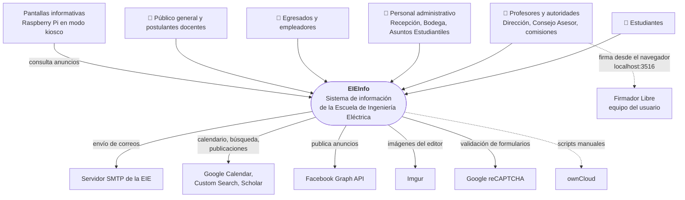
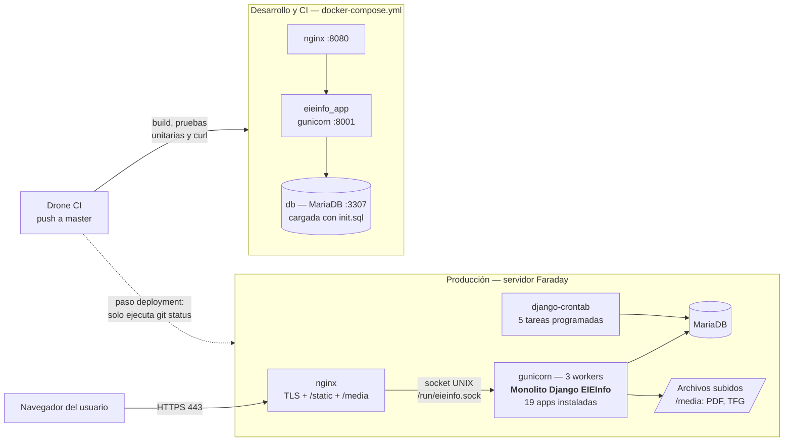
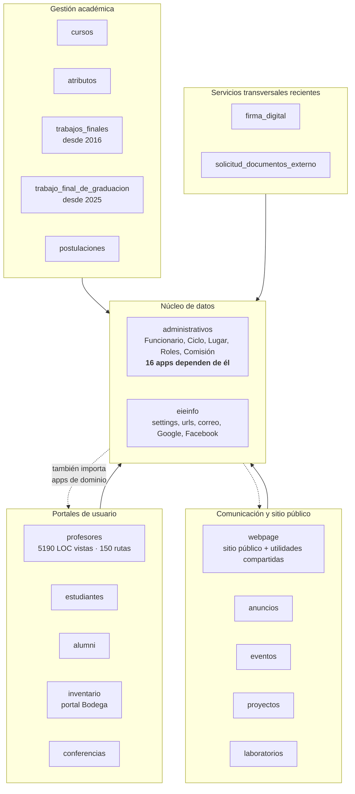

**Universidad de Costa Rica**
**Facultad de Ingeniería — Escuela de Ingeniería Eléctrica**

**IE0417 — Diseño de Software para Ingeniería**

 

# Auditoría de diseño de software del sistema EIEInfo

## Entrega 1: Levantamiento del sistema y diagnóstico inicial

 

**Estudiante:** Brandon Fuentes J. — C12976

**Profesor:** Esteban Badilla Alvarado

**Ciclo:** II-2026

**Fecha:** 10 de noviembre de 2026

---

## Índice

1. [Introducción y alcance](#1-introducción-y-alcance)
2. [Metodología](#2-metodología)
3. [Ficha técnica del sistema](#3-ficha-técnica-del-sistema)
4. [Mapa general del sistema](#4-mapa-general-del-sistema)
5. [Inventario funcional](#5-inventario-funcional)
6. [Hallazgos iniciales](#6-hallazgos-iniciales)
7. [Matriz preliminar de riesgos](#7-matriz-preliminar-de-riesgos)
8. [Respuesta a las preguntas orientadoras](#8-respuesta-a-las-preguntas-orientadoras)
9. [Conclusiones](#9-conclusiones)
10. [Anexos](#10-anexos)

---

## 1. Introducción y alcance

Este documento corresponde a la primera entrega de la auditoría técnica del sistema EIEInfo, el sistema de información de la Escuela de Ingeniería Eléctrica. El objetivo de esta etapa es responder a la pregunta: **¿qué sistema tenemos enfrente y cuáles son sus principales rasgos de diseño?**

Para esto se construyó una visión general del sistema (tecnologías, módulos, actores e infraestructura) y se identificaron los primeros hallazgos y riesgos, todos respaldados con evidencia del repositorio.

**Objeto de estudio:**

| Elemento | Valor |
|---|---|
| Repositorio | `https://git.ucr.ac.cr/eieinfo/EIEInfo` |
| Rama analizada | `master` |
| Commit de referencia | `0b3c575c` (2026-11-04) |
| Historial | 2570 commits en `master` (2909 en todas las ramas), desde el 2016-01-29 |
| Tamaño | ≈ 59 500 líneas de Python (sin migraciones), 406 plantillas HTML |

Todas las rutas citadas en este documento son relativas a la raíz del repositorio auditado, y la notación `archivo:N` indica la línea N. Por tratarse de un repositorio con información sensible, ningún secreto ni dato personal se reproduce en este documento, solo se indica donde se encuentra.

---

## 2. Metodología

El análisis fue principalmente **estático**, es decir, basado en la lectura del código y la configuración, sin ejecutar el sistema. Se trabajó por capas, siguiendo la recomendación del enunciado:

1. **Estructura, configuración, dependencias y despliegue:** `requirements.txt`, `settings.py`, `Dockerfile`, `docker-compose.yml`, `.drone.yml` y los archivos de `conf/`.
2. **Módulos, rutas, modelos y vistas:** inventario de las aplicaciones Django, con conteo de líneas, modelos, rutas, plantillas y pruebas por aplicación.
3. **Dependencias entre módulos:** análisis de los `import` y de las relaciones entre modelos (`ForeignKey`, `OneToOneField`, `ManyToManyField`) que cruzan de una aplicación a otra.
4. **Historial de Git:** actividad por año y por aplicación, para distinguir las partes activas de las legadas.

Para automatizar el conteo de métricas se utilizaron scripts propios en Python que analizan el código sin ejecutarlo; están en `docs/anexos/scripts/` para que las cifras puedan reproducirse. Se utilizó un asistente de IA como apoyo para la recolección de datos, y las afirmaciones principales de este documento se verificaron directamente en los archivos citados.

**Limitaciones:** no se tuvo acceso al servidor de producción, por lo que su configuración real (credenciales, tareas programadas, versión de Python) solo se puede inferir del repositorio. Tampoco se ejecutó la suite de pruebas en esta etapa.

---

## 3. Ficha técnica del sistema

| Aspecto | Descripción | Evidencia |
|---|---|---|
| **Lenguaje** | Python 3.10 declarado; la imagen Docker usa Python 3.11 (inferido de la ruta de `site-packages`) | `.python-version:1`, `docker/django/Dockerfile:45` |
| **Framework** | Django 4.1.3 (sin soporte de seguridad desde diciembre de 2023) | `requirements.txt:2` |
| **Servidor de aplicación** | Gunicorn 20.1.0, 3 *workers* | `conf/etc/systemd/system/eieinfo.service:10-17` |
| **Servidor web** | nginx como proxy inverso, con TLS (Let's Encrypt) y entrega de `/static` y `/media` | `conf/etc/nginx/sites-available/eieinfo` |
| **Base de datos** | MariaDB/MySQL (`django.db.backends.mysql`, `mysqlclient 2.1.1`) | `docker/django/secret_credentials.py:13`, `docker-compose.yml:10` |
| **Frontend** | Plantillas de Django renderizadas en el servidor, con jQuery y librerías JS/CSS incluidas en el repositorio (59 MB en `static/`) | `src/server/eieinfo/static/` |
| **Dependencias relevantes** | django-polymorphic, django-wiki, django-ckeditor, martor, django-crontab, django-select2, PyPDF2, pypandoc + LaTeX, XlsxWriter, openpyxl, google-api-python-client, oauth2client, facebook-sdk, scholarly | `docker/django/requirements.txt` |
| **Pruebas** | `django.test.TestCase` + `coverage`; pytest está instalado pero no se usa | `src/server/*/tests.py`, `.drone.yml:275` |
| **Despliegue (producción)** | Servidor "Faraday" con systemd + gunicorn + nginx, sin contenedores. El despliegue es manual. | `conf/etc/`, `.drone.yml:346-397` |
| **Despliegue (desarrollo/CI)** | Docker Compose con tres servicios: `db` (MariaDB), `nginx` y `eieinfo_app` (gunicorn) | `docker-compose.yml` |
| **Integración continua** | Drone CI, disparado por *push* a `master`: construye, ejecuta pruebas unitarias y pruebas de humo con `curl` | `.drone.yml:9-12` |
| **Tareas programadas** | 5 tareas con `django-crontab` (notificaciones y limpieza de archivos) | `src/server/eieinfo/settings.py:466-473` |
| **Integraciones externas** | Correo SMTP de la EIE, Google Calendar, Google Custom Search, Google Scholar, Facebook Graph API, Instagram, Imgur, reCAPTCHA, Firmador Libre (firma digital), ownCloud (scripts manuales) | Ver sección 4.1 |
| **Arquitectura predominante** | **Monolito Django en capas MVT** (modelo–vista–plantilla), con una única base de datos compartida y sin API REST formal | `src/server/eieinfo/settings.py:44-94` |

**Observación:** la documentación del repositorio describe una versión muy anterior del sistema (Django 1.9.1 y Python > 3.4.3 en `README.md:39-40`), lo que ya da una primera señal de que la documentación no ha evolucionado al mismo ritmo que el código.

---

## 4. Mapa general del sistema

### 4.1 Diagrama de contexto

El siguiente diagrama ubica a EIEInfo con respecto a sus usuarios y a los sistemas externos con los que interactúa.

**Evidencia:** SMTP en `settings.py:342-356`; Google en `src/server/eieinfo/GoogleAPI.py` y `proyectos/models.py:190-196`; Facebook en `src/server/eieinfo/FacebookAPI.py` y `anuncios/models.py:233`; Imgur en `settings.py:418-429`; reCAPTCHA en `webpage/forms.py:9`; Firmador Libre en `firma_digital/models.py:25-29`; pantallas en `src/clients/screens/FullScreen.sh:30`; ownCloud en `src/server/scripts/owncloud.py`.

Un detalle interesante es que la firma digital **no ocurre en el servidor**: el navegador del usuario se comunica con la aplicación Firmador Libre instalada en su propio equipo, y el servidor solo almacena y verifica los PDF.

### 4.2 Diagrama de contenedores

El repositorio muestra **dos formas de desplegar el sistema**: producción en el servidor Faraday (sin contenedores) y un entorno Docker usado para desarrollo y CI.

**Evidencia:** `conf/etc/systemd/system/eieinfo.service:10-17`, `conf/etc/nginx/sites-available/eieinfo:53`, `docker-compose.yml`, `.drone.yml:25-46` y `.drone.yml:346-397`.

La línea punteada entre Drone y producción resume uno de los hallazgos de esta entrega (H-05): el pipeline tiene un paso llamado `deployment`, pero en la práctica no despliega nada.

### 4.3 Módulos y dependencias

El backend está en `src/server/` y se organiza en **aplicaciones de Django** (*apps*). Cada app es una carpeta con sus propios modelos, vistas, formularios, rutas y plantillas, que en teoría agrupa una parte del dominio. Hay 19 apps instaladas en `INSTALLED_APPS` (`settings.py:44-94`), más el paquete del proyecto (`eieinfo/`) y tres carpetas de apps que existen pero no están instaladas.

El siguiente diagrama agrupa las apps por su responsabilidad principal:

Las métricas principales por app (anexo, §3.1) son:

| App | Modelos | LOC vistas | Rutas | Pruebas | Commits últimos 12 meses | Lectura |
|---|---|---|---|---|---|---|
| `profesores` | 2 | 5190 | 150 | 210 | 60 | Concentra la mayor parte de la funcionalidad |
| `administrativos` | 17 | 2428 | 93 | 84 | 38 | Núcleo de datos del sistema |
| `firma_digital` | 8 | 2918 | 29 | 456 | 47 | Módulo reciente (2025), muy activo y bien probado |
| `estudiantes` | 17 | 1483 | 43 | 36 | 24 | Portal de estudiantes; muchos modelos y pocas pruebas |
| `trabajo_final_de_graduacion` | 8 | 1352 | 27 | 74 | 13 | Nuevo subsistema de TFG (2025) |
| `webpage` | 8 | 403 | 30 | 91 | 24 | Sitio público y, a la vez, librería de utilidades |
| `cursos` | 6 | 124 | 5 | 40 | 14 | Planes de estudio y horarios |
| `trabajos_finales` | 6 | 113 | 3 | 5 | 3 | Subsistema antiguo de trabajos finales |

**Dependencias entre apps.** Al revisar qué apps importan a cuáles se encontraron **90 dependencias entre 19 apps**, de las cuales **28 pares son mutuas**: la app A usa a la B y la B también usa a la A (anexo, §4). El diagrama completo está en `docs/diagramas/dependencias-apps.mmd`. Lo más llamativo es que `administrativos`, que debería ser la base del sistema, importa a su vez a 9 apps de dominio. Esto significa que la división en apps es más organizativa que real: las apps no se pueden modificar, probar ni reutilizar de forma independiente.

**Puntos de entrada importantes:**

| Punto de entrada | Archivo | Descripción |
|---|---|---|
| Enrutador principal | `src/server/eieinfo/urls.py:23-71` | Asigna un prefijo de URL a cada app (`/profesores/`, `/estudiantes/`, etc.) |
| Configuración | `src/server/eieinfo/settings.py` (y su copia `docker/django/settings.py`) | Apps instaladas, base de datos, correo, integraciones, cron |
| Arranque en Docker | `docker-compose.yml:61-67` → `docker/django/migraciones.sh` | Regenera migraciones y lanza gunicorn |
| Arranque en producción | `conf/etc/systemd/system/eieinfo.service` | Servicio systemd con gunicorn |
| Tareas programadas | `settings.py:466-473` | `alumni.cron`, `profesores.cron`, `firma_digital.cron`, etc. |
| CI/CD | `.drone.yml` | Pipeline de construcción y pruebas |

---

## 5. Inventario funcional

### 5.1 Actores

| Actor | Cómo accede | Evidencia |
|---|---|---|
| Estudiante | Portal `/estudiantes/`, sesión propia (`est_id`) | `estudiantes/forms.py:124` |
| Profesor | Portal `/profesores/`, sesión propia (`prof_id`) | `profesores/forms.py:84` |
| Autoridades: Dirección, Consejo Asesor, comisiones (TFG, Docencia, Práctica Profesional) | Portal de profesores, con permisos adicionales verificados por decoradores | `profesores/misc.py:143-510` |
| Personal administrativo: Recepción, Jefatura, Asuntos Estudiantiles | Portal `/administrativos/`, sesión propia (`admn_id`) | `administrativos/forms.py:69`, `administrativos/misc.py:69-201` |
| Encargado de bodega | Portal `/inventario/` con login propio | `inventario/views/bodega.py:17` |
| Egresado y empleador | Portal `/alumni/` | `alumni/forms.py:116` |
| Postulante docente | Acceso por código de postulación, sin cuenta | `postulaciones/models.py:38-46` |
| Visitante anónimo | Sitio público de la Escuela | `webpage/urls.py` |
| Superusuario | Panel `/admin/` de Django | `src/server/eieinfo/urls.py` |

Algo importante es que cada portal tiene **su propio modelo de usuario y su propio mecanismo de inicio de sesión**, en lugar de usar el sistema de autenticación de Django (`django.contrib.auth`), que solo se utiliza para `/admin/`, la wiki y `conferencias`.

### 5.2 Áreas funcionales principales

| Área funcional | Apps involucradas |
|---|---|
| Gestión del personal docente y administrativo | `administrativos`, `profesores` |
| Vida estudiantil (expediente, práctica profesional, asistencias) | `estudiantes`, `profesores` |
| Trabajos finales de graduación y proyecto eléctrico | `trabajo_final_de_graduacion`, `trabajos_finales`, `profesores` |
| Firma digital de documentos | `firma_digital` |
| Solicitud de documentos por parte de externos | `solicitud_documentos_externo` |
| Cursos, planes de estudio y horarios | `cursos`, `atributos` |
| Contratación docente | `postulaciones` |
| Inventario y préstamo de equipo | `inventario` |
| Comunicación (anuncios, eventos, pantallas, redes sociales) | `anuncios`, `eventos`, `webpage` |
| Sitio web público (laboratorios, proyectos, personal) | `webpage`, `laboratorios`, `proyectos` |
| Egresados y bolsa de empleo | `alumni` |

### 5.3 Flujos visibles más importantes

1. **Inicio de sesión en un portal.** El usuario envía sus credenciales; el formulario las compara con el hash PBKDF2 guardado en el modelo del portal y guarda el identificador en la sesión. Luego, cada vista protegida verifica ese identificador con un decorador propio (`profesores/forms.py:58,84`; `profesores/misc.py:267-269`).
2. **Firma digital de documentos.** Un funcionario sube un PDF, lo firma desde el navegador con Firmador Libre y el sistema registra el estado de la firma. Una tarea diaria notifica al director los documentos pendientes (`firma_digital/views.py`, `firma_digital.cron.notificar_director_diario` en `settings.py:466-473`).
3. **Gestión de TFG.** Intervienen el estudiante, la comisión de TFG y los revisores; los permisos se verifican con decoradores como `comision_tfg_login_required` (`profesores/misc.py`, `trabajo_final_de_graduacion/views.py`).
4. **Publicación de anuncios.** Un administrador publica un anuncio que aparece en el sitio web, en las pantallas informativas (`/anuncios/pantallas`) y, opcionalmente, en Facebook mediante una acción del panel de administración (`anuncios/admin.py:31`).
5. **Postulación docente.** Un postulante externo llena el formulario y recibe un código con el que puede consultar o editar su postulación (`postulaciones/views.py:415,441`).

### 5.4 Módulos críticos para la operación

- **`administrativos`:** es la base de datos compartida del sistema. Define `Funcionario`, `Ciclo`, `Lugar`, `Roles` y `Comision`, y 16 apps dependen de ella. Un error aquí afecta a todo el sistema.
- **`profesores`:** concentra la mayor parte de la funcionalidad para docentes y autoridades, y es la app con más cambios recientes.
- **`estudiantes`:** tiene 17 modelos y maneja información personal y académica.
- **`firma_digital` y `trabajo_final_de_graduacion`:** soportan procesos formales de la Escuela con validez administrativa.
- **`eieinfo` (configuración):** contiene los `settings`, el enrutador principal y los servicios de correo e integraciones.

---

## 6. Hallazgos iniciales

### 6.1 Resumen

| ID | Título | Criticidad | Alcance |
|---|---|---|---|
| H-01 | Secretos reales versionados en el repositorio | Crítica | Sistémico |
| H-02 | Credenciales en texto plano y datos personales versionados | Crítica | Sistémico |
| H-03 | Migraciones no versionadas y regeneradas en cada arranque | Crítica | Sistémico |
| H-04 | Autenticación y autorización propias, duplicadas en cada portal | Alta | Sistémico |
| H-05 | El pipeline de CI no despliega ni exige calidad | Alta | Sistémico |
| H-06 | Acoplamiento cíclico generalizado entre apps | Alta | Sistémico |
| H-07 | Tecnologías fuera de soporte y parches sobre dependencias | Alta | Sistémico |
| H-08 | Configuración duplicada y modo producción decidido por el nombre del servidor | Alta | Sistémico |
| H-09 | `profesores` concentra demasiadas responsabilidades | Alta | Local |
| H-10 | Conceptos de dominio duplicados o ambiguos | Media | Sistémico |
| H-11 | Pruebas desbalanceadas y dependientes de datos volcados | Media | Sistémico |
| H-12 | Observabilidad operativa débil | Media | Sistémico |

**Criterio de criticidad:** *crítica* indica exposición actual de información o riesgo de pérdida de datos; *alta*, un problema estructural que encarece o pone en riesgo cualquier cambio; *media*, un problema que dificulta el mantenimiento pero no compromete la operación de inmediato.

### 6.2 Detalle de los hallazgos

#### H-01 — Secretos reales versionados en el repositorio

- **Criticidad:** Crítica
- **Descripción:** el repositorio contiene credenciales que no parecen valores de prueba: un token de un bot de Telegram en la configuración del CI, la contraseña del servidor de correo y las llaves de la API de Imgur. Las credenciales de producción de la base de datos sí están correctamente fuera del repositorio (`src/server/eieinfo/secret/` está en `.gitignore:3`), lo que muestra que la práctica existe, pero no se aplica de forma consistente.
- **Evidencia:**
  - `.drone.yml:313`: token de Telegram escrito directamente, sin usar `from_secret` como sí se hace en el paso de correo (`.drone.yml:334-343`). Está presente desde 2024-05-18.
  - `src/server/eieinfo/settings.py:345`: `EMAIL_HOST_PASSWORD`.
  - `src/server/eieinfo/settings.py:428-429`: credenciales de Imgur.
  - `docker/django/secret_credentials.py:31-33`: datos SMTP que no tienen forma de valor de prueba.
- **Impacto:** cualquier persona con acceso de lectura al repositorio, que incluye a varios grupos de estudiantes por semestre, puede usar estas credenciales. Aunque se borren del código, siguen en el historial de Git.

#### H-02 — Credenciales en texto plano y datos personales versionados

- **Criticidad:** Crítica
- **Descripción:** hay archivos con contraseñas sin cifrar de personal docente y con datos personales y académicos de estudiantes. Uno de ellos está en una carpeta que `.gitignore` excluye, pero se agregó antes de esa regla y nunca se retiró.
- **Evidencia:**
  - `src/server/OwncloudProfesores.csv`: 14 filas con usuario y contraseña en texto plano (versionado desde 2019).
  - `src/server/scripts/TODO_ACTUALIZADO.csv`: 9466 filas con carné, nombre y datos que parecen un historial académico (versionado desde 2016). La carpeta está ignorada en `.gitignore:5`, pero el archivo sigue en el índice.
  - `docker/db/init.sql` y `docker/django/testing.sql`: volcados con hashes de contraseñas y correos institucionales. No se pudo determinar si son datos reales o de prueba.
- **Impacto:** exposición de datos personales, con posibles implicaciones bajo la Ley 8968 de Protección de la Persona frente al Tratamiento de sus Datos Personales.

#### H-03 — Migraciones no versionadas y regeneradas en cada arranque

- **Criticidad:** Crítica
- **Descripción:** en Django, las *migraciones* son los archivos que describen, paso a paso, cómo cambia el esquema de la base de datos. Normalmente se guardan en el repositorio para que todos los entornos apliquen exactamente los mismos cambios. En EIEInfo, las migraciones están excluidas de Git y, además, el script de arranque **borra todas las migraciones y las vuelve a generar** cada vez que se inicia el contenedor.
- **Evidencia:**
  - `.gitignore:45-48`: ignora todas las migraciones excepto `__init__.py`.
  - `docker/django/migraciones.sh:5-10`: borra las migraciones, ejecuta `makemigrations` y luego `migrate`.
  - `docker-compose.yml:65`: ese script corre en cada arranque.
  - `.drone.yml:98-100`: el CI hace lo mismo.
  - `README.md:104-116`: la documentación recomienda esta práctica "para evitar problemas".
  - Resultado: 0 migraciones versionadas en todo el repositorio.
- **Impacto:** el esquema de la base de datos no se puede reconstruir ni auditar desde el repositorio. Dos entornos pueden generar migraciones distintas a partir del mismo código, y un cambio en un modelo puede producir una migración que borre o altere datos en una base persistente como la de producción.

#### H-04 — Autenticación y autorización propias, duplicadas en cada portal

- **Criticidad:** Alta
- **Descripción:** en lugar de usar el sistema de usuarios y permisos de Django, cada portal implementa su propio modelo de usuario, su propio inicio de sesión y sus propios decoradores de permisos. Hay alrededor de 20 decoradores con la misma estructura, repartidos en varios archivos `misc.py`. Además, los roles se reconocen comparando cadenas de texto literales, y algunos permisos se guardan en la sesión, por lo que siguen vigentes aunque el rol se haya retirado.
- **Evidencia:**
  - Decoradores: `profesores/misc.py:143-510`, `administrativos/misc.py:69-201`, `estudiantes/misc.py:62`, `alumni/misc.py:24`, `inventario/misc.py:10`.
  - Sesiones separadas: `prof_id` (`profesores/forms.py:84`), `admn_id` (`administrativos/forms.py:69`), `est_id` (`estudiantes/forms.py:124`), `alumnus_id` (`alumni/forms.py:116`).
  - Permiso guardado en sesión: `administrativos/misc.py:174-180`.
- **Impacto:** la seguridad del sistema depende de que cada desarrollador copie correctamente el patrón en cada vista nueva. Un error de copia, un nombre de rol mal escrito o una vista sin decorador abre acceso indebido, y no hay un punto central donde revisarlo o probarlo.

#### H-05 — El pipeline de CI no despliega ni exige calidad

- **Criticidad:** Alta
- **Descripción:** el pipeline de Drone construye el sistema y ejecuta pruebas, pero el paso de despliegue a producción solo ejecuta `git status`: todo el procedimiento real está comentado. Tampoco hay un umbral mínimo de cobertura, el paso `migrate` está comentado y la espera para que levanten los contenedores es un `sleep 200` fijo.
- **Evidencia:**
  - `.drone.yml:346-397`: paso `deployment`, con el procedimiento real comentado (L376-393) y `failure: ignore` (L397).
  - `.drone.yml:102`: `migrate` comentado.
  - `.drone.yml:275-276`: cobertura sin `--fail-under`.
  - `.drone.yml:49-53`: `sleep 200`.
  - `docker/django/run-ut.sh:35`: pruebas comentadas con la nota "Fallan".
- **Impacto:** el despliegue a producción es manual y no deja registro, así que no hay garantía de que lo que pasó las pruebas sea lo que está corriendo. Un pipeline "en verde" no asegura nada sobre el estado de producción.

#### H-06 — Acoplamiento cíclico generalizado entre apps

- **Criticidad:** Alta
- **Descripción:** las apps de Django deberían funcionar como módulos con una dirección clara de dependencia: las apps de dominio dependen del núcleo, y no al revés. En EIEInfo hay 90 dependencias entre 19 apps y 28 pares de apps que dependen mutuamente. El núcleo de datos (`administrativos`) importa a su vez a 9 apps de dominio.
- **Evidencia:** análisis de `import` y relaciones entre modelos (anexo, §4); diagrama completo en `docs/diagramas/dependencias-apps.mmd`. Algunos ciclos: `administrativos↔profesores`, `administrativos↔estudiantes`, `cursos↔estudiantes`, `profesores↔webpage`.
- **Impacto:** ninguna app se puede modificar, probar o extraer de forma aislada. Un cambio en un modelo puede tener efectos en cadena difíciles de anticipar. Este es probablemente el rasgo estructural que más condiciona cualquier propuesta de evolución.

#### H-07 — Tecnologías fuera de soporte y parches sobre dependencias

- **Criticidad:** Alta
- **Descripción:** el sistema corre sobre versiones que ya no reciben actualizaciones de seguridad. Para mantener compatibilidad, se modifican archivos de librerías instaladas mediante `sed` y se reemplazan funciones de Django en tiempo de ejecución (*monkeypatch*).
- **Evidencia:**
  - Django 4.1.3 (`requirements.txt:2`), sin soporte desde diciembre de 2023.
  - Imagen base `python:buster` (Debian 10, retirado), que obliga a usar `archive.debian.org` (`docker/django/Dockerfile:1,7`).
  - Librerías de 2016–2018: `oauth2client 3.0.0` (obsoleta), `PyPDF2 1.26.0`, `google-api-python-client 1.5.3`, `flake8 3.5.0`.
  - Parche con `sed` sobre `django-tagging`: `docker/django/Dockerfile:45`, `.drone.yml:225`.
  - *Monkeypatch*: `src/server/eieinfo/settings.py:19-20`.
  - Imágenes sin versión fija: `mariadb` (`docker-compose.yml:10`), `python:buster`.
- **Impacto:** el sistema no recibe parches de seguridad, las construcciones no son reproducibles (la misma receta puede producir imágenes distintas en fechas distintas) y cualquier actualización puede romper los parches existentes.

#### H-08 — Configuración duplicada y modo producción decidido por el nombre del servidor

- **Criticidad:** Alta
- **Descripción:** existen dos `settings.py` diferentes, y el de Docker reemplaza al principal dentro de la imagen. Además, el sistema decide si está en producción comparando el nombre del equipo con `'faraday'`: en cualquier otro equipo activa `DEBUG = True` y acepta cualquier host. El archivo `.env` versionado define variables que `settings.py` nunca lee.
- **Evidencia:**
  - `src/server/eieinfo/settings.py` (576 líneas) frente a `docker/django/settings.py` (537 líneas).
  - Reemplazo: `docker/django/Dockerfile:33-34`, `.drone.yml:87-88`.
  - `settings.py:483-493`: `if socket.gethostname() == 'faraday':` … en caso contrario, `DEBUG = True` y `ALLOWED_HOSTS = ['*']`.
  - `docker/django/.env` define `DEBUG` y `DJANGO_ALLOWED_HOSTS`, pero ningún `settings.py` usa `os.environ`.
- **Impacto:** lo que se prueba en CI no es la misma configuración que corre en producción. Si el servidor cambia de nombre o se migra a contenedores, el sistema quedaría en modo depuración y expuesto, mostrando información interna en las páginas de error.

#### H-09 — `profesores` concentra demasiadas responsabilidades

- **Criticidad:** Alta
- **Descripción:** la app `profesores` tiene solo 2 modelos propios, pero 5190 líneas de vistas y 150 rutas. Incluye funcionalidad de dominios que deberían estar en otras apps: asistencias, inventario, laboratorios, práctica profesional, proyecto eléctrico, TFG y Consejo Asesor. Es lo que en diseño se conoce como un "módulo dios".
- **Evidencia:**
  - `profesores/views/` (13 módulos) y `profesores/urlpatterns/` (13 archivos).
  - `profesores/views/consejo_asesor.py`: 2117 líneas.
  - `profesores/views/trabajos_finales.py`: 978 líneas.
  - Fan-out de 12: depende de 12 apps diferentes (anexo, §4.1).
- **Impacto:** es la app con más cambios en el último año (60 commits), así que concentra el riesgo de regresiones y de conflictos entre los distintos grupos que trabajan en el sistema al mismo tiempo.

#### H-10 — Conceptos de dominio duplicados o ambiguos

- **Criticidad:** Media
- **Descripción:** hay conceptos que existen dos veces con implementaciones separadas, y nombres iguales para conceptos distintos.
- **Evidencia:**
  - Dos subsistemas de trabajos finales: `trabajos_finales` (desde 2016) y `trabajo_final_de_graduacion` (desde 2025, con tablas `tfg_v6`, en `trabajo_final_de_graduacion/models.py:163,199`).
  - Dos clases `Ciclo` con significados distintos: periodo lectivo en `administrativos/models.py:205` y ciclo de un plan de estudios en `cursos/models.py:854`.
  - Dos comisiones casi homónimas, "Trabajo Final de Graduación" y "Trabajos Finales de Graduación", en los datos de `docker/db/init.sql`; el código busca ambas cadenas.
- **Impacto:** las reglas de negocio pueden quedar inconsistentes, ya que un cambio debe replicarse en dos lugares, y el código resulta confuso para quien se incorpora al proyecto.

#### H-11 — Pruebas desbalanceadas y dependientes de datos volcados

- **Criticidad:** Media
- **Descripción:** existen 1166 funciones de prueba, pero están muy concentradas: el 39 % pertenece a `firma_digital`, mientras que apps centrales como `estudiantes` (17 modelos) tienen 36 pruebas, y `eventos` y `laboratorios` no tienen ninguna. Además, los datos de prueba se generan en el CI con `dumpdata` desde un volcado SQL, en lugar de construirse de forma controlada dentro de cada prueba.
- **Evidencia:**
  - Distribución de pruebas por app: anexo, §3.1 y §6.
  - Fixtures generados con `dumpdata`: `.drone.yml:228-258`.
  - 8 apps con pruebas que el CI no ejecuta: `.drone.yml:275` frente a `src/server/*/tests.py`.
  - 14 pruebas marcadas como `skip`.
  - Pruebas de JavaScript (`firma_digital/tests_js/`) que no se ejecutan en CI.
- **Impacto:** las zonas más acopladas y críticas son de las menos cubiertas en proporción a su tamaño. Las pruebas dependen de un volcado de datos que puede cambiar, lo que las vuelve frágiles.

#### H-12 — Observabilidad operativa débil

- **Criticidad:** Media
- **Descripción:** el sistema tiene poca capacidad para avisar de sus propios errores. La lista `ADMINS`, que Django usa para enviar correos cuando ocurre un error en producción, está vacía, y gunicorn en producción solo registra errores.
- **Evidencia:**
  - `src/server/eieinfo/settings.py:369-373`: entradas de `ADMINS` comentadas.
  - `conf/etc/systemd/system/eieinfo.service:10-17`: `--log-level error`.
  - No existe un endpoint de salud de la aplicación; el CI solo verifica que los puertos respondan (`.drone.yml:56-73`).
- **Impacto:** los errores en producción pueden pasar desapercibidos hasta que un usuario los reporta, y es difícil diagnosticar problemas después de que ocurren.

---

## 7. Matriz preliminar de riesgos

**Escalas:** impacto y probabilidad se califican como Alta (A), Media (M) o Baja (B). La prioridad combina ambos: si los dos son altos, la prioridad es *inmediata*; si uno es alto, *alta*; en los demás casos, *media*.

| # | Riesgo identificado | Posible causa | Impacto | Probabilidad | Prioridad | Hallazgos |
|---|---|---|---|---|---|---|
| R-01 | Uso indebido de credenciales expuestas (correo, Telegram, Imgur) | Secretos escritos en archivos versionados | A | A | **Inmediata** | H-01 |
| R-02 | Filtración de datos personales de estudiantes y docentes | CSV y volcados SQL con datos en el repositorio | A | A | **Inmediata** | H-02 |
| R-03 | Pérdida o corrupción de datos al desplegar un cambio de modelos | Migraciones regeneradas en cada entorno | A | M | **Alta** | H-03 |
| R-04 | Acceso no autorizado a funciones restringidas | Autorización copiada a mano en cada vista; roles por cadena de texto | A | M | **Alta** | H-04 |
| R-05 | Sistema expuesto en modo depuración | Modo producción decidido por el nombre del servidor | A | M | **Alta** | H-08 |
| R-06 | Vulnerabilidades conocidas sin corregir | Django y librerías sin soporte | A | M | **Alta** | H-07 |
| R-07 | Regresiones al modificar funcionalidad existente | Acoplamiento cíclico, módulo dios y pruebas desbalanceadas | M | A | **Alta** | H-06, H-09, H-11 |
| R-08 | Diferencias entre lo probado y lo que corre en producción | Despliegue manual y configuración duplicada | M | A | **Alta** | H-05, H-08 |
| R-09 | Imposibilidad de reconstruir el entorno | Imágenes sin versión, paquetes desde forks de Git, parches con `sed` | M | M | Media | H-07 |
| R-10 | Inconsistencias en reglas de negocio | Conceptos duplicados (dos subsistemas de TFG, dos `Ciclo`) | M | M | Media | H-10 |
| R-11 | Fallas en producción no detectadas a tiempo | Sin alertas de error ni monitoreo | M | M | Media | H-12 |
| R-12 | Pérdida del conocimiento del sistema | Documentación desactualizada y alta rotación de desarrolladores (estudiantes) | M | A | **Alta** | H-09, sección 3 |

---

## 8. Respuesta a las preguntas orientadoras

**¿Qué tan centralizado o fragmentado está el sistema?**
Ambas cosas a la vez. A nivel de despliegue y datos está **muy centralizado**: un solo proceso, una sola base de datos y un solo repositorio. A nivel de código está **fragmentado en apariencia**: hay 19 apps, pero las dependencias mutuas hacen que en la práctica se comporten como un único bloque.

**¿Cuáles módulos concentran más responsabilidad?**
`profesores`, por funcionalidad (5190 líneas de vistas, 150 rutas), y `administrativos`, por datos (17 modelos de los que dependen 16 apps). `webpage` también tiene más responsabilidad de la que su nombre sugiere, porque además de ser el sitio público funciona como librería de utilidades para 26 archivos de otras apps.

**¿Qué partes parecen más activas y cuáles más legadas?**
Las más activas en el último año son `profesores` (60 commits), `firma_digital` (47) y `administrativos` (38). Las legadas son `atributos` (sin cambios en 12 meses), las apps vacías que no están instaladas (`asistencias`, `proyecto_electrico`, `practica_profesional`, sin cambios desde 2023), `src/webclients/` (2017) y los scripts de `src/server/scripts/` (2019).

**¿Qué señales hay de crecimiento orgánico y deuda técnica?**
El historial muestra tres etapas: construcción intensa entre 2016 y 2018 (1717 commits, con un autor principal), casi abandono entre 2019 y 2023 (menos de 90 commits por año) y reactivación desde 2024, con aportes de estudiantes. Esto se refleja en el código: hay dos subsistemas para el mismo dominio (trabajos finales), tablas con versión en el nombre (`tfg_v6`), convenciones de nombres que mezclan español e inglés y estilos distintos (el `README.md` exige CamelCase, pero el código nuevo usa snake_case), configuración duplicada y parches para mantener vivas librerías antiguas.

**¿Dónde se observan los primeros riesgos de mantenimiento o evolución?**
En el manejo de secretos y datos (H-01, H-02), en la falta de un esquema de base de datos reproducible (H-03) y en el acoplamiento entre apps (H-06), que hace que cualquier mejora estructural sea costosa. También preocupa que el sistema depende de estudiantes que rotan cada semestre, mientras que la documentación no refleja el estado real del código.

---

## 9. Conclusiones

1. **EIEInfo es un monolito Django de unos diez años que soporta procesos importantes de la Escuela.** Atiende a estudiantes, docentes, autoridades, personal administrativo, egresados y público general mediante varios portales que comparten una sola base de datos. Su arquitectura predominante es MVT con plantillas renderizadas en el servidor y sin una API formal.

2. **Su principal rasgo de diseño es una modularidad que existe solo de nombre.** La división en apps sugiere módulos independientes, pero las 28 dependencias mutuas, el núcleo `administrativos` que depende de sus propios clientes y el módulo `profesores` que concentra funcionalidad de muchos dominios muestran un sistema muy acoplado. Esto es consistente con un crecimiento orgánico: funcionalidad agregada donde era más fácil, en distintos momentos y por distintas personas.

3. **Los riesgos más urgentes no son de diseño sino de manejo de información.** Hay secretos y datos personales en el repositorio (H-01, H-02) que deberían atenderse antes que cualquier refactorización, porque su impacto es inmediato y no depende de futuros cambios.

4. **La operación del sistema es poco reproducible.** Las migraciones se regeneran en cada arranque, la configuración está duplicada, el despliegue es manual y varias dependencias están fuera de soporte o emparchadas. Esto significa que hoy no se puede garantizar que dos entornos sean equivalentes.

5. **También hay aspectos positivos que conviene preservar.** Las apps más recientes (`firma_digital`, `solicitud_documentos_externo`, `postulaciones`) son más independientes y tienen más pruebas, lo que muestra que el equipo actual sí puede trabajar con mejores prácticas. Existe un pipeline de CI que corre pruebas, la configuración de nginx en producción usa TLS y HSTS, y el sistema mantiene un historial completo en Git que permite estudiar su evolución.

En la Entrega 2 se profundizará en estos hallazgos mediante la evaluación por atributos de calidad, la auditoría detallada de 4 a 6 módulos clave, el análisis del modelo de dominio y la revisión de pruebas y seguridad.

---

## 10. Anexos

| Anexo | Contenido |
|---|---|
| [`docs/anexos/levantamiento-e1.md`](../anexos/levantamiento-e1.md) | Levantamiento técnico completo: métricas por app, dependencias, configuración, CI/CD, pruebas y candidatos a hallazgo |
| [`docs/anexos/scripts/`](../anexos/scripts/) | Scripts usados para calcular las métricas (análisis estático, sin ejecutar el sistema) |
| [`docs/diagramas/dependencias-apps.mmd`](../diagramas/dependencias-apps.mmd) | Grafo completo de dependencias entre apps |
