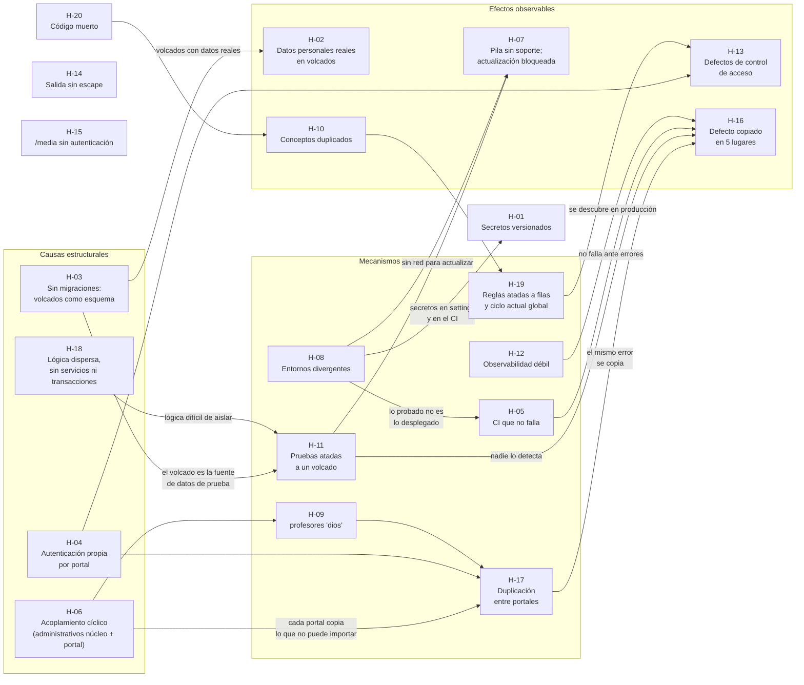

<div align="center">

**Universidad de Costa Rica**
**Facultad de Ingeniería — Escuela de Ingeniería Eléctrica**

**IE0417 — Diseño de Software para Ingeniería**

<br>

# Auditoría de diseño de software del sistema EIEInfo

## Entrega 2: Auditoría profunda de diseño, calidad y riesgos

<br>

**Estudiante:** Brandon Fuentes Jiménez. — C12976

**Profesor:** Esteban Badilla Alvarado

**Ciclo:** II-2026

**Fecha:** 17 de noviembre de 2026

</div>

---

## Índice

1. [Introducción y alcance](#1-introducción-y-alcance)
2. [Metodología](#2-metodología)
3. [Evaluación por atributos de calidad](#3-evaluación-por-atributos-de-calidad)
4. [Auditoría modular](#4-auditoría-modular)
5. [Auditoría del dominio](#5-auditoría-del-dominio)
6. [Auditoría de calidad del código](#6-auditoría-de-calidad-del-código)
7. [Auditoría de pruebas y confiabilidad](#7-auditoría-de-pruebas-y-confiabilidad)
8. [Auditoría de seguridad y operación](#8-auditoría-de-seguridad-y-operación)
9. [Registro consolidado de hallazgos](#9-registro-consolidado-de-hallazgos)
10. [Respuesta a las preguntas orientadoras](#10-respuesta-a-las-preguntas-orientadoras)
11. [Conclusiones](#11-conclusiones)
12. [Anexos](#12-anexos)

---

## 1. Introducción y alcance

Este documento corresponde a la segunda entrega de la auditoría técnica de EIEInfo. La Entrega 1 respondió qué sistema tenemos enfrente; esta responde a la pregunta: **¿cuáles son los principales problemas de diseño del sistema, por qué importan y cómo se relacionan entre sí?**

Para responderla se profundizó en cinco frentes: los atributos de calidad del sistema completo, seis módulos analizados a fondo, el modelo de dominio, la calidad del código y las pruebas, y la seguridad y la operación. El resultado se consolida en un registro de 20 hallazgos priorizados (sección 9), con un diagrama de cómo se causan unos a otros.

**Objeto de estudio:** el mismo de la Entrega 1, para que las cifras sean comparables.

| Elemento | Valor |
|---|---|
| Repositorio | `https://git.ucr.ac.cr/eieinfo/EIEInfo` |
| Rama y commit | `master`, `0b3c575c` (2026-11-04) |
| Tamaño | 117 modelos, 1408 funciones de producción, 401 vistas enrutadas, 1166 pruebas |

**Continuidad con la Entrega 1.** Se conservan los identificadores H-01 a H-12 del documento entregado y los hallazgos nuevos siguen desde H-13. Al profundizar aparecieron datos de la Entrega 1 que había que corregir; los más relevantes son estos (lista completa en el anexo, §10):

| Dato de la Entrega 1 | Corrección |
|---|---|
| Dos subsistemas de TFG vivos (H-10) | El TFG antiguo está **comentado** (1999 líneas con `##`); lo que conviven son dos flujos hermanos, Proyecto Eléctrico y TFG |
| `django.contrib.auth` solo se usa en `/admin`, la wiki y `conferencias` | El login de profesores y administrativos **también** crea una sesión de Django con un `User` espejo, desde 2018 |
| `\|safe` en 6 plantillas como superficie de XSS | Además hay 119 bloques `` en 101 plantillas |
| No determinable si los volcados SQL tienen datos reales | Al menos parte son reales: las pruebas afirman contra una persona concreta del personal |
| Secretos: solo el árbol actual | El historial agrega una contraseña SSH de producción y muestra que la contraseña SMTP no cambia desde 2016 |
| PyPDF2 como dependencia de PDF | Ningún archivo la importa: es una dependencia muerta |

Como en la Entrega 1, ningún secreto ni dato personal se reproduce en este documento: se indica dónde está, su tipo y su forma.

---

## 2. Metodología

El análisis siguió siendo **estático**: no se ejecutó el sistema, ni su suite de pruebas, ni Docker. Esto tiene una consecuencia que conviene decir desde el inicio: los defectos que se reportan como "por lectura estática" (por ejemplo, en H-16) se dedujeron leyendo el código y no se reprodujeron ejecutándolo.

Se usaron dos tipos de herramientas, todas guardadas en `docs/anexos/scripts/` para que las cifras se puedan reproducir:

| Herramienta | Qué mide | Usada en |
|---|---|---|
| `complexity.py` | Complejidad ciclomática (CC) y longitud de cada función, con las mismas reglas de conteo que `radon` | Secciones 3, 4 y 6 |
| `domain.py` | Modelos, campos, relaciones y herencia de todos los `models.py` | Sección 5 |
| `duplication.py` | Funciones duplicadas: clones exactos, clones estructurales (iguales al ignorar nombres y constantes) y funciones homónimas parecidas | Sección 6 |
| `views_audit.py` | Vistas, rutas y protección visible de cada vista | Secciones 4 y 8 |
| `tests_audit.py` | Perfil de la suite: pruebas, fixtures, `mock`, aserciones, `skip` y qué corre el CI | Sección 7 |
| `secrets_history.py` | Secretos en **todo** el historial de Git (2909 commits, 47 ramas), sin imprimir nunca su valor | Sección 8 |
| `deps_audit.py` + `pip-audit` 2.10.1 | Vulnerabilidades conocidas (base OSV) en las versiones declaradas de las dependencias | Sección 8 |

Los scripts analizan el árbol de sintaxis de Python (AST) o el historial de Git; ninguno importa ni ejecuta código de EIEInfo. `pip-audit` es la única herramienta externa: se instaló en un entorno aparte y solo consulta la base de vulnerabilidades por nombre y versión de paquete. Cada cifra de este documento remite a una línea del repositorio, a un comando o a la salida de un script, y el anexo [`levantamiento-e2.md`](../anexos/levantamiento-e2.md) contiene el detalle completo.

**Selección de módulos.** Los seis módulos de la sección 4 se eligieron por cuatro criterios medibles: tamaño, acoplamiento (cuántas apps dependen de ellos y de cuántas dependen), actividad en los últimos 12 meses y criticidad para la operación (anexo, §1).

**Limitaciones.** Sin acceso a producción no se puede confirmar qué versión del código, qué configuración ni qué lista de paquetes corre en el servidor; cuando eso importa, se marca como *no determinable*. Tampoco se midió la cobertura real de las pruebas.

---

## 3. Evaluación por atributos de calidad

La escala usada es **Buena** (dominan las fortalezas), **Aceptable** (hay equilibrio), **Débil** (dominan las debilidades) y **Crítica** (el atributo está comprometido en todo el sistema).

| Atributo | Valoración | Módulos que ilustran el problema | Módulos de contraste |
|---|---|---|---|
| Mantenibilidad | Débil | `profesores`, área de trabajos finales | `solicitud_documentos_externo`, `eieinfo/email_service.py` |
| Modificabilidad | Débil | `administrativos` (modelos), configuración | `firma_digital` |
| Cohesión | Débil | `profesores`, `administrativos`, `webpage` | `postulaciones`, `firma_digital` |
| Acoplamiento | **Crítica** | Ciclo `administrativos` ↔ `profesores` ↔ `cursos` ↔ `estudiantes` | `firma_digital`, `solicitud_documentos_externo` |
| Testabilidad | Débil | `profesores`, `estudiantes`, `webpage` | `firma_digital`, `solicitud_documentos_externo` |
| Seguridad básica | **Crítica** | Configuración (secretos), `*/misc.py` (autorización), plantillas | `firma_digital`, nginx |
| Consistencia arquitectónica | Débil | `trabajos_finales`, `cursos`, `profesores` frente a `firma_digital` | — |
| Observabilidad operativa | Débil | `eieinfo/settings.py`, `eieinfo/misc.py` | `eieinfo/email_service.py` |

Un patrón atraviesa toda la tabla: **el código reciente (2025–2026) y el antiguo (2016–2018) son casi dos sistemas distintos**. Los módulos nuevos aparecen siempre como contraste positivo en cohesión, acoplamiento y pruebas, pero no en complejidad ni en consistencia.

### 3.1 Mantenibilidad — Débil

**Fortalezas**

- La complejidad está **concentrada, no repartida**: de 1408 funciones de producción, solo 48 (3,4 %) tienen CC mayor que 10, y la CC media es 2,97 (`scripts/complejidad-eieinfo-0b3c575c.json`). Eso permite atacar el problema por puntos.
- Ya existe un servicio de correo central y bien escrito, `eieinfo/email_service.py:16`, al que delegan los métodos más nuevos.

**Debilidades**

- **Duplicación alta:** una de cada cinco funciones de 8 líneas o más (160 de 788) tiene un clon estructural. El caso extremo es `resumen_ciclo` (158 líneas, CC 25), que existe en `profesores` y en `administrativos` y difiere en **una sola línea** (`profesores/views/consejo_asesor.py:289-446` frente a `administrativos/views/consejo_asesor.py:129-286`).
- **Código desactivado sin borrar:** 2025 líneas comentadas con `##`, 1999 de ellas en el área de trabajos finales (commit `f5a94cab`, 2025-02-15).
- **Archivos monolíticos también en el código nuevo:** `firma_digital/views.py` tiene 2918 líneas y la mayor CC acumulada del sistema (492).
- **Código roto que sobrevive porque nada lo ejecuta**, como `Profesor.ActualizarGruposUsuario` (`profesores/models.py:160-200`) o `PracticaProfesional.GetEncargados` (`estudiantes/models.py:1016-1019`, ver H-16).

### 3.2 Modificabilidad — Débil

**Fortalezas**

- Agregar un módulo **hoja** (del que nadie depende) es barato, y el historial lo confirma: `postulaciones`, `firma_digital` y `solicitud_documentos_externo` entraron en 2025–2026 tocando solo `INSTALLED_APPS` y el enrutador principal.
- Los parámetros de la firma digital están en un modelo editable (`firma_digital/models.py:11-109`), no en constantes.

**Debilidades**

- **Los conceptos centrales no tienen un punto único de cambio.** El "ciclo lectivo actual" se obtiene con `Ciclo.objects.filter(actual=True)[0]` (`administrativos/models.py:252-255`), llamado 94 veces en 28 archivos y sin ninguna restricción que garantice que exista uno solo. Los roles se identifican por texto libre: el código busca 16 nombres de rol distintos y **10 de ellos no existen en los datos semilla** (`docker/db/init.sql`).
- **El esquema no se puede cambiar de forma controlada:** sin migraciones, cada cambio de modelo obliga a editar a mano dos volcados SQL de unos 500 KB (H-03).
- **Una regla de autorización está escrita varias veces:** "tiene Jefatura" aparece 8 veces entre `profesores/misc.py` y `administrativos/misc.py`.

### 3.3 Cohesión — Débil

**Fortalezas**

- Las apps recientes tienen una sola razón de existir (contratación docente, trámite de documentos, flujo de firma) y sus modelos solo los usa la propia app.

**Debilidades**

- **`profesores` es un portal, no un módulo de dominio:** 2 modelos y 136 vistas sobre planificación del ciclo, Proyecto Eléctrico, asistencias, práctica profesional, noticias y laboratorios (sección 4.1).
- **`administrativos` cumple dos papeles incompatibles:** es el núcleo de datos de toda la Escuela (17 modelos) y a la vez el portal del personal administrativo (87 vistas).
- **`webpage` es sitio público, gestor de contenidos y librería de contexto** para los demás portales.
- **Los modelos mezclan persistencia con efectos externos:** envían correo, generan PDF con LaTeX, publican en Facebook (`anuncios/models.py:233`) y consultan Google Scholar (`proyectos/models.py:190-196`).

### 3.4 Acoplamiento — Crítica

**Fortalezas**

- **A nivel de datos la dirección es razonable:** de 81 relaciones de modelo entre apps, la mitad termina en cuatro entidades centrales (`Profesor`, `Funcionario`, `Estudiante`, `Ciclo`). El modelo de datos tiene forma de estrella.
- Hay apps con dependencia en un solo sentido: `firma_digital` y `solicitud_documentos_externo` no son importadas por nadie.

**Debilidades**

- **El desorden está en el código, no en los datos:** 90 dependencias y 28 pares mutuos entre 19 apps (E1 §4.3). El ciclo `administrativos` ↔ `profesores` ↔ `cursos` ↔ `estudiantes` impide importar, probar o desplegar cualquiera de las cuatro sin las otras tres.
- **Funciones de contexto globales:** `CrearContextoProfesor`, `CrearContextoAdministrativo`, `CrearContexto` y `CrearContextoEstudiante` suman 309 llamadas. La de profesores hace al menos 12 consultas por petición e importa modelos de 5 apps (`profesores/misc.py:25-140`), así que cada vista de profesor queda acoplada a esas 5 apps.
- **Acoplamiento a filas concretas de la base:** `Comision.objects.get(nombre='Docencia')` (`profesores/misc.py:294`) falla si alguien renombra la comisión en `/admin/`.
- **Integridad referencial sin política:** 80 de 141 llaves foráneas usan `on_delete=DO_NOTHING`, que deja la decisión al motor de base de datos.

### 3.5 Testabilidad — Débil

**Fortalezas**

- Hay una suite real: 1166 pruebas, con 2,6 aserciones por prueba en promedio.
- El código nuevo construye sus propios datos y simula lo externo: `firma_digital` (456 pruebas, 0 con fixture, 156 con `mock`) y `solicitud_documentos_externo` (79, 0 y 33).

**Debilidades**

- **El 39 % de las pruebas (454) depende de fixtures que no están en el repositorio** y que el CI genera volcando una base cargada desde SQL (`.drone.yml:228-258`). En `estudiantes` la dependencia es total (36 de 36).
- **No hay capa de servicios:** la lógica vive en vistas de 150–200 líneas, en modelos con efectos externos y en decoradores que consultan la base. Para probar una regla hay que levantar sesión, base de datos y plantillas.
- **Los decoradores de autorización no tienen pruebas dirigidas** y cuatro tienen defectos de lógica (H-13).

### 3.6 Seguridad básica — Crítica

**Fortalezas**

- Contraseñas con PBKDF2 y sal (`administrativos/models.py:487-504`); tokens de recuperación de 122 bits con expiración de un día.
- De 401 vistas enrutadas, 324 tienen protección visible; las 77 restantes son casi todas públicas por diseño (`scripts/vistas-eieinfo-0b3c575c.txt`).
- CSRF activo por defecto (4 excepciones), sin SQL crudo, `eval` ni `pickle`; nginx de producción con TLS 1.2/1.3 y HSTS.

**Debilidades**

- **Secretos vigentes en el repositorio y en el historial**, incluida una contraseña SSH del servidor de producción (H-01).
- **Defectos explotables en la autorización:** `comisiones_login_required` deja entrar a cualquier profesor que tenga cualquier rol (`profesores/misc.py:393-397`) (H-13).
- **119 bloques `autoescape off`** sobre campos que escriben usuarios, y datos de usuario insertados en plantillas LaTeX sin escape (H-14).
- **Archivos subidos accesibles sin autenticación** fuera de `/media/tfg/` (H-15).

### 3.7 Consistencia arquitectónica — Débil

**Fortalezas**

- Todo el sistema sigue el patrón MVT de Django con plantillas del servidor; no conviven dos arquitecturas (no hay una API REST paralela ni una SPA).

**Debilidades**

- **Dos generaciones de código con convenciones opuestas:**

| Aspecto | Código 2016–2018 | Código 2025–2026 |
|---|---|---|
| Estructura | `views/` y `urlpatterns/` por subárea | Un solo `views.py` (2918 y 1352 líneas) |
| Nombres | `CamelCase`, como exige `README.md:26-29` | `snake_case` |
| Usuario | Modelo propio por portal + sesión `*_id` | `django.contrib.auth.User` (`firma_digital`) |
| Transacciones | Ninguna | `transaction.atomic` (30 usos en `firma_digital`) |
| Pruebas | Fixture global | Datos propios + `mock` |

- **Dónde va la lógica de negocio no es una decisión del sistema:** está en vistas, formularios, modelos o módulos sueltos, según quién la escribió.
- **La identidad del usuario se resuelve de cuatro formas** (sección 5.6 d).

### 3.8 Observabilidad operativa — Débil

**Fortalezas**

- Hay configuración de registro con cuatro *loggers* y archivos separados (`settings.py:239-309`), y el servicio de correo registra cada fallo.

**Debilidades**

- **Pocas trazas y mal niveladas:** 67 llamadas de registro en unas 40 000 líneas, y el *logger* de la aplicación está en nivel `ERROR` (`settings.py:293-297`), así que las advertencias se descartan.
- **51 `except:` sin tipo**, muchos con `pass` (por ejemplo `profesores/misc.py:69-70`).
- **Sin alertas** (`ADMINS` vacío), sin rotación de archivos de registro y sin endpoint de salud.
- **Trabajo pesado dentro de la petición:** dos ejecuciones de `pdflatex` sin tiempo límite (`eieinfo/misc.py:160-167`) con solo 3 *workers* de gunicorn.

---

## 4. Auditoría modular

Se analizaron seis módulos o áreas. La tabla resume por qué se eligió cada uno (métricas del anexo, §1.1):

| Módulo | LOC producción | Rutas | Modelos | Depende de / dependen de él | Commits 12 meses | Funciones con CC > 10 | Pruebas |
|---|---|---|---|---|---|---|---|
| `profesores` | 7653 | 150 | 2 | 12 / 10 apps | **60** | **14** | 210 |
| `administrativos` | 6156 | 93 | 17 | 9 / **16** apps | 38 | 3 | 84 |
| `estudiantes` | 4111 | 43 | 17 | 9 / 10 apps | 24 | 0 | 36 |
| `firma_digital` | 4024 | 29 | 8 | 2 / 0 apps | 47 | 11 | **456** |
| Área de trabajos finales | 5474 | 30 | 14 | — | 16 | 5 | 79 |
| `webpage` | 1074 | 30 | 8 | 8 / 12 apps | 24 | 0 | 91 |

### 4.1 `profesores`

**Responsabilidad principal (por su nombre):** gestionar al personal docente y su portal.

**Responsabilidades reales observadas.** Solo 3 de sus 13 archivos de vistas tratan del profesor como tal. El resto pertenece a otros dominios:

| Responsabilidad real | Evidencia | Dominio al que pertenece |
|---|---|---|
| Planificación del ciclo: grupos, horarios, aulas, nombramientos, comisiones | `views/consejo_asesor.py` (2117 líneas, 55 vistas, 54 rutas) | `cursos` y `administrativos` |
| Proyecto Eléctrico del lado docente | `views/trabajos_finales.py` (13 vistas) | `trabajos_finales` |
| Asistencias y práctica profesional de estudiantes | `views/asistencias.py`, `views/practica_profesional.py` | `estudiantes` |
| **Autorización de casi todo el sistema docente** | `profesores/misc.py:143-543`: 11 decoradores usados también por `atributos`, `trabajo_final_de_graduacion`, `postulaciones` y `firma_digital` | Transversal |

**Dependencias relevantes.** Depende de 12 apps; 14 relaciones de modelo de otras 5 apps apuntan a `Profesor`. Sus decoradores y su función de contexto los importan otras 4 apps, de modo que un cambio en `profesores/misc.py` afecta a 5 apps a la vez.

**Fortalezas**

- La división en `views/` y `urlpatterns/` por subárea da una costura natural para extraer partes.
- La parte más delicada de la planificación, los choques de horario y de aula, sí tiene pruebas dedicadas (`profesores/tests.py:1583-2185`).

**Debilidades**

- `views/consejo_asesor.py` contiene `editar_grupo` (CC 33, 167 líneas), la segunda función más compleja del sistema, y 6 funciones más con CC > 10.
- **10 vistas del Consejo Asesor están copiadas** en `administrativos` (sección 6.3).
- **Decoradores con defectos de lógica** que conceden acceso de más (H-13) y sin pruebas dirigidas.
- `CrearContextoProfesor` (CC 23) se ejecuta en sus 136 vistas, con 5 `except:` que ocultan errores (`misc.py:69,90,116,126,137`).
- 7 vistas borran registros aceptando peticiones GET (por ejemplo `eliminar_grupo`, `consejo_asesor.py:1420`).

**Riesgos de cambio.** `consejo_asesor.py` es el segundo archivo más modificado del año (14 commits), con 7 autores distintos en la app: alta probabilidad de conflictos. Cualquier cambio en una vista del Consejo Asesor hay que replicarlo en `administrativos`. 186 de sus 210 pruebas dependen del volcado, así que pueden romperse por datos y no por lógica.

**Recomendaciones puntuales**

1. Corregir los decoradores defectuosos y escribir una prueba por decorador (permitido, denegado, sin sesión).
2. Extraer el Consejo Asesor a una app propia (`planificacion`) con **una sola** implementación para los dos portales.
3. Mover los decoradores a un módulo neutral, por ejemplo `eieinfo/authz.py`, para que otras apps no dependan del portal de profesores.

### 4.2 `administrativos`

**Responsabilidad principal (por su nombre):** el portal del personal administrativo.

**Responsabilidades reales observadas**

| Responsabilidad real | Evidencia |
|---|---|
| **Núcleo de datos de toda la Escuela:** personas (`Funcionario`), tiempo (`Ciclo`), espacio (`Lugar`, `Horario`), organización (`Comision`, `Roles`, `Jefatura`) y contratación (`Nombramiento`) | `administrativos/models.py:173-1217`; 30 relaciones entrantes desde 12 apps |
| Credenciales de **todos** los funcionarios, incluidos los profesores | `Funcionario.SetPassword`, `GetOrCreateUsuario` (`models.py:487-553`) |
| Portal administrativo con vistas sobre dominios ajenos | Inventario (15 vistas), práctica profesional (13), noticias (10) |
| Procesos por lotes | `duplicar_ciclo.py` (duplica jefaturas, grupos y comisiones de un ciclo al siguiente), `nombramientos_auto.py` |

**Dependencias relevantes.** Es la dependencia más fuerte del sistema: lo importan 16 apps. Pero el dato clave está en sus dependencias salientes: de las 9 apps que importa, **solo 2 se importan desde los modelos**, y como cadenas de texto (`models.py:968` y `:1109`). Las otras 7 vienen de la capa de portal (vistas, formularios, procesos por lotes). Si se separan los modelos del portal, el núcleo queda prácticamente sin dependencias salientes y desaparece el origen de la mayoría de los ciclos.

**Fortalezas**

- Los modelos tienen nombres de tabla explícitos y estables (`funcionarios`, `ciclos_admin`), lo que permite mover clases entre apps **sin migrar datos**.
- La detección de choques de horario está encapsulada en el modelo (`Horario.RevisarColisiones`, `:813`) y la complejidad de los modelos es baja (CC máxima 7).

**Debilidades**

- **Doble papel núcleo/portal**, origen de los ciclos de dependencia (H-06).
- **`Funcionario` mezcla identidad, credenciales, presentación e integración** (21 campos y 8 métodos) y guarda el hash de la contraseña en dos lugares: su propio campo y una copia en `User.password` (`:528`, `:551`).
- **`Ciclo` es un punto único de fallo:** `ObtenerCicloActual` lanza `IndexError` si no hay ciclo actual, y `SetCicloActual` asigna un atributo que no existe (`self.borrador`, `:249`).
- **Cuatro formas de decir "esta persona tiene esta función":** `Roles`, `Encargado`, `Comision` y `Jefatura`, más modelos "por ciclo" que el propio código marca como *legacy* (`:1044-1046`).
- **Procesos por lotes sin transacción:** `duplicar_ciclo.py` hace decenas de `save()` encadenados; si falla a la mitad, el ciclo queda duplicado parcialmente.

**Riesgos de cambio.** Un cambio de campo en `Funcionario`, `Ciclo`, `Lugar` u `Horario` afecta a 12 apps y, sin migraciones, no se puede revisar ni revertir. Renombrar un rol desde `/admin/` cambia quién tiene acceso.

**Recomendaciones puntuales**

1. Separar una app `nucleo` con los 17 modelos (conservando `db_table`) y dejar `administrativos` solo como portal. Es la intervención que más ciclos elimina por unidad de esfuerzo.
2. Dar a `Roles` y `Comision` un campo `codigo` único y no editable, y reemplazar los literales de texto por constantes.
3. Envolver `duplicar_ciclo` y la generación de nombramientos en `transaction.atomic`.

### 4.3 `estudiantes`

**Responsabilidad principal:** el portal del estudiante y su expediente.

**Responsabilidades reales observadas.** Identidad del estudiante con datos personales y bancarios (`Estudiante`, `models.py:110-246`), el régimen de horas asistente (jerarquía polimórfica `Asistencia` con 5 subtipos), la **práctica profesional completa** (`PracticaProfesional`, `:826-1181`: 26 campos y 14 métodos, 9 de ellos de notificación por correo, más la generación de la carta en PDF), y el lado estudiante de Proyecto Eléctrico y de los préstamos de bodega.

**Dependencias relevantes.** 14 relaciones de modelo hacia `administrativos` y `cursos`; `Estudiante` recibe 9 relaciones desde 8 apps. Forma ciclos a nivel de modelo con `administrativos` (`administrativos/models.py:968`) y con `cursos` (`cursos/models.py:580` frente a `estudiantes/models.py:144`).

**Fortalezas**

- Ninguna función supera CC 9 y las vistas son cortas.
- La jerarquía `Asistencia` es un uso razonable del polimorfismo: un subtipo por destino de la asistencia.

**Debilidades**

- **El modelo es motor de flujo y notificador.** `models.py` es el archivo de modelos más grande del sistema (1347 líneas). Las transiciones de estado de la práctica profesional están repartidas entre un formulario y vistas de **tres** apps.
- **Defecto en un flujo activo:** `GetEncargados` (`:1016-1019`) llama un atributo que no existe sobre un conjunto de resultados; lo invocan las notificaciones que se disparan al solicitar la práctica (H-16).
- **Renderizar la carta escribe en la base:** la plantilla LaTeX llama `NumeroOficio` (`CartaPracticaProfesional.tex:24`), que calcula `count() + 1` y guarda; dos solicitudes simultáneas pueden recibir el mismo número de oficio.
- **Solo 36 pruebas para 4111 líneas**, todas dependientes del volcado; ninguna cubre la práctica profesional más allá de cargar una página.

**Riesgos de cambio.** Tocar `PracticaProfesional` exige revisar tres apps sin ninguna prueba del flujo. Cualquier cambio en `Estudiante` se propaga a 8 apps.

**Recomendaciones puntuales**

1. Corregir `GetEncargados` y cubrir con pruebas las dos notificaciones afectadas.
2. Sacar notificaciones, carta y transiciones de `PracticaProfesional` a un módulo de servicio, y generar el número de oficio dentro de una transacción y fuera del renderizado.
3. Agregar un filtro de escape para LaTeX y aplicarlo a los campos que escribe el usuario.

### 4.4 `firma_digital`

**Responsabilidad principal:** gestionar las solicitudes de firma digital de documentos PDF de la Dirección. **Coincide con lo observado:** es el módulo más cohesivo de los seis.

**Dependencias relevantes.** Solo depende de `administrativos`, `profesores` y `eieinfo`, y nadie depende de él. Pero importa de `profesores.misc` una constante privada (`_PUESTOS_FIRMA`, `firma_digital/misc.py:10`), y sus 5 relaciones de autoría apuntan a `django.contrib.auth.User`, no a `Funcionario`.

**Fortalezas**

- **Concurrencia tratada explícitamente:** `firmar_pdf` hace un `UPDATE` condicionado por estado y número de revisión dentro de una transacción (`misc.py:33-52`), lo que impide aceptar un firmado de una versión vieja.
- **Notificaciones fuera de la petición**, con registro persistente e idempotente y reintento manual.
- **Estados con `TextChoices`** y 456 pruebas autocontenidas, incluidas 2 de concurrencia.

**Debilidades**

- **Un solo archivo de 2918 líneas** con 28 clases de vista, la mayor complejidad acumulada del sistema (CC 492) y el mayor número de cambios del año (41 commits), de solo 2 autores.
- **Dependencia circular interna** entre `views.py` y `misc.py` (`misc.py:171`, `:211`).
- **Identidad mixta:** unas vistas usan la sesión del portal y otras la de Django; funciona solo porque el login de funcionarios crea ambas.
- **Los PDF se guardan dentro de la base de datos** (`BinaryField`, `models.py:206`, `:302`), a diferencia del resto del sistema, lo que hace crecer la base y sus respaldos.

**Riesgos de cambio.** Lo que sostiene a este módulo es su suite, no su diseño: con `_emparejar_firmado` (CC 28, 199 líneas) cada cambio exige entender todo el flujo. El conocimiento está concentrado en 2 personas.

**Recomendaciones puntuales**

1. Partir `views.py` en un paquete por responsabilidad (carga, firma, descargas, solicitudes) y mover las funciones puras a un módulo de servicios; las 456 pruebas dan la red de seguridad para hacerlo.
2. Reunir la notificación en un solo módulo para eliminar el import circular.
3. Agregar al CI las 3 pruebas JavaScript, que hoy no se ejecutan.

### 4.5 Área de trabajos finales

Comprende `trabajos_finales`, `trabajo_final_de_graduacion` y `profesores/views/trabajos_finales.py`.

**Responsabilidad principal (por los nombres):** `trabajos_finales` sugiere todos los trabajos finales; `trabajo_final_de_graduacion`, el TFG.

**Responsabilidades reales observadas.** Aquí la Entrega 1 se corrige (C-1): **no hay dos TFG vivos**.

- `trabajos_finales` hoy **solo contiene Proyecto Eléctrico**. Las clases del TFG antiguo están comentadas en el mismo archivo (`trabajos_finales/models.py:674-1264`).
- `trabajo_final_de_graduacion` es el TFG nuevo (desde 2025): 26 vistas en un archivo para tres actores (estudiante, profesor y comisión).

Lo que conviven son **dos flujos hermanos** con la misma forma (concurso, asignación, avances, presentación o defensa) modelados de dos maneras distintas.

**Dependencias relevantes.** Ambas apps dependen de `profesores`, `estudiantes` y `administrativos`. A la inversa, `profesores/misc.py:16` y `estudiantes/misc.py:8-9` importan sus modelos para armar el menú de **todas** las vistas de esos portales.

**Fortalezas**

- El TFG nuevo sirve sus archivos con control de acceso y una lista blanca de campos descargables (`views.py:1189-1255`), coherente con el bloqueo de `/media/tfg/` en nginx.
- Estados con constantes nombradas y 74 pruebas, la mayoría con datos propios.

**Debilidades**

- **1999 líneas comentadas:** el 45 % de `trabajos_finales/models.py` y el 46 % de su `forms.py` es código inactivo.
- **Nombres que engañan:** la app `trabajos_finales` es Proyecto Eléctrico, y en los datos semilla coexisten las comisiones "Trabajo Final de Graduación" y "Trabajos Finales de Graduación" (H-10).
- **Dos decoradores para la misma comisión con criterios distintos** (`profesores/misc.py:429` y `:479-480`).
- **El flujo del TFG está en vistas largas** (`enviar_revision_propuesta_tfg`: 196 líneas, CC 29), con 10 cambios de estado repartidos por el archivo, sin transacción ni tabla de transiciones.
- **Tablas con versión en el nombre** (`…_tfg_v6`): el esquema se versionó a mano porque no hay migraciones.
- **Proyecto Eléctrico casi sin pruebas:** 5, que además el CI no ejecuta.
- **Bloquea la actualización de Django:** tres formularios usan un patrón de subida múltiple que Django prohíbe desde la versión 4.1.9 (`trabajo_final_de_graduacion/forms.py:169,537,637`; ver H-07).

**Riesgos de cambio.** Quien llegue a modificar "trabajos finales" tiene que descubrir primero qué mitad del código está viva. Proyecto Eléctrico se puede romper sin que ninguna prueba del CI lo note.

**Recomendaciones puntuales**

1. Borrar el código comentado (el historial de Git lo conserva) y renombrar `trabajos_finales` a `proyecto_electrico` conservando los nombres de tabla.
2. Concentrar las transiciones del TFG en un módulo con una tabla de "estado → estados permitidos", ejecutado dentro de una transacción.
3. Agregar `trabajos_finales` a la lista de pruebas del CI y corregir los tres *widgets* que bloquean la actualización de Django.

### 4.6 `webpage`

**Responsabilidad principal:** el sitio web público de la Escuela.

**Responsabilidades reales observadas**

| Responsabilidad real | Evidencia |
|---|---|
| Sitio público (27 vistas) | `webpage/views.py:42-398` |
| **Gestor de contenidos para todo el sistema:** textos, imágenes y archivos identificados por nombre | `Texto`, `ImagenEstatica`, `ArchivoEstatico` (`models.py:7-137`); 46 llamadas a `GetTexto` |
| **Contexto base de los portales** | `CrearContexto` (`misc.py:25-37`): 53 llamadas desde otras apps |
| Punto de entrada de vistas de **otras** apps y servicio de verificación de credenciales | `urls.py:44-56`; `login_webservice` (`views.py:386-395`) |

**Dependencias relevantes.** `webpage/misc.py` importa 7 apps (`misc.py:3-11`), y es justo el archivo que importan las demás: **usar `CrearContexto` arrastra siete apps**. Además, `webpage` está incluido en la raíz de URL **antes** que otras 4 apps (`eieinfo/urls.py:62-70`).

**Fortalezas**

- Vistas simples (CC máxima 6), modelos de contenido con clave única y 91 pruebas que recorren las páginas públicas.
- Si falta un contenido, se registra un error en lugar de romper la página (`misc.py:48,61,73`).

**Debilidades**

- **Tres papeles en una app,** y el más usado por las demás (`misc.py`) es el más acoplado.
- **`login_webservice`** responde si unas credenciales de funcionario son válidas, sin CSRF, sin autenticación y sin límite de intentos, y no tiene consumidor conocido en el repositorio (H-13).
- **Contenido administrado sin escape:** `texto.contenido` aparece 29 veces dentro de `autoescape off`; quien edita un `Texto` en `/admin/` puede inyectar código en los portales (H-14).
- **Una ruta sin ancla** (`urls.py:36`) puede capturar URL de las apps registradas después.
- **Pruebas atadas al volcado:** 78 de 91 dependen de él y 9 están saltadas por falta de datos.

**Riesgos de cambio.** Modificar `webpage/misc.py` obliga a volver a probar los tres portales. Agregar una ruta puede ocultar rutas de otras apps.

**Recomendaciones puntuales**

1. Mover el gestor de contenidos a una app `contenido` sin dependencias, y `CrearContexto` a un *context processor* de Django.
2. Anclar la ruta `tramites_graduacion` y mover `include('webpage.urls')` al final del enrutador principal.
3. Retirar `login_webservice` o protegerlo con credencial de servicio y límite de intentos.

---

## 5. Auditoría del dominio

El dominio se reconstruyó con `domain.py` sobre todos los `models.py`: **117 modelos** en 18 apps, unos 800 campos y 179 relaciones, de las cuales **81 cruzan de una app a otra**. Hay 6 jerarquías de herencia y un solo modelo abstracto.

### 5.1 Entidades principales

| Subdominio | Entidades centrales | App | Observación |
|---|---|---|---|
| Personas internas | `Funcionario` → `Profesor`, `Administrativo` | `administrativos`, `profesores` | `Profesor` es la entidad más referenciada desde otras apps (14 relaciones) |
| Tiempo | `Ciclo` (ciclo lectivo) | `administrativos` | 7 relaciones entrantes; 94 llamadas a `ObtenerCicloActual` |
| Espacio y agenda | `Lugar`, `Horario` | `administrativos` | `Horario` sirve para clases, horas de consulta y reservaciones |
| Organización | `Nombramiento`, `Jefatura`, `Comision`, `Roles`, `Encargado` | `administrativos` | Cuatro mecanismos distintos para "quién hace qué" |
| Oferta académica | `PlantillaCurso` → `Curso`, `Catedra`, `Grupo`, `PlanDeEstudio` | `cursos` | `Grupo` une profesor, estudiantes, horario y aula |
| Estudiantes | `Estudiante`, `Asistencia` (5 subtipos), `PracticaProfesional` | `estudiantes` | `Estudiante` recibe 9 relaciones de 8 apps |
| Trabajos finales | `ProyectoElectrico`, `Lector`; `TFG`, `ComiteAsesor`, `Defensa` | `trabajos_finales`, `trabajo_final_de_graduacion` | Dos flujos hermanos sin modelo común |
| Firma digital | `PDF`, `SignedPDF`, `LoteSolicitud` | `firma_digital` | Único subdominio ligado a `auth.User` |
| Externos | `Alumnus`, `Postulante`, `Solicitud` | `alumni`, `postulaciones`, `solicitud_documentos_externo` | Sin vínculo con `Estudiante` ni `Funcionario` |

### 5.2 Diagrama entidad-relación simplificado

El diagrama muestra 25 de las 117 entidades: las que sostienen las relaciones entre apps. Fuente: [`docs/diagramas/dominio.mmd`](../diagramas/dominio.mmd).

```mermaid
%% Diagrama entidad-relación simplificado del dominio de EIEInfo (commit 0b3c575c).
%% 25 de 117 modelos. Fuente: docs/anexos/scripts/dominio-eieinfo-0b3c575c.json
%% (generado con docs/anexos/scripts/domain.py) y lectura de los models.py citados
%% en docs/anexos/levantamiento-e2.md, sección 4.
%%
%% Convenciones:
%%   - Ciclo_admin  = administrativos.Ciclo (ciclo lectivo, tabla ciclos_admin).
%%   - Ciclo_cursos = cursos.Ciclo (bloque de un plan de estudios, tabla ciclos).
%%   - User         = django.contrib.auth.models.User.
%%   - "herencia" = herencia multi-tabla de Django (django-polymorphic en Funcionario y PlantillaCurso).
%%   - Solo se muestran algunos atributos. Los nombres con ñ se escriben sin ella
%%     (anio = campo "año"; contrasena = campo "contraseña").
erDiagram
    %% ---------- Núcleo: personas, tiempo, espacio y organización (app administrativos)
    Funcionario ||--o| Profesor : "herencia"
    Funcionario ||--o| Administrativo : "herencia"
    Funcionario |o--o| User : "usuario espejo (misma clave)"
    Lugar |o--o{ Funcionario : "oficina"
    Funcionario ||--o{ Nombramiento : "funcionario"
    Ciclo_admin ||--o{ Nombramiento : "ciclo"
    Funcionario ||--o{ Jefatura : "funcionario"
    Funcionario }o--o{ Roles : "funcionarios"
    Funcionario |o--o{ Comision : "encargado"
    Funcionario }o--o{ Comision : "miembros"
    Lugar |o--o{ Horario : "lugar"
    Funcionario |o--o{ Horario : "responsable"

    %% ---------- Oferta académica (app cursos)
    PlantillaCurso ||--o| Curso : "herencia"
    Curso ||--o{ Catedra : "curso"
    Ciclo_admin |o--o{ Catedra : "ciclo"
    Profesor |o--o{ Catedra : "coordinador"
    Catedra |o--o{ Grupo : "catedra"
    Curso ||--o{ Grupo : "curso"
    Profesor |o--o{ Grupo : "profesor"
    Grupo }o--o{ Horario : "horario y consulta"
    Grupo }o--o{ Estudiante : "estudiantes"
    PlanDeEstudio }o--o{ Ciclo_cursos : "ciclos (bloques)"
    Ciclo_cursos }o--o{ PlantillaCurso : "cursos"

    %% ---------- Estudiantes
    PlanDeEstudio |o--o{ Estudiante : "plan_estudio"
    Estudiante |o--o{ Asistencia : "estudiante"
    Funcionario ||--o{ Asistencia : "funcionario a cargo"
    Ciclo_admin |o--o{ Asistencia : "ciclo"
    Estudiante ||--o{ PracticaProfesional : "estudiante"

    %% ---------- Trabajos finales (dos apps, dos flujos hermanos)
    Estudiante |o--o{ ProyectoElectrico : "estudiante"
    Profesor ||--o{ ProyectoElectrico : "profesor guia"
    Ciclo_admin |o--o{ ProyectoElectrico : "ciclo"
    Estudiante }o--o{ TFG : "estudiantes"
    ComiteAsesor |o--o{ TFG : "comite_asesor"
    Profesor |o--o{ ComiteAsesor : "directora, asesor 1, asesor 2"
    Ciclo_admin |o--o{ TFG : "ciclo"

    %% ---------- Investigación y firma digital
    Profesor |o--o{ Laboratorio : "coordinador"
    Lugar |o--o{ Laboratorio : "lugar"
    User |o--o{ PDF : "subido_por, revisado_por"

    Funcionario {
        string nombre
        string apellidos
        string email
        text contrasena "hash PBKDF2"
        string url "perfil publico"
        bool oculto
    }
    Profesor {
        int departamento
        int categoria
        int continuidad
        decimal horas_carga
    }
    Administrativo {
        string puesto
    }
    User {
        string username "igual al email"
        string password "copia del hash"
    }
    Ciclo_admin {
        string ciclo "I, II, III"
        int anio
        bool actual "sin restriccion de unicidad"
        date inicio
        date final
    }
    Nombramiento {
        string nombre
        decimal horas_carga
        int tipo
    }
    Jefatura {
        int puesto "choices JEFATURAS"
        decimal horas_carga
    }
    Roles {
        string nombre "texto libre, sin unique"
        decimal carga
    }
    Comision {
        string nombre "texto libre, sin unique"
        string url
    }
    Lugar {
        int numero
        string edificio
        int capacidad
        bool revisar_colisiones
    }
    Horario {
        string dia
        time inicio
        time final
        date fecha_inicio
        date fecha_final
    }
    PlantillaCurso {
        string sigla
        string nombre
        int creditos
    }
    Curso {
        text descripcion
    }
    Grupo {
        int cupo
        bool choque_horario
    }
    PlanDeEstudio {
        string nombre
        int nivel
        int numero_ciclos
    }
    Ciclo_cursos {
        string nombre
        int ciclo "numero de bloque"
        int creditos
    }
    Estudiante {
        string carnet
        string cedula
        string email
        text contrasena "hash PBKDF2"
        string cuenta_iban
        bool activo
    }
    Asistencia {
        string tipo "5 subclases polimorficas"
    }
    PracticaProfesional {
        int estado
        string numero_oficio
        file carta_inicio "PDF generado con LaTeX"
    }
    ProyectoElectrico {
        int estado
        text descripcion_larga
    }
    TFG {
        string titulo
        string modalidad
        int estado "13 estados"
        file propuesta_pdf
    }
    Laboratorio {
        string url
        text descripcion_larga
    }
    PDF {
        string estado
        int revision
        binary data "PDF dentro de la base"
    }
```

### 5.3 Lectura analítica del diagrama

1. **Tres entidades sostienen el sistema: `Funcionario`/`Profesor`, `Ciclo` y `Estudiante`.** Reciben 40 de las 81 relaciones entre apps. El dominio tiene forma de estrella con un núcleo claro; lo que está enredado es el código que lo rodea, no el modelo de datos. Esta es la principal buena noticia de la auditoría: **el problema de acoplamiento se puede atacar sin rediseñar los datos**.
2. **El núcleo está partido entre dos apps.** `Funcionario`, `Ciclo`, `Lugar` y `Horario` están en `administrativos`, pero `Profesor`, su subclase más usada, está en `profesores`. Por eso `cursos`, `laboratorios`, `proyectos` y los dos subsistemas de trabajos finales dependen de ambas apps a la vez.
3. **Para un mismo concepto, unas relaciones apuntan a `Funcionario` y otras a `Profesor`.** `Comision.encargado` es un `Funcionario` (`administrativos/models.py:1020`), pero el código lo compara con un `Profesor` (`profesores/misc.py:301`); en `DelegacionDirector`, el director es `Funcionario` y el subdirector es `Profesor` (`profesores/models.py:229`, `:235`). Funciona porque la herencia comparte la llave primaria, pero obliga a recordar en cada consulta cuál de los dos usar.
4. **`Grupo` es la entidad más conectada de la oferta académica:** une `Curso`, `Catedra`, `Profesor`, `Estudiante` y dos conjuntos de `Horario` (`cursos/models.py:562-594`), y de ella cuelgan préstamos, rúbricas y asistencias. Es donde un cambio de esquema toca más subdominios.
5. **El tiempo se modela como una lista enlazada** (`ciclo_anterior`, `ciclo_siguiente`) más una bandera `actual`, sin ninguna restricción que impida dos ciclos actuales o una cadena rota.
6. **Proyecto Eléctrico y TFG modelan lo mismo de dos formas:** uno tiene un solo estudiante y dos lectores como campos fijos; el otro, varios estudiantes y un comité como entidad aparte. No comparten ningún modelo base.
7. **`firma_digital` es una isla ligada a `auth.User`:** el único puente con el resto del dominio es `Funcionario.usuario` (`administrativos/models.py:416`), que puede ser nulo.

### 5.4 Relaciones importantes y política de borrado

| Destino | Relaciones entrantes | Desde |
|---|---|---|
| `profesores.Profesor` | 14 | `trabajo_final_de_graduacion` (5), `proyectos` (3), `cursos` (2), `laboratorios` (2), `trabajos_finales` (2) |
| `administrativos.Funcionario` | 10 | 7 apps |
| `estudiantes.Estudiante` | 9 | 8 apps |
| `auth.User` | 8 | `firma_digital` (5), `postulaciones` (2), `administrativos` (1) |
| `administrativos.Ciclo` | 7 | 5 apps |

Cinco relaciones de modelo **cierran ciclos entre apps**, por ejemplo `administrativos.ConfirmarCambioEnfasis` → `estudiantes.CambioEnfasis` (`administrativos/models.py:968`), contra 6 relaciones de `estudiantes` hacia `administrativos`. Son las dependencias más costosas de romper, porque están en el esquema y no solo en el código.

**Política de borrado.** De 141 `ForeignKey`/`OneToOneField`, 80 usan `DO_NOTHING` (57 %): `administrativos` 25 de 29, `estudiantes` 17 de 19, `cursos` 7 de 7. El código nuevo sí decide (`firma_digital` usa `SET_NULL` y `CASCADE`). Con `DO_NOTHING`, qué pasa con los grupos de un profesor que se va no es una decisión de diseño sino del motor de base de datos.

### 5.5 Jerarquías y herencia

| Base | Tipo | Subclases |
|---|---|---|
| `Funcionario` | Polimórfica, multi-tabla, **cruza apps** | `Profesor`, `Administrativo` |
| `PlantillaCurso` | Polimórfica | `Curso` |
| `Asistencia` | Polimórfica | 5 subtipos según el destino de la asistencia |
| `RequisitosGraduacion` | Abstracta y polimórfica | `RequisitosBachillerato`, `RequisitosLicenciatura` |
| `Bien`, `Prestamo` | Polimórficas | `Activo` → `Computadora`, `Componente`; 2 tipos de préstamo |

- **Las jerarquías se usan para datos, no para comportamiento compartido.** Como hay un solo modelo abstracto, el comportamiento común se copia: 30 métodos `Search`, y `SetPassword` y `EnviarEmail` en tres modelos de usuario distintos.
- **`Funcionario` decide por el nombre de la clase** (`self.__class__.__name__ == 'Profesor'`, `administrativos/models.py:536-541`) en vez de usar el polimorfismo, lo que anula la ventaja de la jerarquía.
- **La herencia entre apps fija el orden de importación:** como `profesores` importa a `administrativos`, el núcleo no puede nombrar a `Profesor` en sus modelos, y lo resuelve por texto o desde su capa de vistas.

### 5.6 Conceptos compartidos, duplicaciones y ambigüedades

| Concepto | Problema | Evidencia |
|---|---|---|
| Ciclo lectivo actual | 94 llamadas sin manejo de ausencia ni restricción de unicidad | `administrativos/models.py:252` |
| Profesor activo | Tres implementaciones de la misma regla; una lo admite en un comentario ("Replica `Profesor.estaActivo`") | `profesores/models.py:127,133`; `webpage/misc.py:96` |
| Director o firmante | **Cinco** definiciones. El subdirector puede firmar documentos sin delegación, pero no entrar a las vistas de director | `profesores/models.py:113`; `profesores/misc.py:19-22`; `firma_digital/views.py:71-85` |
| Estado de un trámite | Enteros, constantes o `TextChoices` según la app; sin tabla de transiciones; se compara contra la **etiqueta visible** | `estudiantes/forms.py:551-552` |
| Envío de correo | Migración a medias hacia `email_service`: conviven 5 mecanismos | `eieinfo/misc.py:41-136`; `firma_digital/misc.py` |

**a) Dos clases `Ciclo`.** `administrativos.Ciclo` es el ciclo lectivo (tabla `ciclos_admin`); `cursos.Ciclo` es un bloque de un plan de estudios (tabla `ciclos`). Dentro de `cursos/models.py`, el identificador `Ciclo` **cambia de significado según la línea**: se importa de `administrativos` en la línea 3 y desde la línea 854 pasa a ser la clase local. El equipo ya lo llama "Bloque" (`cursos/forms.py:6`), pero la clase no se renombró.

**b) Comisiones y roles casi homónimos.** En los datos semilla existen las comisiones "Trabajo Final de Graduación" y "Trabajos Finales de Graduación". El código pide el **rol** en plural (`profesores/misc.py:120`), que en los datos solo existe en singular; la búsqueda falla y un `except:` lo oculta (`:126`).

**c) Un modelo de usuario por portal.**

| Portal | Dónde está la contraseña | Marca de sesión | ¿Usa `auth.User`? |
|---|---|---|---|
| Profesores y administrativos | `Funcionario.contraseña` **y** una copia en `User.password` | `prof_id`/`admn_id` + sesión de Django | Sí, como espejo |
| Bodega | `Funcionario.contraseña` | `funcionario_bodega` | No |
| Estudiantes | `Estudiante.contraseña` | `est_id` | No |
| Egresados | `Alumnus.password` | `alumnus_id` | No |
| `/admin/`, wiki, conferencias | `User.password` | Sesión de Django | Sí |
| Postulación docente | Ninguna: un código `EIE-<año>-<8 hex>` | Ninguna | No |

Son cuatro almacenes de contraseña y seis marcas de sesión. Una misma persona puede existir como `Estudiante`, luego como `Alumnus` y luego como `Profesor` sin ningún vínculo entre los tres registros.

**d) "Persona" modelada muchas veces:** además de las anteriores, `PersonaColaboradora`, `AsesorExterno`, `Lector` y `Postulante` repiten nombre, apellidos y correo con nombres de campo distintos.

---

## 6. Auditoría de calidad del código

### 6.1 Archivos y funciones de alta complejidad o tamaño

De 1408 funciones de producción, 48 tienen CC > 10, 11 tienen CC > 20 y 18 superan las 100 líneas. **30 de esas 48 están en tres apps:** `profesores` (14), `firma_digital` (11) y `trabajo_final_de_graduacion` (5).

| CC | Líneas | Función | Ubicación | Qué concentra |
|---|---|---|---|---|
| 39 | 114 | `enviar_email` | `eieinfo/email_service.py:16` | Normalización de 5 listas opcionales (ver nota) |
| 33 | 167 | `editar_grupo` | `profesores/views/consejo_asesor.py:98` | Varios formularios en una vista, cupo, choques de aula y de profesor |
| 29 | 196 | `enviar_revision_propuesta_tfg` | `trabajo_final_de_graduacion/views.py:432` | Validación, archivos, cambio de estado y correos |
| 28 | 199 | `_emparejar_firmado` | `firma_digital/views.py:2371` | Emparejar un PDF firmado con su original |
| 25 | 158 | `resumen_ciclo` (×2) | `administrativos/views/consejo_asesor.py:129` y `profesores/…:289` | Jornadas y presupuesto del ciclo, copiado en dos apps |
| 23 | 116 | `CrearContextoProfesor` | `profesores/misc.py:25` | Contexto de las 136 vistas de profesor |

`enviar_email` encabeza la lista por la forma de contar, pero es código lineal y con un solo efecto. **Las que de verdad concentran riesgo son las siguientes:** mezclan decisión de negocio, acceso a datos y respuesta HTTP. **12 de las 15 funciones más complejas están en módulos de vistas.**

| Archivo | CC acumulada | Líneas | Commits en 12 meses |
|---|---|---|---|
| `firma_digital/views.py` | 492 | 2918 | 41 |
| `profesores/views/consejo_asesor.py` | 317 | 2117 | 14 |
| `trabajo_final_de_graduacion/views.py` | 196 | 1352 | 12 |

Los tres archivos más complejos son también tres de los cinco más modificados del año: **la complejidad está justo donde más se trabaja**. Otro dato: las dos apps más recientes tienen una CC media más alta que el código de 2016–2018, es decir, el código nuevo está mejor probado pero no es más simple.

### 6.2 Mezcla de responsabilidades

- **Vistas que hacen todo:** comprueban permisos, arman el contexto, validan, aplican reglas, cambian el estado, envían correo y responden. `editar_grupo` decide entre formularios según qué clave venga en `request.POST` (`consejo_asesor.py:106`, `:145`) y contiene la regla de cupo contra la capacidad del aula (`:153-164`), copiada en otra vista (`:1535-1540`).
- **Modelos que notifican, generan documentos y publican:** `estudiantes/models.py` tiene 20 llamadas de envío de correo; `anuncios` y `eventos` publican en Facebook con dos copias casi iguales del mismo método.
- **Formularios que abren sesión:** el inicio de sesión de cada portal está en el `save()` de un formulario que escribe en `request.session` (5 formularios).
- **Plantillas que deciden:** 95 condiciones sobre el estado en 32 plantillas, muchas comparando contra la etiqueta visible (``). Cambiar el texto de un estado cambia el comportamiento de la interfaz.

### 6.3 Duplicación

| Nivel | Grupos | Funciones | Líneas redundantes |
|---|---|---|---|
| Clones exactos | 12 | 24 | 138 |
| Clones estructurales (iguales al ignorar nombres y constantes) | 65 | 160 | 1661 |

Los grupos más relevantes son las 10 vistas del Consejo Asesor y las 4 de delegación de director copiadas entre `profesores` y `administrativos`, 20 decoradores de autorización con la misma estructura, 5 inicios de sesión, 3 flujos de recuperación de contraseña y 30 métodos `Search`.

**La duplicación ya tiene una consecuencia medible: el mismo defecto se copió.** Un patrón erróneo que entró en 2020 (commit `8609b97b`) sigue vivo en 5 lugares; en mayo de 2026 se corrigió **una** aparición (commit `ef215199`) y las demás quedaron (H-16).

### 6.4 Convenciones inconsistentes

| Aspecto | Observado |
|---|---|
| Nombres de función | 320 en `CamelCase` y 958 en `snake_case` en producción; el `README.md:26-29` exige `CamelCase` |
| Representación de estados | Tuplas de enteros con diccionario inverso, constantes enteras y `TextChoices`, según la app |
| Acceso a la configuración | `django.conf.settings` y, en 6 archivos, `from eieinfo.settings import …` |
| Manejo de errores | 51 `except:` sin tipo y 38 `except Exception` |
| Método HTTP | `require_POST` en 7 archivos; 15 vistas que borran sin comprobarlo |
| Estilo automático | flake8 3.5.0 (2017) no corre en el CI; el commit que comentó el TFG antiguo dice "sin verificación flake8" |

### 6.5 Código histórico o legado

- **2025 líneas comentadas con `##`**, casi todas el TFG antiguo, desactivado en 2025 sin borrarse.
- **3 apps no instaladas** (`asistencias`, `proyecto_electrico`, `practica_profesional`) que solo tienen README y pruebas que nadie ejecuta.
- **5 vistas sin ruta** y 3 métodos rotos sin uso (por ejemplo `TFG.NotificarEstudiante`, que usa un campo con el nombre equivocado, `trabajo_final_de_graduacion/models.py:154-160`).
- **Modelos marcados como *legacy*** por el propio código (`administrativos/models.py:1044-1046`) que siguen con tablas vivas.
- **Archivos sueltos sin uso:** `eieinfo_uwsgi.ini` (el despliegue usa gunicorn), `profesores/views/inventario.py` (vacío), scripts de 2019.

### 6.6 Puntos de acoplamiento difícil

1. **`CrearContexto*` más un decorador en cada vista:** no se puede probar una vista sin sesión, sin una base con ciclo actual y sin los modelos de 5 apps.
2. **`Ciclo.ObtenerCicloActual()`** en 28 archivos: un estado global implícito leído desde modelos, formularios, vistas, decoradores y tareas programadas.
3. **Literales de rol y de comisión** en 16 archivos: el código depende de filas concretas de la base.
4. **`from eieinfo.settings import …`:** importar `eieinfo.misc` evalúa toda la configuración, incluidos los secretos y la creación de directorios.
5. **`webpage.misc`**, importado por 19 archivos de los portales, arrastra 7 apps.

### 6.7 Lógica de negocio en capas inadecuadas

| Capa | Lógica que contiene | Dónde debería estar |
|---|---|---|
| Vistas | Reglas de cupo y choques; transiciones de estado del TFG; cálculo de presupuesto | Servicios de dominio invocados por la vista |
| Decoradores | Quién es consejo asesor, director o comisión, con consultas y efectos en la sesión | Un módulo de políticas con predicados probados |
| Formularios | Inicio de sesión, transiciones de práctica profesional y Proyecto Eléctrico, correos | El formulario valida; el servicio ejecuta |
| Modelos | Correo, PDF, Facebook, Scholar, numeración de oficios | Servicios e integraciones separados |
| Plantillas | Qué acciones mostrar según la etiqueta del estado; numeración de oficios al renderizar | Propiedades del modelo calculadas en Python |

El sistema no tiene una capa de servicios (`git ls-files | grep -E "/(services|selectors)"` no devuelve nada). Pero hay dos lugares donde la idea ya se aplicó y funciona: `firma_digital/misc.py` (`firmar_pdf`) y `eieinfo/email_service.py`. Sirven de modelo para el resto.

---

## 7. Auditoría de pruebas y confiabilidad

La suite **no se ejecutó**; todo sale de leer los archivos de prueba (`tests_audit.py`), el `.drone.yml` y los scripts de Docker.

### 7.1 Estilo de pruebas

- **Pruebas de vista a través del cliente HTTP:** 798 de 1166 (68 %) usan `self.client`. Casi no hay pruebas unitarias puras.
- **Datos:** 454 pruebas (39 %) cargan un fixture global; el resto crea sus datos en `setUp`.
- **Aislamiento de lo externo:** 203 pruebas usan `mock`, y 189 de ellas están en dos apps (`firma_digital` y `solicitud_documentos_externo`).
- **Sin pruebas de navegador, y las 3 pruebas de JavaScript existentes no se ejecutan.**
- **Pruebas de humo:** 74 llamadas a `curl` contra nginx en el CI.

### 7.2 Qué partes están mejor y peor cubiertas

| App | LOC prod. | Pruebas | Pruebas por 100 LOC | Con fixture | ¿En el CI? |
|---|---|---|---|---|---|
| `firma_digital` | 4024 | 456 | **11,3** | 0 % | Sí |
| `webpage` | 1074 | 91 | 8,5 | 86 % | Sí |
| `solicitud_documentos_externo` | 1148 | 79 | 6,9 | 0 % | Sí |
| `profesores` | 7653 | 210 | 2,7 | 89 % | Sí |
| `cursos` | 2187 | 40 | 1,8 | 62 % | Sí |
| `administrativos` | 6156 | 84 | 1,4 | 89 % | Sí |
| `estudiantes` | 4111 | 36 | **0,9** | 100 % | Sí |
| `trabajos_finales` | 2795 | 5 | 0,2 | 0 % | **No** |
| `inventario`, `atributos`, `alumni` | 3819 | 5 | 0,1 | — | **No** |
| `eventos`, `laboratorios` | 871 | 0 | 0 | — | — |

**Lectura:**

- **Lo mejor cubierto es lo más nuevo:** `firma_digital` y `solicitud_documentos_externo`, con datos propios, simulación del correo y pruebas de concurrencia.
- **Los tres módulos más acoplados tienen la menor densidad** entre los que sí corren en el CI: `estudiantes`, `administrativos` y `cursos`.
- **La densidad de `webpage` engaña:** son pruebas de "la página responde", atadas al volcado y con 9 saltadas.
- **Sin protección:** Proyecto Eléctrico, inventario, atributos, egresados, eventos y laboratorios.

### 7.3 Qué partes parecen frágiles

1. **Autorización:** los 20 decoradores no tienen pruebas dirigidas, y cuatro tienen defectos de lógica (H-13).
2. **Flujos con defectos que ninguna prueba detecta:** notificaciones de práctica profesional, vistas del coordinador de Proyecto Eléctrico y login de bodega (H-16).
3. **Procesos por lotes:** `duplicar_ciclo.py` y `nombramientos_auto.py` (513 líneas, sin transacción) casi no tienen pruebas, y se ejecutan una vez por ciclo.
4. **Dependencia del reloj:** 58 usos de la fecha actual en las pruebas y ninguna herramienta para fijarla; con un fixture de fechas fijas, una prueba puede pasar hoy y fallar al cambiar de ciclo lectivo.
5. **Identificadores fijos del volcado:** `session['est_id'] = 1` (`estudiantes/tests.py:14-15`) y decenas de llaves primarias numéricas.

### 7.4 Qué tan confiable parece la suite

**a) Los fixtures son un volcado completo de la base, generado en el propio CI.** El CI carga la base con `mysql … -f … 2> /dev/null` (`.drone.yml:95`): `-f` sigue adelante ante errores de SQL y `2> /dev/null` los descarta. Después ejecuta ocho veces `dumpdata` sin filtrar por app y guarda el mismo volcado con ocho nombres (`.drone.yml:228-258`). Ningún fixture está versionado.

**b) 13 de los 14 `skip` existen porque al volcado le faltan datos.** Por ejemplo: "Se requieren al menos 2 profesores en la fixture".

**c) Las pruebas de humo "autenticadas" no se autentican ni pueden fallar.** El pipeline intenta iniciar sesión con `curl --user` (`.drone.yml:167`, `:177`, `:191`), que envía autenticación HTTP básica; el login de EIEInfo es un formulario con CSRF y no lee esa cabecera. Además, las 31 peticiones siguientes no llevan `-f`, así que el paso termina con éxito aunque reciba un error 500.

**d) El CI no ejecuta 30 pruebas en 8 archivos,** entre ellas las de Proyecto Eléctrico, inventario y atributos, y no exige un mínimo de cobertura.

**Valoración.** La suite es **confiable en lo que cubre el código nuevo** (535 pruebas autocontenidas) y **poco confiable como red de seguridad del núcleo:** 454 pruebas dependen de un volcado que nadie controla desde el código, los pasos que deberían fallar están silenciados y 31 de las 74 pruebas de humo no verifican nada. Un pipeline en verde dice que las páginas públicas responden y que el código reciente funciona, pero no dice nada sobre autorización, Proyecto Eléctrico, práctica profesional ni inventario.

### 7.5 Vacíos que dificultan la evolución segura

| Vacío | Por qué bloquea la evolución |
|---|---|
| No hay pruebas de la matriz rol × vista | No se pueden unificar ni corregir los decoradores sin riesgo de abrir o cerrar accesos |
| No hay datos de prueba construidos en código | Cualquier cambio de modelo rompe 454 pruebas por datos, no por lógica |
| No hay pruebas de los flujos de práctica profesional y Proyecto Eléctrico | Son justamente los flujos que habría que extraer de modelos y formularios |
| No hay pruebas de esquema ni de migración | Sin migraciones no existe "probar el cambio en una copia de producción" |
| No hay pruebas de plantillas con contenido de usuario | No se puede retirar `autoescape off` con confianza |

---

## 8. Auditoría de seguridad y operación

### 8.1 Manejo de secretos

Se recorrió **todo** el historial de Git (2909 commits, 47 ramas) con `secrets_history.py`, que compara valores sin imprimirlos nunca. Los resultados principales:

| # | Secreto | Ubicación | Desde | ¿Sigue en HEAD? |
|---|---|---|---|---|
| S-1 | **Contraseña SSH del despliegue hacia el servidor de producción** | `.drone.yml` (commit `4dea1744`) | 2026-08-12, retirada al día siguiente | No, pero queda en el historial de `master` |
| S-2 | Token de un bot de Telegram | `.drone.yml:313` | 2024-05-18 | Sí |
| S-3 | Contraseña SMTP | `src/server/eieinfo/settings.py:345` | **2016-02-25, mismo valor desde entonces** | Sí |
| S-5 | Credenciales de Imgur | `settings.py:428-429` | 2018-01-12 | Sí |
| S-6 | `SECRET_KEY` original de Django | Commit `e36b1478` | 2016 | No |
| S-8 | Hashes de contraseñas | `docker/db/init.sql`, `docker/django/testing.sql` | 2024 | Sí (30 y 16) |

S-1 es el hallazgo nuevo más grave: no se puede determinar desde el repositorio si esa contraseña sigue vigente, así que debe tratarse como comprometida. Además, **los volcados SQL contienen datos personales reales**: filas de estudiantes, funcionarios, usuarios y **sesiones de Django**, con 85 y 100 direcciones de correo, y las pruebas afirman contra el nombre de una persona del personal (`profesores/tests.py:91-95`).

La práctica correcta existe: el paso de correo del CI usa `from_secret` (`.drone.yml:334-343`) y las credenciales de producción de la base de datos están fuera del repositorio. Lo que falla es que no se aplica de forma consistente.

### 8.2 Configuración sensible

- **Modo producción por nombre de servidor:** en cualquier equipo que no se llame `faraday`, el sistema activa `DEBUG = True` y acepta cualquier host (`settings.py:483-493`).
- **`/media/` se sirve sin autenticación** salvo `/media/tfg/` (`conf/etc/nginx/sites-available/eieinfo:76-82`), y el propio código lo reconoce en un comentario (`trabajo_final_de_graduacion/views.py:1225-1229`). Ahí están cartas de práctica profesional, expedientes de Proyecto Eléctrico, adjuntos de solicitudes y fotos de estudiantes (H-15).
- **Sesiones de 6 horas, contraseñas de 6–7 caracteres y permisos guardados en la sesión:** retirar un rol no tiene efecto hasta que la sesión expira.
- **El contenedor corre como root** (el `Dockerfile` no define `USER`).

### 8.3 Riesgos en endpoints y autenticación

| Riesgo | Evidencia |
|---|---|
| `comisiones_login_required` concede acceso a cualquier profesor que tenga cualquier rol | `profesores/misc.py:393-397` |
| Dos decoradores fallan con error 500 cuando el profesor no tiene roles, en lugar de negar el acceso | `profesores/misc.py:305,350-355`; `administrativos/misc.py:107` |
| Redirección abierta después del login (existe una rama de corrección sin integrar) | `profesores/views/publico.py:96`; `administrativos/views/publico.py:80` |
| Servicio que confirma si unas credenciales son válidas, sin CSRF ni límite de intentos | `webpage/views.py:386-395` |
| `webservice_profesor` entrega la cédula y el correo de cualquier profesor a cualquier otro profesor | `profesores/views/home.py:55-64` |
| Código de postulación de 32 bits, sin límite de intentos, que da lectura y edición de datos personales | `postulaciones/models.py:41-46` |
| 15 vistas borran registros aceptando GET | `scripts/vistas-eieinfo-0b3c575c.txt` |
| Ningún inicio de sesión limita los intentos | `git grep -nE "ratelimit\|axes\|throttle"` → 0 |
| 119 `autoescape off` y datos de usuario en LaTeX sin escape | H-14 |

### 8.4 Dependencias problemáticas

Las dependencias declaradas se auditaron con `pip-audit` contra la base OSV (`scripts/dependencias-eieinfo-0b3c575c.txt`). Entre los dos archivos de requisitos hay 85 vulnerabilidades conocidas en 8 paquetes (82 en el de Docker y 84 en el de la raíz), contando una por CVE. Pero lo importante no es la cifra sino **cuáles alcanza realmente EIEInfo**, que se verificó contra su código:

| Paquete | Vulnerabilidades | ¿Las alcanza EIEInfo? |
|---|---|---|
| Pillow 9.4.0 | 55 | **Sí, por los decodificadores de imagen:** Django abre cada imagen subida para validarla (15 campos `ImageField`). No se alcanzan las API que habría que llamar a propósito |
| Django 4.1.3 | 20 | **3 aplican**, 1 está mitigada, 14 no se alcanzan, 1 es falso positivo y 1 no es determinable. La rama 4.1 ya no recibe parches |
| gunicorn 20.1.0 | 2 | **Sí:** *request smuggling*, el riesgo típico de un gunicorn detrás de un *proxy* como el nginx de producción |
| PyPDF2 1.26.0 | 2 | No: **ningún archivo la importa**, es una dependencia muerta |
| requests, Markdown, django-select2, pytest | 6 | No, o solo de forma indirecta |

**Actualizar Django rompe el sistema.** Desde la versión 4.1.9, Django lanza un error si un campo de archivo recibe `attrs={'multiple': True}`; se verificó en el código fuente de Django (`django/forms/widgets.py:421-430`, versión 4.2.26). EIEInfo usa ese patrón en tres formularios de TFG (`trabajo_final_de_graduacion/forms.py:169,537,637`). Como el error salta al importar el módulo, y el enrutador principal lo incluye (`eieinfo/urls.py:68`), **cualquier actualización de Django, incluso a 4.1.13 dentro de la misma rama, deja todo el sitio sin responder** hasta que se corrijan esos tres formularios.

Otros problemas de dependencias:

- **Hay dos `requirements.txt` que no coinciden,** y el de la raíz, que es el que indica el README, no basta para arrancar el código actual: le falta `django-countries`, que `postulaciones` necesita. **No es determinable qué paquetes tiene instalados producción.**
- **Imagen base `python:buster`** (Debian 10, retirado), 59 MB de librerías de frontend copiadas en `static/` y parches con `sed` sobre librerías instaladas (E1 H-07).

### 8.5 Prácticas de despliegue y automatización

- **El despliegue es manual:** el paso `deployment` solo ejecuta `git status` (E1 H-05). S-1 muestra que en agosto de 2026 se intentó reactivarlo con la contraseña escrita en el archivo.
- **La preparación del CI silencia errores** y no ejecuta `migrate` (`.drone.yml:95`, `:102`).
- **Los volcados SQL hacen de esquema:** `init.sql` tuvo 32 commits en 12 meses y `testing.sql` 19.
- **Sin rotación de registros, sin endpoint de salud y sin procedimiento de respaldo documentado** en el repositorio.

---

## 9. Registro consolidado de hallazgos

### 9.1 Criterios

**Severidad** (se mantiene el criterio de la Entrega 1 y se agrega el nivel bajo):

- **Crítica:** exposición actual de información, acceso indebido explotable hoy o riesgo de pérdida de datos.
- **Alta:** problema estructural que encarece o pone en riesgo cualquier cambio, o vulnerabilidad que requiere condiciones adicionales para explotarse.
- **Media:** dificulta el mantenimiento o produce fallos acotados, pero no compromete la operación de inmediato.
- **Baja:** deuda que confunde o estorba, sin efecto directo en la operación.

**Prioridad de atención:**

- **P1, inmediata:** antes de cualquier otro trabajo; son correcciones pequeñas o rotaciones de credenciales.
- **P2, corto plazo:** saneamiento que habilita el resto (esquema, CI, pruebas, configuración).
- **P3, mediano plazo:** refactorización estructural; requiere que lo de P2 esté hecho.
- **P4, oportunista:** se resuelve al tocar la zona por otro motivo.

**Alcance:** *sistémico* si el problema aparece en varias apps o nace de una decisión transversal; *local* si se concentra en un módulo o en un conjunto acotado de archivos.

### 9.2 Resumen

| ID | Título | Severidad | Alcance | Prioridad | Respecto a E1 |
|---|---|---|---|---|---|
| H-01 | Secretos reales versionados, también en el historial | Crítica | Sistémico | P1 | Ampliado |
| H-02 | Datos personales reales y credenciales en volcados y CSV versionados | Crítica | Sistémico | P1 | Ampliado |
| H-03 | Sin migraciones: los volcados SQL hacen de esquema | Crítica | Sistémico | P2 | Ampliado |
| H-13 | Defectos explotables de control de acceso en endpoints concretos | Crítica | Local | P1 | **Nuevo** |
| H-04 | Autenticación y autorización propias, duplicadas y sin pruebas | Alta | Sistémico | P3 | Ampliado |
| H-05 | El CI no despliega, no falla y sus pruebas de humo autenticadas no verifican nada | Alta | Sistémico | P2 | Ampliado |
| H-06 | Acoplamiento cíclico originado en el doble papel de `administrativos` | Alta | Sistémico | P3 | Ampliado |
| H-07 | Pila sin soporte con vulnerabilidades alcanzables y actualización bloqueada | Alta | Sistémico | P1 / P3 | Ampliado |
| H-08 | Configuración y dependencias divergentes entre entornos | Alta | Sistémico | P2 | Ampliado |
| H-09 | `profesores` como portal "dios" que además autoriza a otras apps | Alta | Local | P3 | Ampliado |
| H-11 | Pruebas atadas a un volcado y ausentes donde más se necesitan | Alta | Sistémico | P2 | **Severidad elevada** |
| H-14 | Datos de usuario renderizados sin escape (HTML y LaTeX) | Alta | Sistémico | P2 | **Nuevo** |
| H-15 | Archivos subidos servidos sin autenticación fuera de `/media/tfg/` | Alta | Local | P2 | **Nuevo** |
| H-16 | Un defecto copiado en 5 lugares rompe flujos activos sin que ninguna prueba lo detecte | Alta | Local | P1 | **Nuevo** |
| H-18 | Lógica de negocio dispersa, sin capa de servicios ni transacciones | Alta | Sistémico | P3 | **Nuevo** |
| H-10 | Conceptos de dominio duplicados o ambiguos | Media | Sistémico | P4 | Corregido y ampliado |
| H-12 | Observabilidad operativa débil y errores silenciados | Media | Sistémico | P2 | Ampliado |
| H-17 | Duplicación estructural entre portales | Media | Sistémico | P3 | **Nuevo** |
| H-19 | Reglas atadas a filas concretas de la base y a un "ciclo actual" global | Media | Sistémico | P3 | **Nuevo** |
| H-20 | Código muerto, comentado y nombres que engañan | Baja | Sistémico | P4 | **Nuevo** |

Distribución: 4 críticos, 11 altos, 4 medios y 1 bajo; 16 sistémicos y 4 locales. La tabla de trazabilidad con los candidatos del anexo de la Entrega 1 está en el anexo, §8.3.

### 9.3 Cómo se relacionan los hallazgos

Los 20 hallazgos no son independientes. El diagrama muestra las relaciones causales más fuertes; una flecha A → B significa "A causa, agrava o mantiene a B". Fuente: [`docs/diagramas/relaciones-hallazgos.mmd`](../diagramas/relaciones-hallazgos.mmd).



Se leen tres cadenas principales:

1. **Esquema → datos de prueba → datos personales.** Como no hay migraciones (H-03), el esquema vive en volcados SQL. Esos volcados son a la vez la fuente de los fixtures de prueba (H-11) y contienen datos reales de personas (H-02). Arreglar el esquema y generar datos sintéticos resuelve tres hallazgos a la vez.
2. **Acoplamiento → copia → defecto copiado.** Como las apps no pueden importarse sin ciclos (H-06), cada portal copia lo que necesita (H-17), y el mismo error se replica (H-16). Como las pruebas no cubren esas zonas (H-11) y no hay alertas (H-12), los defectos se descubren en producción: el commit `ef215199` (mayo de 2026) corrigió uno de los cinco casos después de que fallara.
3. **Autorización artesanal + reglas por texto → accesos indebidos.** Cada portal implementa su autorización (H-04) con nombres de rol escritos a mano (H-19), sin pruebas; el resultado son decoradores que dejan entrar de más o fallan con error 500 (H-13).

La consecuencia práctica es que **los hallazgos locales y urgentes (H-13, H-16) son síntomas**. Corregirlos es necesario pero no suficiente: si no se atacan sus causas (H-04, H-11, H-17, H-19), van a reaparecer.

### 9.4 Detalle de los hallazgos

Los hallazgos se presentan por severidad y, dentro de cada nivel, por prioridad.

#### H-01 — Secretos reales versionados, también en el historial

- **Severidad:** Crítica · **Alcance:** Sistémico · **Prioridad:** P1
- **Descripción:** el repositorio contiene credenciales vigentes y el historial conserva otras que ya se retiraron del código. La de mayor riesgo es una contraseña SSH del servidor de producción, que estuvo un día en el archivo del CI.
- **Evidencia:** S-1, contraseña SSH del despliegue (commits `4dea1744` → `94bc38c8`, agosto de 2026); S-2, token de Telegram (`.drone.yml:313`); S-3, contraseña SMTP sin cambios desde 2016 (`settings.py:345`); S-5, Imgur (`settings.py:428-429`); S-6, la `SECRET_KEY` original (commit `e36b1478`). Detalle en la sección 8.1 y en `scripts/secretos-historial-eieinfo-0b3c575c.txt`.
- **Impacto técnico:** borrar un secreto del código no lo quita del historial; cualquier clon conserva todos los valores.
- **Riesgo asociado:** si S-1 sigue vigente, da acceso al servidor de producción. Las demás permiten enviar correo en nombre de la Escuela o usar las cuentas de servicios externos. El repositorio lo leen varios grupos de estudiantes cada semestre.
- **Recomendación:** rotar S-1 a S-5 dando por hecho que están comprometidas. Pasar todos los secretos a variables de entorno y, en el CI, a `from_secret`, que ya se usa en `.drone.yml:334-343`. Agregar al CI un detector de secretos que bloquee los commits nuevos. Reescribir el historial es opcional; rotar no lo es.

#### H-02 — Datos personales reales y credenciales en volcados y CSV versionados

- **Severidad:** Crítica · **Alcance:** Sistémico · **Prioridad:** P1
- **Descripción:** además de los CSV señalados en la Entrega 1, los volcados SQL que usan el CI y Docker contienen datos de personas reales, hashes de contraseñas y sesiones de Django. La Entrega 1 dejó como no determinable si los datos eran reales; ahora hay evidencia de que al menos parte lo son.
- **Evidencia:** `src/server/OwncloudProfesores.csv` (14 filas con contraseñas en claro) y `src/server/scripts/TODO_ACTUALIZADO.csv` (9466 filas) (E1); `docker/db/init.sql` y `docker/django/testing.sql`, con filas en `estudiantes`, `funcionarios`, `auth_user` y `django_session`, 85 y 100 correos, y 30 y 16 hashes; `profesores/tests.py:91-95` afirma contra el nombre y el perfil de una persona del personal; otro volcado con datos en 2 ramas remotas (S-10).
- **Impacto técnico:** los datos no se pueden retirar sin romper las pruebas, porque el CI construye sus fixtures a partir de esos volcados (H-11).
- **Riesgo asociado:** exposición de datos personales bajo la Ley 8968, y posible reutilización de hashes y sesiones.
- **Recomendación:** reemplazar los volcados por datos sintéticos generados por código, que es la misma pieza que necesita H-11. Retirar los CSV del índice. Forzar el cambio de contraseña de las cuentas cuyos hashes aparecen, e invalidar las sesiones incluidas en los volcados.

#### H-03 — Sin migraciones: los volcados SQL hacen de esquema

- **Severidad:** Crítica · **Alcance:** Sistémico · **Prioridad:** P2
- **Descripción:** las migraciones se borran y regeneran en cada arranque (E1). La Entrega 2 muestra el efecto: el esquema real del proyecto vive en dos volcados SQL que se editan a mano, y algunas tablas se "versionan" con sufijos en el nombre.
- **Evidencia:** `docker/django/migraciones.sh:5-10`, `.gitignore:45-48` (E1); `init.sql` con 32 commits en 12 meses y `testing.sql` con 19; el CI carga el volcado ignorando errores (`.drone.yml:95`) y no ejecuta `migrate` (`:102`); tablas `…_tfg_v6` (`trabajo_final_de_graduacion/models.py:90,115,163,199`).
- **Impacto técnico:** ningún cambio de modelo se puede revisar, aplicar de forma reproducible ni revertir. Es además la causa de fondo de H-02 y H-11.
- **Riesgo asociado:** pérdida o corrupción de datos al desplegar un cambio de modelos en producción.
- **Recomendación:** tomar un respaldo de producción; generar una sola vez las migraciones iniciales contra un esquema equivalente y aplicarlas en producción con `migrate --fake-initial`; versionarlas, quitar el borrado de `migraciones.sh` y hacer que el CI ejecute `migrate` y `makemigrations --check`. Es P2 y no P1 porque exige preparación, pero es lo primero que hay que hacer después de lo urgente.

#### H-13 — Defectos explotables de control de acceso en endpoints concretos

- **Severidad:** Crítica · **Alcance:** Local · **Prioridad:** P1
- **Descripción:** varios puntos concretos permiten hoy un acceso o una exposición indebidos. Cada uno se corrige con un cambio pequeño.
- **Evidencia:**
  - `comisiones_login_required` contiene una comparación suelta que no decide nada y luego concede el acceso a cualquier profesor con cualquier rol (`profesores/misc.py:393-397`).
  - `profesor_or_comision_docencia_or_consejo_asesor_login_required` evalúa `roles[0]` cuando `roles` puede ser `None` y termina en una condición siempre verdadera (`:350-355`).
  - Redirección abierta tras el login (`profesores/views/publico.py:96`, `administrativos/views/publico.py:80`); existe una rama de corrección sin integrar.
  - `login_webservice` confirma credenciales sin CSRF ni límite de intentos (`webpage/views.py:386-395`).
  - `webservice_profesor` entrega cédula y correo de cualquier profesor (`profesores/views/home.py:55-64`).
  - Código de postulación de 32 bits sin límite de intentos (`postulaciones/models.py:41-46`).
  - 15 vistas borran registros aceptando GET.
- **Impacto técnico:** el control de acceso no es confiable en las vistas de comisiones ni en los servicios web.
- **Riesgo asociado:** acceso a funciones de comisión por parte de profesores sin ese rol; enumeración de credenciales; *phishing* con dominio legítimo; exposición de cédulas y de expedientes de postulantes.
- **Recomendación:** corregir los dos decoradores y que `ObtenerRolesFuncionario` devuelva una lista vacía en lugar de `None`; validar `next` con `url_has_allowed_host_and_scheme`; retirar o proteger `login_webservice`; restringir `webservice_profesor`; alargar el código de postulación y limitar intentos; exigir POST en los borrados. Cada corrección debe ir con su prueba.

#### H-04 — Autenticación y autorización propias, duplicadas y sin pruebas

- **Severidad:** Alta · **Alcance:** Sistémico · **Prioridad:** P3
- **Descripción:** cada portal tiene su modelo de usuario, su sesión y sus decoradores. Además, desde 2018 los funcionarios tienen un `User` de Django espejo con una copia del hash (C-4), así que hoy conviven dos sistemas de identidad para la misma persona.
- **Evidencia:** 20 decoradores con la misma estructura en 6 archivos; cuatro almacenes de contraseña y seis marcas de sesión (sección 5.6 c); copia del hash en `administrativos/models.py:521-553`; permisos guardados en la sesión (`administrativos/misc.py:102-111`); ningún inicio de sesión limita los intentos; ninguna prueba dirigida a los decoradores.
- **Impacto técnico:** la seguridad depende de que cada vista nueva copie bien el patrón, y no hay un punto central que revisar ni probar. Es la causa de fondo de H-13.
- **Riesgo asociado:** accesos indebidos que aparecen con cada vista nueva.
- **Recomendación:** primero, un módulo de políticas (`eieinfo/authz.py`) con predicados probados mediante una matriz rol × vista. Después, migrar a los funcionarios al `User` de Django como único almacén, aprovechando el espejo que ya existe. Por último, extenderlo a los demás portales.

#### H-05 — El CI no despliega, no falla y sus pruebas de humo autenticadas no verifican nada

- **Severidad:** Alta · **Alcance:** Sistémico · **Prioridad:** P2
- **Descripción:** a lo señalado en la Entrega 1 (despliegue manual, sin umbral de cobertura) se suma que el pipeline está construido para no fallar: silencia los errores de preparación y sus pruebas de humo autenticadas no se autentican.
- **Evidencia:** `mysql -f … 2> /dev/null` (`.drone.yml:95`); `curl --user` contra un login de formulario (`:167`, `:177`, `:191`); 31 peticiones sin `-f`; 30 pruebas en 8 archivos que no se ejecutan; paso `deployment` con `failure: ignore`.
- **Impacto técnico:** un pipeline en verde no dice nada sobre autorización ni sobre la mitad de las apps.
- **Riesgo asociado:** regresiones que llegan a producción con el CI aprobado.
- **Recomendación:** quitar `-f` y `2> /dev/null`; ejecutar todas las apps; agregar `--fail-under`; reescribir las pruebas de humo con un inicio de sesión real o eliminarlas; automatizar el despliegue con secretos del CI.

#### H-06 — Acoplamiento cíclico originado en el doble papel de `administrativos`

- **Severidad:** Alta · **Alcance:** Sistémico · **Prioridad:** P3
- **Descripción:** la Entrega 1 midió 90 dependencias y 28 pares mutuos. La Entrega 2 identifica el origen: `administrativos` es a la vez el núcleo de datos y un portal, y es la capa de portal la que importa a las demás apps.
- **Evidencia:** de las 9 apps que importa `administrativos`, solo 2 lo hacen desde `models.py` y como cadena de texto (`:968`, `:1109`); `CrearContexto*` suma 309 llamadas; `webpage.misc` arrastra 7 apps; 5 relaciones de modelo cierran ciclos (sección 5.4).
- **Impacto técnico:** ninguna de las apps del ciclo central se puede importar, probar ni extraer sin las demás.
- **Riesgo asociado:** cualquier refactorización tiene efectos en cadena difíciles de anticipar.
- **Recomendación:** separar los modelos de `administrativos` en una app `nucleo` sin mover tablas; convertir los `CrearContexto*` en *context processors*; agregar al CI una regla que prohíba importaciones nuevas en sentido contrario.

#### H-07 — Pila sin soporte con vulnerabilidades alcanzables y actualización bloqueada

- **Severidad:** Alta · **Alcance:** Sistémico · **Prioridad:** P1 (parches en la misma rama) / P3 (cambio de rama)
- **Descripción:** la Entrega 1 señaló versiones sin soporte. La auditoría de dependencias muestra cuáles vulnerabilidades alcanza realmente el código, y que la actualización de Django está bloqueada por un módulo.
- **Evidencia:** Pillow (55 vulnerabilidades, los decodificadores se alcanzan con cualquier imagen subida); gunicorn (*request smuggling*); Django (3 aplicables y 13 posteriores al fin de la rama 4.1); el patrón `multiple` en `trabajo_final_de_graduacion/forms.py:169,537,637`, que Django rechaza desde 4.1.9; PyPDF2 sin uso; `python:buster`; 59 MB de librerías copiadas en `static/` (sección 8.4).
- **Impacto técnico:** cualquier actualización de Django, incluso dentro de la misma rama, tumba todo el sitio hasta corregir TFG.
- **Riesgo asociado:** explotación de vulnerabilidades conocidas, en especial mediante imágenes subidas y peticiones manipuladas.
- **Recomendación:**
  1. Corregir los tres *widgets* de TFG con una subclase que permita la selección múltiple.
  2. Subir a Django 4.1.13 (cierra 2 de las 3 vulnerabilidades aplicables), gunicorn 22 y una versión corregida de Pillow, verificando su compatibilidad con `sorl-thumbnail`; retirar PyPDF2.
  3. Planificar el salto a la rama LTS vigente (5.2), que exige antes las pruebas de H-11.

#### H-08 — Configuración y dependencias divergentes entre entornos

- **Severidad:** Alta · **Alcance:** Sistémico · **Prioridad:** P2
- **Descripción:** hay dos `settings.py` y dos `requirements.txt` que no coinciden, y el modo producción se decide por el nombre del servidor (E1). Ahora se suma que la lista de paquetes que indica el README ni siquiera alcanza para arrancar el código actual.
- **Evidencia:** `settings.py:483-493`; el CI reemplaza la configuración (`.drone.yml:87-88`); `postulaciones/models.py:4` importa `django_countries`, que solo declara `docker/django/requirements.txt:81`; 6 archivos importan `eieinfo.settings` directamente; rutas fijas como `/var/info/logs`.
- **Impacto técnico:** lo que se prueba no es lo que corre en producción, y **no es determinable** qué paquetes tiene instalados el servidor.
- **Riesgo asociado:** el sistema queda en modo depuración si el servidor cambia de nombre o se migra a contenedores; los fallos son irreproducibles.
- **Recomendación:** un único `settings.py` que lea variables de entorno, con `DEBUG = False` por defecto; un único archivo de dependencias fijadas (con *hashes*); documentar cómo se instala producción.

#### H-09 — `profesores` como portal "dios" que además autoriza a otras apps

- **Severidad:** Alta · **Alcance:** Local · **Prioridad:** P3
- **Descripción:** `profesores` tiene 2 modelos y 136 vistas sobre dominios ajenos, y además provee la autorización de otras 4 apps.
- **Evidencia:** sección 4.1; `views/consejo_asesor.py` (2117 líneas, `editar_grupo` con CC 33); `profesores/misc.py:143-543` importado por `atributos`, `firma_digital`, `trabajo_final_de_graduacion` y `postulaciones`; 60 commits en 12 meses.
- **Impacto técnico:** es el punto con más cambios y más complejidad, y un cambio en su `misc.py` afecta a 5 apps.
- **Riesgo asociado:** regresiones y conflictos entre los grupos de estudiantes que trabajan en paralelo.
- **Recomendación:** extraer el Consejo Asesor a una app `planificacion` unificando las dos copias (H-17); mover los decoradores a un módulo neutral (H-04).

#### H-11 — Pruebas atadas a un volcado y ausentes donde más se necesitan

- **Severidad:** Alta (se eleva desde Media) · **Alcance:** Sistémico · **Prioridad:** P2
- **Descripción:** se eleva la severidad porque la Entrega 2 muestra que la suite no puede servir de red de seguridad para el núcleo, y que de ella depende cualquier refactorización o actualización (H-06, H-07, H-09).
- **Evidencia:** 454 pruebas (39 %) dependen de un volcado generado en el CI con `dumpdata` sin filtrar (`.drone.yml:228-258`); 13 de 14 `skip` por datos ausentes; densidad de 0,9, 1,4 y 1,8 pruebas por 100 líneas en `estudiantes`, `administrativos` y `cursos`; 6 apps sin protección; decoradores sin pruebas dirigidas; 58 dependencias del reloj sin forma de fijarlo.
- **Impacto técnico:** un cambio de modelo rompe pruebas por datos y no por lógica, y los flujos con defectos no tienen pruebas.
- **Riesgo asociado:** sin red de seguridad, cada refactorización propuesta para la Entrega 3 se vuelve riesgosa.
- **Recomendación:** fábricas de datos en código (por ejemplo `factory_boy`), empezando por `Funcionario`, `Ciclo` y `Estudiante`; pruebas de caracterización de práctica profesional y de Proyecto Eléctrico antes de tocarlos; matriz rol × vista; fijar la fecha en las pruebas. El modelo a seguir ya existe en `firma_digital/tests.py`.

#### H-14 — Datos de usuario renderizados sin escape (HTML y LaTeX)

- **Severidad:** Alta · **Alcance:** Sistémico · **Prioridad:** P2
- **Descripción:** Django escapa la salida por defecto, pero el sistema lo desactiva en 119 bloques. Algunos de esos bloques muestran campos que escriben estudiantes, profesores y egresados. Además, los datos de usuario se insertan en plantillas LaTeX sin escaparlos.
- **Evidencia:** 119 `` en 101 plantillas (C-5), sobre campos como `observaciones`, `justificacion` o `biografia`; `texto.contenido` 29 veces; un solo punto de saneamiento (`alumni/forms.py:139`); `CartaPracticaProfesional.tex:27-29,50`; `pdflatex` sin tiempo límite (`eieinfo/misc.py:161-167`).
- **Impacto técnico:** HTML o JavaScript almacenado se ejecuta en los portales autenticados; un nombre de empresa con caracteres de LaTeX rompe la carta, y una instrucción de LaTeX se interpretaría.
- **Riesgo asociado:** acciones ejecutadas con la sesión de otra persona; lectura de archivos del servidor por medio de LaTeX; bloqueo de *workers* con documentos costosos de compilar.
- **Recomendación:** sanear al guardar los campos de texto enriquecido con `bleach` (que ya se usa, pero hay que declararlo como dependencia); retirar los `autoescape off` por plantilla, empezando por los campos que escriben estudiantes y egresados; agregar un filtro de escape para LaTeX y un tiempo límite a `pdflatex`.

#### H-15 — Archivos subidos servidos sin autenticación fuera de `/media/tfg/`

- **Severidad:** Alta · **Alcance:** Local · **Prioridad:** P2
- **Descripción:** nginx sirve directamente todo `/media/` salvo la carpeta de TFG. Ahí hay documentos con datos personales.
- **Evidencia:** `conf/etc/nginx/sites-available/eieinfo:76-82`; `trabajo_final_de_graduacion/views.py:1225-1229` (el propio código lo reconoce); cartas de práctica profesional con nombre derivado del estudiante (`estudiantes/models.py:1003-1006`), expedientes de Proyecto Eléctrico, adjuntos de solicitudes y fotos.
- **Impacto técnico:** el control de acceso de las vistas se puede saltar con la URL del archivo.
- **Riesgo asociado:** descarga de documentos personales por quien conozca o adivine la ruta. Qué tan adivinables son las rutas **no se determinó**, porque no se revisaron todas las funciones que las generan.
- **Recomendación:** servir los archivos privados desde una vista que controle el acceso, como ya hace el TFG nuevo (`trabajo_final_de_graduacion/views.py:1189-1255`), y bloquear su ruta directa en nginx como se hizo con `/media/tfg/`. Si se quiere que nginx siga entregando el archivo, se puede usar `X-Accel-Redirect`. Además, usar nombres de archivo aleatorios.

#### H-16 — Un defecto copiado en 5 lugares rompe flujos activos sin que ninguna prueba lo detecte

- **Severidad:** Alta · **Alcance:** Local · **Prioridad:** P1
- **Descripción:** desde 2020, cinco fragmentos de código piden un atributo que no existe sobre un conjunto de resultados (`Roles.objects.filter(...)` seguido de `rol.funcionarios`). En mayo de 2026 se corrigió un caso igual tras fallar en producción, y los demás siguen.
- **Evidencia:** `estudiantes/models.py:1017-1018` (notificaciones de práctica profesional); `trabajos_finales/misc.py:20-21` (el decorador `pe_login_required`, que además tiene un `redirect` sin `return` en `:25`); `inventario/forms.py:353-354` y `:411-412`, e `inventario/misc.py:34-35` (login de bodega). Origen: commit `8609b97b` (2020-10-06); corrección parcial: `ef215199` (mayo de 2026).
- **Impacto técnico:** por lectura estática, esos caminos terminan en `AttributeError`. No se ejecutaron para confirmarlo.
- **Riesgo asociado:** las solicitudes de práctica profesional no notifican al encargado, el coordinador de Proyecto Eléctrico no puede usar 4 vistas y el login de bodega falla.
- **Recomendación:** corregir los cinco casos con una prueba cada uno, y buscar el patrón en el CI para que no vuelva a entrar.

#### H-18 — Lógica de negocio dispersa, sin capa de servicios ni transacciones

- **Severidad:** Alta · **Alcance:** Sistémico · **Prioridad:** P3
- **Descripción:** las reglas de negocio están repartidas entre vistas, formularios, modelos, decoradores y plantillas, sin un lugar acordado para ellas, y casi ninguna operación que cambia varios registros usa transacciones.
- **Evidencia:** 12 de las 15 funciones más complejas están en vistas; modelos que envían correo (20 llamadas en `estudiantes/models.py`); formularios que abren sesión; 95 condiciones de estado en plantillas; `transaction.atomic` solo en `firma_digital` (30) y `postulaciones` (2); `duplicar_ciclo.py` sin transacción; numeración de oficios con `count() + 1` invocada desde una plantilla (`CartaPracticaProfesional.tex:24`).
- **Impacto técnico:** la lógica es difícil de probar de forma aislada (lo que agrava H-11) y los procesos pueden quedar a medias.
- **Riesgo asociado:** datos inconsistentes después de un fallo a mitad de un proceso por lotes; números de oficio duplicados.
- **Recomendación:** introducir servicios por proceso, empezando por práctica profesional y TFG, con una tabla de transiciones de estado y ejecutados dentro de `transaction.atomic`. Los modelos a seguir ya existen: `firmar_pdf` y `email_service`.

#### H-10 — Conceptos de dominio duplicados o ambiguos

- **Severidad:** Media · **Alcance:** Sistémico · **Prioridad:** P4
- **Descripción:** se corrige el planteamiento de la Entrega 1 (C-1): no hay dos TFG vivos, sino dos flujos hermanos sin un modelo común. Además aparecen otros conceptos con varias definiciones.
- **Evidencia:** sección 5.6. Dos clases `Ciclo` (en `cursos/models.py` el nombre cambia de significado según la línea); cinco definiciones de "director"; "persona" modelada al menos ocho veces; comisiones casi homónimas en los datos semilla.
- **Impacto técnico:** confunde a quien se incorpora y produce inconsistencias reales; por ejemplo, el subdirector puede firmar documentos pero no entrar a las vistas de director.
- **Riesgo asociado:** reglas de negocio que divergen entre módulos.
- **Recomendación:** renombrar `cursos.Ciclo` a `Bloque` conservando la tabla; un solo predicado de "director o firmante" en `Profesor`; un glosario del dominio en la documentación.

#### H-12 — Observabilidad operativa débil y errores silenciados

- **Severidad:** Media · **Alcance:** Sistémico · **Prioridad:** P2
- **Descripción:** el sistema registra poco, descarta lo que registra por debajo de `ERROR`, oculta errores con `except:` y no avisa a nadie.
- **Evidencia:** 67 llamadas de registro en unas 40 000 líneas; *logger* de la aplicación en nivel `ERROR` (`settings.py:293-297`); 51 `except:` sin tipo; `ADMINS` vacío; archivos de registro sin rotación; `print` como diagnóstico (`webpage/views.py:93,211,220`).
- **Impacto técnico:** los defectos como los de H-16 solo se descubren cuando un usuario los reporta.
- **Riesgo asociado:** fallas en producción no detectadas a tiempo y difíciles de diagnosticar.
- **Recomendación:** configurar `ADMINS` o un servicio de reporte de errores; cambiar `except:` por excepciones concretas registradas; rotar los registros; agregar un endpoint de salud y un tiempo límite a `pdflatex`.

#### H-17 — Duplicación estructural entre portales

- **Severidad:** Media · **Alcance:** Sistémico · **Prioridad:** P3
- **Descripción:** una de cada cinco funciones medianas tiene un clon estructural, y las copias más grandes existen para que cada portal tenga "su" versión.
- **Evidencia:** sección 6.3; `resumen_ciclo` duplicada con una línea de diferencia; 20 decoradores, 5 inicios de sesión y 3 flujos de recuperación de contraseña; 30 métodos `Search`.
- **Impacto técnico:** cada corrección hay que aplicarla varias veces, y en la práctica no se hace (H-16).
- **Riesgo asociado:** los portales divergen en silencio.
- **Recomendación:** consolidar en orden de riesgo: el Consejo Asesor junto con H-09, la autenticación junto con H-04 y `Search` en un *manager* común.

#### H-19 — Reglas atadas a filas concretas de la base y a un "ciclo actual" global

- **Severidad:** Media · **Alcance:** Sistémico · **Prioridad:** P3
- **Descripción:** quién tiene acceso a qué se decide comparando nombres de rol y de comisión escritos a mano, y casi todo el sistema depende de que exista exactamente un ciclo marcado como actual.
- **Evidencia:** 16 nombres de rol y 3 de comisión literales en 16 archivos; `Roles.nombre` sin `unique` (`administrativos/models.py:919-942`); 10 de los 16 nombres no existen en los datos semilla; variantes con y sin tilde (`profesores/misc.py:130` frente a `estudiantes/models.py:1017`); `ObtenerCicloActual` con 94 llamadas y sin restricción.
- **Impacto técnico:** renombrar una fila desde `/admin/` cambia quién tiene acceso, y si no hay ciclo actual, la mayoría de las vistas fallan.
- **Riesgo asociado:** pérdidas o concesiones de acceso por un cambio administrativo; caída general al cerrar mal un ciclo.
- **Recomendación:** campo `codigo` único y no editable en `Roles` y `Comision`, con constantes en el código; restricción de base de datos que garantice un solo ciclo actual y un acceso que falle con un mensaje claro.

#### H-20 — Código muerto, comentado y nombres que engañan

- **Severidad:** Baja · **Alcance:** Sistémico · **Prioridad:** P4
- **Descripción:** hay mucho código que no se ejecuta, apps vacías y nombres que no describen su contenido. La documentación tampoco refleja el estado real.
- **Evidencia:** 2025 líneas con `##`; 3 apps no instaladas; 5 vistas sin ruta; modelos *legacy*; `trabajos_finales` que en realidad es Proyecto Eléctrico; `README.md:39-40` describe Django 1.9.1 (sección 6.5).
- **Impacto técnico:** aumenta el costo de entender el sistema e infla las métricas; la Entrega 1 sobrestimó el tamaño de `trabajos_finales` por esta razón (C-2).
- **Riesgo asociado:** decisiones tomadas sobre código que no está activo.
- **Recomendación:** borrar el código comentado y muerto (el historial lo conserva), renombrar `trabajos_finales` a `proyecto_electrico` conservando las tablas y actualizar el README.

---

## 10. Respuesta a las preguntas orientadoras

**¿Qué problemas son locales y cuáles son sistémicos?**
De los 20 hallazgos, 16 son sistémicos y 4 locales (H-09, H-13, H-15 y H-16). Lo importante es que **los locales son, casi todos, síntomas de causas sistémicas**. Los decoradores que dejan entrar de más (H-13) existen porque cada portal escribe su propia autorización con nombres de rol a mano (H-04, H-19). El defecto copiado en cinco lugares (H-16) existe porque el código se copia entre portales (H-17) y no hay pruebas que lo detecten (H-11). Por eso la recomendación no es solo corregir los locales, que es urgente y barato, sino atacar sus causas para que no reaparezcan.

**¿Qué partes del sistema serían más costosas de cambiar?**
1. **Los modelos núcleo de `administrativos`** (`Funcionario`, `Ciclo`, `Lugar`, `Horario`): reciben 30 relaciones desde 12 apps y, sin migraciones, cualquier cambio de esquema obliga a editar volcados a mano.
2. **La autorización:** los decoradores de `profesores/misc.py` los usan 5 apps, no tienen pruebas y cuatro tienen defectos; tocarlos sin una matriz de pruebas puede abrir o cerrar accesos.
3. **El Consejo Asesor:** dos copias casi idénticas, con las funciones más complejas del código heredado, en el archivo más modificado del portal docente.
4. **La versión de Django:** no se puede actualizar ni siquiera dentro de su rama sin corregir antes TFG, y para cambiar de rama hace falta una suite que hoy no protege al núcleo.

En el otro extremo, los módulos hoja (`firma_digital`, `solicitud_documentos_externo`, `postulaciones`) son baratos de cambiar: nadie depende de ellos y, salvo `postulaciones`, tienen pruebas propias.

**¿Dónde existe mayor acoplamiento estructural?**
En el ciclo `administrativos` ↔ `profesores` ↔ `cursos` ↔ `estudiantes`. Tiene cuatro mecanismos que se refuerzan: la capa de portal de `administrativos` importa a sus propios clientes; las funciones `CrearContexto*` (309 llamadas) atan cada vista a los modelos de varias apps; `webpage.misc` arrastra 7 apps a quien lo importa, y la herencia `Funcionario` → `Profesor` cruza apps y fija el orden de importación. Hay además un acoplamiento menos visible pero igual de rígido: **el acoplamiento a los datos**, porque el código depende de nombres concretos de filas y de que exista un único ciclo actual (H-19). Lo alentador es que el modelo de datos es una estrella con un núcleo claro (sección 5.3): el acoplamiento está en el código y se puede deshacer sin rediseñar las tablas.

**¿Qué decisiones de diseño parecen haber envejecido mal?**

| Decisión | Por qué pudo tener sentido (inferencia) | Por qué envejeció mal |
|---|---|---|
| Regenerar las migraciones en cada arranque | El README la recomienda "para evitar problemas" (`README.md:104-116`), y entre 2016 y 2018 hubo un autor principal | Con producción persistente y muchos colaboradores, el esquema terminó viviendo en volcados editados a mano (H-03) |
| Un modelo de usuario y una sesión por portal | Cada portal se construyó por separado en 2016–2017 | En 2018 se agregó un `User` espejo sin retirar lo anterior: hoy hay dos sistemas de identidad (H-04) |
| `administrativos` como núcleo y portal a la vez | Era el lugar natural para los datos compartidos | La capa de portal creció e importa a los clientes del núcleo, lo que creó los ciclos (H-06) |
| Roles y comisiones identificados por su nombre | Simple mientras los nombres no cambiaban | Los datos semilla ya no coinciden con lo que busca el código (H-19) |
| Usar un volcado de la base como datos de prueba | Rápido para empezar a probar | Atrapa 454 pruebas a datos que nadie controla y metió datos reales en el repositorio (H-02, H-11) |
| Desactivar código comentándolo | Fácil de revertir | 2025 líneas inactivas que confunden y distorsionan las métricas (H-20) |

**¿Qué riesgos afectan la evolución futura del sistema?**
Cuatro se combinan. **Primero, la falta de red de seguridad:** el núcleo tiene la menor densidad de pruebas y las que tiene dependen de un volcado (H-11). **Segundo, la falta de control del esquema** (H-03): ningún cambio de modelo se puede aplicar de forma reproducible. **Tercero, una pila sin soporte cuya actualización ya rompe un módulo** (H-07): mientras más se espere, más grande será el salto. **Cuarto, el conocimiento concentrado y rotativo:** `firma_digital`, el módulo más activo, tiene 2 autores, y el resto del sistema lo mantienen estudiantes que cambian cada semestre, con una documentación que describe una versión de hace años. Juntos, estos riesgos hacen que hoy **cualquier mejora estructural sea más riesgosa que dejar el sistema como está**; por eso la Entrega 3 debe empezar por crear las condiciones (pruebas, esquema, CI) antes de refactorizar.

---

## 11. Conclusiones

1. **Los problemas principales de EIEInfo no están en su modelo de datos, sino en el código que lo rodea.** El dominio tiene forma de estrella con un núcleo claro (`Funcionario`/`Profesor`, `Ciclo`, `Estudiante`). Lo que está enredado es la capa de aplicación: portales que importan a sus clientes, funciones de contexto globales, autorización copiada y lógica de negocio sin un lugar definido. Esto es una buena noticia para la evolución, porque el acoplamiento se puede deshacer sin migrar datos.

2. **Los problemas se relacionan en cadenas causales, y los más urgentes son síntomas.** El esquema en volcados (H-03) explica a la vez la fragilidad de las pruebas (H-11) y la presencia de datos personales reales (H-02). El acoplamiento (H-06) obliga a copiar código (H-17), y la copia replicó un defecto en cinco lugares (H-16). La autorización artesanal (H-04) con roles escritos a mano (H-19) produce accesos indebidos (H-13).

3. **Hay riesgos que deben atenderse antes que cualquier refactorización:** rotar las credenciales expuestas, sobre todo la contraseña SSH de producción (H-01); retirar los datos personales (H-02); corregir los defectos concretos de control de acceso (H-13) y el defecto copiado (H-16); y aplicar los parches de Pillow, gunicorn y Django dentro de su rama, lo que exige antes corregir los formularios de TFG (H-07).

4. **El sistema no tiene hoy las condiciones para cambiar con seguridad.** Sin migraciones, con un CI construido para no fallar y con pruebas que no protegen al núcleo, cualquier refactorización estructural es riesgosa. Crear esas condiciones (esquema versionado, datos de prueba en código, CI que falle) es la base de la hoja de ruta de la Entrega 3.

5. **El propio repositorio contiene los modelos a seguir.** `firma_digital` trata la concurrencia con transacciones, aísla sus pruebas y separa la lógica de firma en una función de servicio; `email_service` centralizó el correo; `postulaciones` y `solicitud_documentos_externo` muestran que se pueden agregar módulos sin aumentar el acoplamiento. La evolución no requiere inventar prácticas nuevas, sino extender al núcleo las que el equipo actual ya aplica en el código reciente. Al mismo tiempo, `firma_digital` advierte que el código nuevo está mejor probado pero no es más simple: 2918 líneas en un archivo y la mayor complejidad del sistema.

En la Entrega 3 estos hallazgos se convertirán en una arquitectura objetivo, una hoja de ruta por fases y un conjunto de intervenciones priorizadas.

---

## 12. Anexos

| Anexo | Contenido |
|---|---|
| [`docs/anexos/levantamiento-e2.md`](../anexos/levantamiento-e2.md) | Levantamiento técnico completo de esta entrega: selección de módulos, evidencia detallada por sección, trazabilidad de hallazgos y correcciones a la Entrega 1 |
| [`docs/anexos/scripts/`](../anexos/scripts/) | Scripts de medición y sus salidas para el commit `0b3c575c` (complejidad, dominio, duplicación, vistas, pruebas, secretos y dependencias) |
| [`docs/diagramas/dominio.mmd`](../diagramas/dominio.mmd) | Diagrama entidad-relación simplificado |
| [`docs/diagramas/relaciones-hallazgos.mmd`](../diagramas/relaciones-hallazgos.mmd) | Relaciones causales entre los hallazgos |
| [`docs/anexos/levantamiento-e1.md`](../anexos/levantamiento-e1.md) y [`docs/entrega-1/entrega-1.md`](../entrega-1/entrega-1.md) | Entrega 1, de la que parte esta |
