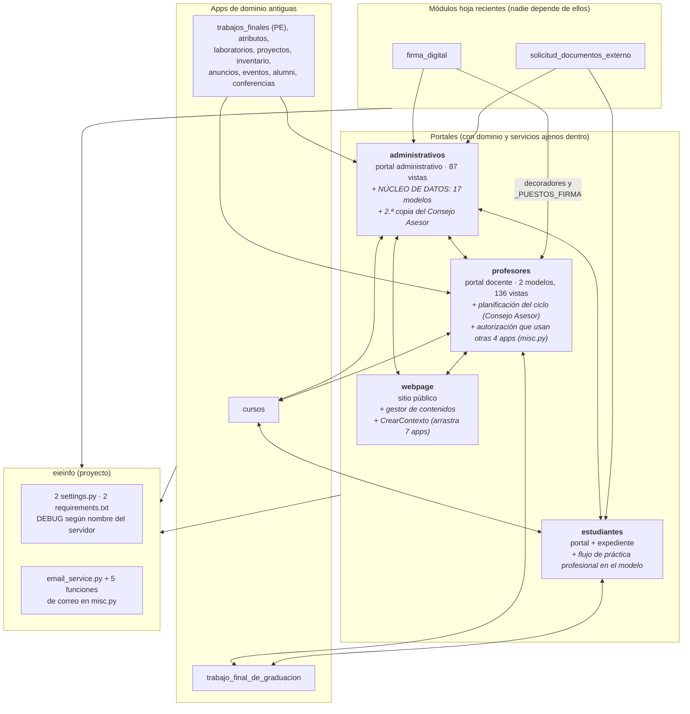
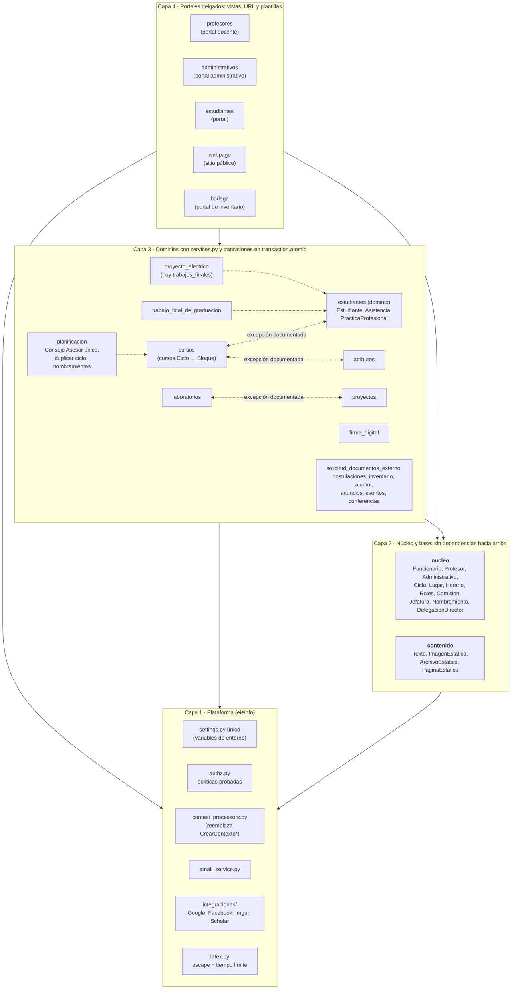
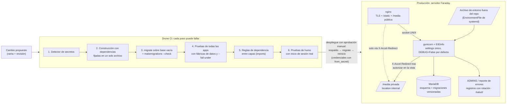
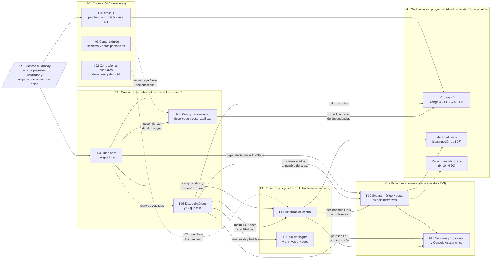

**Universidad de Costa Rica**
**Facultad de Ingeniería — Escuela de Ingeniería Eléctrica**

**IE0417 — Diseño de Software para Ingeniería**

 

# Auditoría de diseño de software del sistema EIEInfo

## Entrega 3: Informe final de auditoría y propuesta de evolución

 

**Estudiante:** Brandon Fuentes Jiménez — C12976

**Profesor:** Esteban Badilla Alvarado

**Ciclo:** II-2026

**Fecha:** 24 de noviembre de 2026

---

## Índice

1. [Resumen ejecutivo final](#1-resumen-ejecutivo-final)
2. [Introducción, alcance y método](#2-introducción-alcance-y-método)
3. [Arquitectura actual y arquitectura objetivo](#3-arquitectura-actual-y-arquitectura-objetivo)
4. [Hoja de ruta de evolución](#4-hoja-de-ruta-de-evolución)
5. [Intervenciones prioritarias](#5-intervenciones-prioritarias)
6. [Matriz de trazabilidad](#6-matriz-de-trazabilidad)
7. [Propuesta de gobierno técnico](#7-propuesta-de-gobierno-técnico)
8. [Respuesta a las preguntas orientadoras](#8-respuesta-a-las-preguntas-orientadoras)
9. [Conclusiones](#9-conclusiones)
10. [Anexos](#10-anexos)

---

## 1. Resumen ejecutivo final

*Sección en redacción.*

---

## 2. Introducción, alcance y método

*Sección en redacción.*

---

## 3. Arquitectura actual y arquitectura objetivo

La Entrega 2 concluyó que el modelo de datos de EIEInfo es razonable y que el problema está en el código que lo rodea (E2 §5.3, §11). Esta sección parte de esa conclusión. La arquitectura objetivo **no cambia de tecnología, de base de datos ni de forma de despliegue**: reorganiza el código existente para que cada pieza esté en la capa que le corresponde y para que esa organización se pueda verificar de forma automática.

### 3.1 Síntesis de la arquitectura actual

EIEInfo es un **monolito Django con patrón MVT**. Las plantillas se renderizan en el servidor, corre en un solo proceso gunicorn (3 *workers*) detrás de nginx en el servidor Faraday y usa una sola base MariaDB (E1 §3). El código se divide en 19 apps instaladas, pero esa división es más nominal que real (E1 §4.3): hay 90 dependencias entre apps y 28 pares mutuos.

Al cruzar los resultados de la E2 se ve que el problema no es que existan muchas apps, sino que **varias responsabilidades están alojadas en una app que no les corresponde**. El diagrama resume la estructura real. El grafo completo está en [`dependencias-apps.mmd`](../diagramas/dependencias-apps.mmd).

*Fuente: [`docs/diagramas/arquitectura-actual.mmd`](../diagramas/arquitectura-actual.mmd).*

La arquitectura actual se puede resumir en seis rasgos:

| # | Rasgo | Evidencia | Hallazgos |
|---|---|---|---|
| A1 | **El núcleo de datos vive dentro de un portal.** `administrativos` tiene los 17 modelos de los que dependen 12 apps y, además, 87 vistas de portal. De sus 9 dependencias salientes, 7 vienen de la capa de portal; las únicas 2 que nacen en `models.py` son relaciones declaradas como cadena de texto | `administrativos/models.py:173-1217`, `:968`, `:1109`; anexo E2 §3.2 | H-06 |
| A2 | **El núcleo está partido entre dos apps.** `Profesor` hereda de `Funcionario`, pero vive en `profesores` y recibe 14 relaciones de 5 apps. Como `profesores.models` importa a `administrativos.models`, el núcleo no puede nombrar a `Profesor` y lo resuelve por el nombre de la clase | `profesores/models.py:5-6,48`; `administrativos/models.py:536-541`; anexo E2 §4.5 | H-06, H-10 |
| A3 | **Los servicios transversales están en apps de dominio.** `profesores/misc.py` contiene la autorización del portal docente, y otras 4 apps la usan también (`atributos`, `firma_digital`, `trabajo_final_de_graduacion` y `postulaciones`). El contexto de las plantillas está en `CrearContexto*`, con 309 llamadas, y `webpage.misc` arrastra 7 apps a quien lo importa. El correo está repartido en 5 mecanismos | `profesores/misc.py:143-543`; `webpage/misc.py:3-11`; anexo E2 §2.4, §4.6 | H-04, H-06, H-09 |
| A4 | **No hay capa de servicios.** Las reglas de negocio están en vistas, formularios, modelos, decoradores y plantillas, y solo `firma_digital` y `postulaciones` usan `transaction.atomic` | `git ls-files \| grep -E "/(services\|selectors)"` → vacío; anexo E2 §5.7 | H-18 |
| A5 | **La identidad está fragmentada.** Hay cuatro almacenes de contraseña y seis marcas de sesión, más un `User` espejo de Django para funcionarios desde 2018 | anexo E2 §4.7 d); `administrativos/models.py:521-553` | H-04, H-17 |
| A6 | **La plataforma no es reproducible.** Las migraciones se regeneran en cada arranque, hay dos `settings.py` y dos `requirements.txt`, el modo producción se decide por el nombre del servidor y el despliegue es manual | `docker/django/migraciones.sh:5-10`; `settings.py:483-493`; `.drone.yml:346-397` | H-03, H-05, H-08 |

Hay un séptimo rasgo, que es positivo: **los módulos recientes ya siguen la forma que se propone como objetivo.** `firma_digital` y `solicitud_documentos_externo` son hojas del grafo (nadie depende de ellas), tienen pruebas con datos propios y `firma_digital/misc.py` concentra la operación de firma en una función de servicio transaccional (`firmar_pdf`, `:33-52`). El problema de EIEInfo no es que el equipo no sepa trabajar de otra forma, sino que esa forma nunca llegó al código de 2016–2018 que sostiene el núcleo.

### 3.2 Principios de la arquitectura objetivo

La arquitectura objetivo se deriva de seis principios. Cada uno responde a un rasgo de la sección anterior:

| Principio | Responde a |
|---|---|
| **P1. El mismo despliegue, la misma base de datos y las mismas tablas.** Los modelos se pueden mover de una app a otra conservando su `db_table`, de modo que la reorganización no migra datos | Restricción de viabilidad: no se puede interrumpir la operación |
| **P2. Capas con dependencia en un solo sentido:** portal → dominio → núcleo → plataforma | A1, A2 |
| **P3. Lo transversal vive en la plataforma y no en un portal:** autorización, contexto de plantillas, correo, integraciones y generación de documentos | A3 |
| **P4. Cada proceso con estado tiene un servicio.** Las transiciones se definen en una tabla y se ejecutan dentro de `transaction.atomic`; la vista solo valida la entrada y responde | A4 |
| **P5. Las reglas se verifican en el CI y no quedan como convención:** dirección de las dependencias, migraciones al día y secretos fuera del repositorio | A6 y la rotación semestral del equipo |
| **P6. Extender lo que ya funciona en el código reciente** en vez de introducir patrones nuevos: `firmar_pdf` como modelo de servicio, `email_service` como modelo de servicio transversal y `firma_digital/tests.py` como modelo de pruebas | Fortaleza observada en §3.1 |

### 3.3 Vista de módulos objetivo

La propuesta es un **monolito modular** de cuatro capas. "Monolito" porque se mantiene un solo proceso, una sola base y un solo despliegue; "modular" porque cada capa tiene responsabilidades y dependencias permitidas explícitas.

*Fuente: [`docs/diagramas/arquitectura-objetivo.mmd`](../diagramas/arquitectura-objetivo.mmd).*

**Contenido de cada capa y de dónde sale**

| Capa | Contenido | De dónde sale en el código actual |
|---|---|---|
| **1. Plataforma** (`eieinfo`) | `settings.py` único que lee variables de entorno; `authz.py` con predicados de acceso ("es director", "pertenece a la comisión X") probados de forma aislada; `context_processors.py`; `email_service.py`; `integraciones/` con adaptadores para Google, Facebook, Imgur y Scholar; `latex.py`; endpoint de salud | Los dos `settings.py` (E1 H-08); los decoradores de `profesores/misc.py:143-543` y `administrativos/misc.py:69-237`; `CrearContexto*`; `eieinfo/email_service.py:16`; `eieinfo/GoogleAPI.py`, `FacebookAPI.py` y las llamadas desde `anuncios/models.py:233` y `proyectos/models.py:190-196`; `GenerarLaTeX` en `eieinfo/misc.py:160-193` |
| **2. Núcleo** (`nucleo`) | Personas internas (`Funcionario`, `Profesor`, `Administrativo`), tiempo (`Ciclo`), espacio (`Lugar`, `Horario`) y organización (`Roles`, `Comision`, `Jefatura`, `Nombramiento`, `DelegacionDirector`) | `administrativos/models.py:173-1217` y `profesores/models.py:48-293`. Los modelos núcleo tienen nombres de tabla explícitos, por ejemplo `funcionarios` y `ciclos_admin` (anexo E2 §3.2) y `profesores` (`profesores/models.py:81`) |
| **2. Base** (`contenido`) | Gestor de contenidos: `Texto`, `ImagenEstatica`, `ArchivoEstatico`, `SeccionesDocs`, `PaginaEstatica` y las funciones `Get*` | `webpage/models.py:7-137` y `webpage/misc.py:40-73`; `models.py` no tiene dependencias externas (anexo E2 §3.6) |
| **3. Dominios** | Una app por proceso de la Escuela, cada una con `services.py` para sus transiciones. La app nueva `planificacion` reúne el Consejo Asesor, que hoy está copiado en dos portales, y los procesos por ciclo. `trabajos_finales` pasa a llamarse `proyecto_electrico` | `profesores/views/consejo_asesor.py` (2117 líneas) y `administrativos/views/consejo_asesor.py` (10 vistas gemelas); `administrativos/duplicar_ciclo.py`, `nombramientos_auto.py`; las transiciones del TFG (`trabajo_final_de_graduacion/views.py:432-627`) y de práctica profesional (`estudiantes/models.py:826-1181`) |
| **4. Portales** | Vistas, URL y plantillas de cada tipo de usuario. No contienen reglas de negocio: llaman servicios y preguntan a `authz` | Lo que queda de `profesores`, `administrativos`, `webpage`, `alumni` e `inventario/views/bodega.py` después de mover lo anterior |

Dos aclaraciones sobre esta tabla:

- **Un portal es un papel, no necesariamente una app.** En `estudiantes` (portal y dominio en el diagrama) y en `alumni`, las vistas del portal pueden quedarse en la misma app que el dominio, siempre que solo llamen servicios. Lo que sí se separa en apps distintas es el caso de `administrativos` y `profesores`, porque ahí la mezcla de papeles es lo que produce los ciclos (A1).
- **Las dos relaciones de modelo de `administrativos` que apuntan hacia fuera no pasan al núcleo.** `ConfirmarCambioEnfasis` (`administrativos/models.py:968`) pertenece al dominio de `estudiantes`, y `LugarCiclo` (`:1109`) es uno de los modelos que el propio código marca como *legacy* (`:1044-1046`). Así el núcleo queda sin dependencias salientes.

**Reglas de dependencia**

| Regla | Contenido | Cómo se verifica |
|---|---|---|
| R1 | Ningún módulo importa a uno de una capa superior | Análisis de imports en el CI (§3.4) |
| R2 | Ningún portal importa a otro portal. Lo que dos portales comparten baja a un dominio o a la plataforma | Análisis de imports |
| R3 | Entre dominios, las dependencias pasan por `services.py` y forman un grafo sin ciclos, salvo los tres ciclos residuales de §3.7 | Análisis de imports contra una **lista cerrada** de tres excepciones (`cursos` ↔ `estudiantes`, `cursos` ↔ `atributos`, `laboratorios` ↔ `proyectos`). Cualquier ciclo nuevo hace fallar el CI. La lista solo se reduce; ampliarla exige una decisión registrada (§7) |
| R4 | El acceso se decide solo con predicados de `eieinfo.authz`. No se comparan nombres de rol o de comisión escritos en el código; se usan constantes asociadas a un `codigo` único | Búsqueda de literales en el CI y pruebas de la matriz rol × vista |
| R5 | Una vista no cambia el estado de un proceso directamente: llama a un servicio que valida la transición y usa `transaction.atomic` | Revisión técnica (§7) |
| R6 | El esquema solo cambia mediante migraciones versionadas | `makemigrations --check` en el CI |

R5 se limita a los procesos con estado o con varias escrituras (TFG, práctica profesional, Proyecto Eléctrico, planificación del ciclo y firma). Exigir un servicio para cada formulario de edición simple agregaría capas sin beneficio.

### 3.4 Vista de operación objetivo

En operación, la propuesta conserva lo que funciona: nginx con TLS y HSTS, gunicorn bajo systemd y el servidor Faraday (E1 §3). Lo que cambia es cómo se configura el sistema, cómo se valida un cambio antes de desplegarlo y cómo se protege lo que se sirve.

*Fuente: [`docs/diagramas/despliegue-objetivo.mmd`](../diagramas/despliegue-objetivo.mmd).*

| Aspecto | Actual | Objetivo |
|---|---|---|
| Configuración | Dos `settings.py`; el de Docker reemplaza al principal; `DEBUG = True` en cualquier equipo que no se llame `faraday` (`settings.py:483-493`) | Un solo `settings.py` que lee variables de entorno, con `DEBUG = False` si la variable no está. En Faraday, los valores se cargan desde un archivo de entorno de systemd que no está en el repositorio |
| Esquema | Migraciones borradas y regeneradas en cada arranque; el CI no ejecuta `migrate` (`.drone.yml:102`) | Migraciones versionadas. El CI aplica `migrate` sobre una base vacía y rechaza el cambio si `makemigrations --check` detecta un modelo sin migración |
| Datos de prueba | Volcados SQL con datos reales cargados ignorando errores (`.drone.yml:95`) y convertidos en *fixtures* con `dumpdata` | Fábricas de datos sintéticos en el código, como ya hace `firma_digital/tests.py` |
| Validación | Las pruebas de humo autenticadas no se autentican y los errores de preparación se descartan (E2 §7.4) | Cada paso del CI puede fallar y bloquear el cambio |
| Despliegue | Manual; el paso `deployment` solo ejecuta `git status` (`.drone.yml:346-397`) | Un paso versionado con aprobación manual: respaldo, `migrate` y reinicio del servicio, con las credenciales en `from_secret` |
| Archivos subidos | nginx sirve todo `/media/` salvo `/media/tfg/` (`conf/etc/nginx/sites-available/eieinfo:76-82`) | Los archivos privados solo se entregan después de que la vista verifica el acceso, por medio de `X-Accel-Redirect` hacia una ubicación `internal`. Es el mismo control que hoy tiene el TFG (`trabajo_final_de_graduacion/views.py:1189-1255`), pero sin que Django tenga que leer el archivo |
| Observabilidad | `ADMINS` vacío, *logger* en `ERROR`, sin rotación ni endpoint de salud (E2 §3.8) | Avisos de error a responsables, registros con rotación y un endpoint `/salud/` que consulte la base |

### 3.5 Diferencias principales entre ambas arquitecturas

| Dimensión | Arquitectura actual | Arquitectura objetivo | ¿Cambia el esquema? |
|---|---|---|---|
| Organización del código | 19 apps con 28 pares mutuos | Cuatro capas con dependencias hacia abajo, verificadas en el CI | No |
| Núcleo de datos | Dentro de `administrativos`, con `Profesor` aparte | App `nucleo` sin dependencias salientes | Solo el estado de las migraciones; las tablas se conservan |
| Autorización | Unos 20 decoradores copiados, que comparan texto | Predicados en `eieinfo/authz.py` y `codigo` único en `Roles` y `Comision` | Agrega un campo |
| Identidad | Cuatro almacenes de contraseña | El `User` de Django como único almacén de credenciales, empezando por los funcionarios (el espejo ya existe) | Sí, en la última fase |
| Lógica de negocio | Repartida entre vistas, formularios, modelos y plantillas | `services.py` por dominio, con transiciones explícitas y transacciones | No |
| Contexto de plantillas | `CrearContexto*`, importado desde cada portal | *Context processors* de la plataforma | No |
| Consejo Asesor | Dos copias, en `profesores` y `administrativos` | Una sola implementación en `planificacion`, con los nombres de ruta `prof_*` y `admn_*` como alias | No |
| Plataforma | No reproducible (A6) | Configuración, dependencias y esquema versionados; CI que falla | No |

**Lo que se conserva a propósito:** Django con plantillas del servidor, MariaDB, todos los nombres de tabla, nginx, gunicorn y systemd en Faraday, `django-polymorphic`, las URL públicas y los nombres de ruta (como alias mientras haga falta). También se conservan sin cambios de fondo los módulos que ya cumplen la forma objetivo: `firma_digital`, `solicitud_documentos_externo` y `email_service`.

### 3.6 Problemas que la arquitectura objetivo busca resolver

La E2 identificó tres cadenas causales (E2 §9.3). La arquitectura objetivo está pensada para cortar cada cadena en su causa y no solo en su síntoma:

| Cadena causal (E2 §9.3) | Dónde se corta | Hallazgos que atiende |
|---|---|---|
| **Esquema → datos de prueba → datos personales** | Migraciones versionadas (R6) y fábricas de datos sintéticos (§3.4). Al dejar de depender de los volcados, se pueden retirar del repositorio | H-03, H-11, H-02 |
| **Acoplamiento → copia → defecto copiado** | Núcleo sin dependencias salientes (A1, A2), contexto en la plataforma y Consejo Asesor único. Al poder importar lo común sin crear ciclos, deja de ser necesario copiarlo | H-06, H-17, H-16, H-09 |
| **Autorización artesanal + reglas por texto → accesos indebidos** | Un solo módulo de políticas con pruebas (R4) y roles identificados por `codigo` | H-04, H-19, H-13 |

Además, la plataforma objetivo atiende la configuración divergente, el CI que no falla y la observabilidad (H-08, H-05, H-12), y es la condición para actualizar Django con seguridad (H-07). La capa de servicios atiende H-18. La entrega controlada de archivos y el escape de LaTeX en `latex.py` atienden parte de H-15 y H-14. El paso a `nucleo`, `proyecto_electrico` y `Bloque` es la oportunidad para corregir los nombres que hoy confunden (H-10, H-20).

**Lo que la arquitectura objetivo no resuelve por sí sola:**

- **La complejidad interna de los módulos recientes.** `firma_digital/views.py` (2918 líneas, CC acumulada 492) ya está en la capa correcta; dividirlo es una tarea interna del módulo, no un cambio de arquitectura.
- **La política de borrado.** 80 de 141 llaves foráneas usan `DO_NOTHING` (E2 §5.4). Mover modelos no decide qué debe pasar con los grupos de un profesor que se va: esa decisión hay que tomarla relación por relación, con criterio de negocio.
- **Los 119 bloques `autoescape off`.** Se retiran plantilla por plantilla (H-14). La arquitectura solo ofrece el lugar donde poner el saneamiento.

### 3.7 Trade-offs y costos de transición

**Alternativas descartadas**

| Alternativa | Por qué se descarta para EIEInfo |
|---|---|
| **Reescritura** | El sistema contiene unos diez años de reglas de la Escuela, muchas sin documentar fuera del código, y 1166 pruebas que se perderían o habría que rehacer. Mientras dure la reescritura habría que mantener dos sistemas, con un equipo que cambia cada semestre |
| **Microservicios** | 81 relaciones de modelo cruzan apps y la mitad termina en cuatro entidades centrales (E2 §5.3). Separar servicios obligaría a partir la base o a compartirla, y a coordinar transacciones entre procesos. Además, la operación es un solo servidor sin contenedores en producción. El costo operativo no corresponde al tamaño del equipo ni del problema |
| **API REST + frontend separado** | Ningún consumidor del repositorio lo necesita: el sistema es coherente en MVT (E2 §3.7). Agregarlo duplicaría la superficie que hay que proteger, justo cuando la autorización es el punto débil |

**Trade-offs de la propuesta**

| Decisión | Se gana | Se paga |
|---|---|---|
| Conservar los `db_table` al mover modelos | La reorganización no toca datos | Quedan nombres de tabla engañosos: el bloque de un plan sigue en la tabla `ciclos` y hay tablas con sufijo `_tfg_v6`. Se documentan en un glosario en lugar de renombrarlas |
| Capa de servicios solo para procesos con estado (R5) | Las reglas importantes se pueden probar sin HTTP ni plantillas | Durante la transición conviven vistas antiguas con lógica y vistas nuevas delgadas. Hay que aceptar esa inconsistencia temporal |
| *Context processors* en lugar de `CrearContexto*` | Las vistas dejan de importar a los portales | Un *context processor* se ejecuta en todas las plantillas. `CrearContextoProfesor` hace al menos 12 consultas por petición (anexo E2 §2.4), así que debe devolver objetos de evaluación perezosa y activarse solo en el portal que lo usa. Si no, el cambio empeora el rendimiento del sitio público |
| Reglas de dependencia en el CI | La modularidad no depende de la memoria del equipo | Al inicio el chequeo bloqueará cambios que hoy pasan, y la lista cerrada de excepciones obliga a justificar por escrito cualquier ciclo nuevo |
| Alias de nombres de ruta `prof_*` y `admn_*` | No se rompen las plantillas ni los enlaces existentes | Dos nombres para la misma vista hasta que se retire el alias |

**Ciclos residuales.** La propuesta elimina los ciclos que nacen de `administrativos` y de `webpage.misc`, pero no todos. E2 §5.4 identificó cinco relaciones de modelo que cierran ciclos. Una se resuelve al sacar `ConfirmarCambioEnfasis` del núcleo y otra desaparece si se elimina `LugarCiclo`. Las otras tres, `cursos` ↔ `estudiantes` (`cursos/models.py:580` frente a `estudiantes/models.py:144`), `cursos` ↔ `atributos` (`cursos/models.py:502`) y `laboratorios` ↔ `proyectos` (`laboratorios/models.py:68`), están en el esquema. Romperlas exige decidir qué dominio es dueño de cada relación. La propuesta las acepta como **excepciones documentadas a R3**, en una lista cerrada que el CI verifica: puede reducirse, pero cualquier ciclo nuevo hace fallar la verificación. No las resuelve en esta etapa porque cambiar una relación muchos a muchos sí toca el esquema. En el diagrama de §3.3 aparecen como líneas punteadas en ambos sentidos.

**Costos de transición**

| Transición | Costo principal | Cómo se acota |
|---|---|---|
| Mover modelos a `nucleo` | Requiere migraciones con `SeparateDatabaseAndState` para cambiar el estado sin tocar las tablas. Por eso exige **antes** una línea base de migraciones (H-03): sin migraciones versionadas no existe un estado que mover | Primero la línea base; luego un movimiento por modelo, empezando por los que tienen menos relaciones entrantes |
| Mover modelos polimórficos | `Funcionario` es un `PolymorphicModel` (`administrativos/models.py:345`). `django-polymorphic` guarda en cada fila el tipo de contenido (`ContentType`) de su clase, que incluye el nombre de la app. Al mover `Funcionario`, `Profesor` y `Administrativo`, hay que actualizar sus filas de `django_content_type` dentro de la misma migración. Esto se deduce de cómo funciona la biblioteca; **no se probó contra EIEInfo** | Hacerlo en una migración de datos, ensayada sobre una copia de producción y con respaldo previo |
| Verificar `db_table` | Se verificó para `Profesor` (`profesores/models.py:81`) y para los modelos núcleo que cita el anexo E2 §3.2. **Pendiente:** revisar uno por uno los modelos que se muevan; si alguno usa el nombre por defecto, moverlo sí cambiaría su tabla | Revisión explícita antes de cada movimiento |
| Unificar la autorización | Mientras conviven decoradores antiguos y predicados nuevos, un error puede abrir o cerrar accesos | La matriz de pruebas rol × vista se escribe **antes** de tocar los decoradores, y cada decorador pasa a ser un envoltorio delgado del predicado |
| Unificar la identidad | Afecta el inicio de sesión de todos los usuarios | Se deja para la última fase y se empieza por los funcionarios, que ya tienen `User` espejo (`administrativos/models.py:521-553`) |
| Costo organizacional | Durante las fases de saneamiento el equipo entrega poca funcionalidad visible | Cada fase se diseña para cerrarse dentro de un semestre y deja beneficios medibles: secretos rotados, un CI que falla y pruebas que no dependen del volcado (§4) |

---

## 4. Hoja de ruta de evolución

La hoja de ruta ordena las diez intervenciones de la §5 en cinco fases. Su lógica viene de la conclusión de la E2: los hallazgos urgentes son síntomas, y antes de reestructurar hay que crear las condiciones para cambiar sin riesgo (E2 §9.3, §11). Por eso se aparta en un punto del ejemplo del enunciado: **pruebas y seguridad (F2) van antes que la refactorización modular (F3)**. La razón es concreta. Mover modelos de app (I-09) rompe las 454 pruebas que cargan *fixtures* atados al nombre de la app. Unificar los decoradores sin una matriz de pruebas puede abrir o cerrar accesos sin que nadie lo note (E2 §7.5). Ambas condiciones se construyen en F1 y F2.

**Escala de esfuerzo.** El esfuerzo es relativo. Supone un equipo pequeño de estudiantes con dedicación parcial que cambia cada semestre, como sugiere el historial (E1 §8). El tamaño real del equipo no se puede determinar desde el repositorio.

| Nivel | Referencia |
|---|---|
| Bajo | Unas semanas; cabe en el primer mes |
| Medio | Alrededor de medio semestre |
| Alto | Alrededor de un semestre |
| Muy alto | Más de un semestre |

### 4.1 Vista general

| Fase | Ventana indicativa | Intervenciones | Hallazgos que atiende | Esfuerzo | Criterio de salida (verificable) |
|---|---|---|---|---|---|
| **F0** Contención | Primer mes | I-01, I-02, I-03 (etapa 1) | H-01, H-02, H-13, H-16, H-07 | Bajo | Credenciales S-1 a S-5 rotadas; `git ls-files` ya no lista los dos CSV; cada defecto de H-13 y H-16 tiene una prueba que falla con el código anterior; producción en Django 4.1.13 |
| **F1** Saneamiento habilitante | Resto del primer semestre | I-04, I-05, I-06 | H-03, H-11, H-05, H-08, H-12, H-02 | Alto | `migraciones.sh` ya no borra migraciones; `init.sql` y `testing.sql` fuera del repositorio; se comprueba a propósito que el CI falla ante un error de SQL y ante una prueba rota; un solo `settings.py` |
| **F2** Pruebas y seguridad de la frontera | Segundo semestre | I-07, I-08 | H-04, H-19, H-13, H-14, H-15, H-09 | Alto | Cada decorador tiene sus casos en la matriz rol × vista (permitido, denegado, sin sesión); `git grep` no encuentra literales de rol en el código; `/media` privada no responde sin pasar por la vista |
| **F3** Refactorización modular | Semestres 2 y 3 | I-09, I-10 | H-06, H-09, H-17, H-18, H-10 | Muy alto | `nucleo` no importa ninguna app de una capa superior; entre las apps solo quedan las 3 excepciones de §3.7 como pares mutuos (medido con un análisis de imports como el de `docs/anexos/scripts/metrics.py`); `resumen_ciclo` existe una sola vez |
| **F4** Modernización progresiva | Desde el cierre de F1, en paralelo con F2 y F3 | I-03 (etapa 2); identidad única; renombres y limpieza | H-07, H-04, H-17, H-10, H-20 | Alto, repartido | Django en una rama LTS con soporte; `Funcionario.contraseña` ya no se usa para autenticar |

F4 no espera a F3, por el calendario de Django. Según el proyecto Django, la rama 4.2 LTS llegó al fin de su soporte extendido el 7 de abril de 2026 [R1], y la 5.2 LTS recibe correcciones de seguridad hasta abril de 2028 [R2]. Por eso **el destino de la migración es 5.2**. La 4.2 aparece en la ruta solo como paso intermedio, ya sin soporte: no es un lugar donde el sistema deba quedarse. Si la etapa 2 de I-03 se dejara para después de F3, el sistema llegaría a 5.2 cuando a esa rama le quede poco soporte. Por eso esa etapa arranca en cuanto F1 entrega la red de pruebas y el archivo único de dependencias. Las otras dos líneas de F4 sí dependen de F2 y F3 (§4.3).

### 4.2 Fases y dependencias

*Fuente: [`docs/diagramas/hoja-de-ruta.mmd`](../diagramas/hoja-de-ruta.mmd).*

### 4.3 Dependencias entre intervenciones

| Intervención | Depende de | Tipo | Motivo |
|---|---|---|---|
| I-03 etapa 1 | PRE: paquetes instalados en Faraday | Fuerte | No se puede determinar con qué lista de paquetes se instaló producción (E2 §8.4). Actualizar sin saberlo puede mover también otras dependencias |
| I-04 | PRE: esquema de la base de Faraday, sin datos | Fuerte | La línea base debe generarse contra un esquema equivalente al de producción (H-03); hoy la coincidencia no se puede determinar |
| I-05 | I-04 | Parcial | Las fábricas pueden empezar antes. Retirar `init.sql` y `testing.sql` exige que el esquema venga de migraciones versionadas |
| I-06 | I-04 | Fuerte, solo para el despliegue | El paso de despliegue ejecuta `migrate`, que necesita migraciones versionadas |
| I-06 | I-01 | Parcial | I-01 saca de los archivos versionados los secretos rotados; I-06 generaliza eso a variables de entorno |
| I-07 | I-04, I-05 | Fuerte | El campo `codigo` y la restricción de ciclo actual son cambios de esquema. La matriz rol × vista necesita fábricas de `Funcionario`, `Roles` y `Comision` |
| I-07 | I-02 | Parcial | I-07 reemplaza con predicados los parches de I-02; las pruebas de I-02 se conservan como regresión |
| I-08 | I-05 | Fuerte | Para retirar `autoescape off` hay que tener pruebas de plantillas con contenido de usuario (E2 §7.5) |
| I-09 | I-04, I-05, I-07 | Fuerte | Usa `SeparateDatabaseAndState`. Los *fixtures* volcados llevan el nombre de la app en cada objeto (`administrativos.funcionario`) y dejarían de cargar. Si los decoradores siguen en `profesores`, el núcleo seguiría arrastrando al portal |
| I-10 | I-09, I-05, I-07 | Fuerte | `planificacion` debe depender de `nucleo` y no del portal `administrativos`. Hacen falta pruebas de caracterización de práctica profesional y Proyecto Eléctrico antes de extraer sus servicios. El Consejo Asesor único necesita un predicado de acceso que acepte las dos sesiones |
| I-03 etapa 2 | I-03 etapa 1, I-04, I-05, I-06 | Fuerte | El salto de rama necesita la red de pruebas, migraciones versionadas para las apps de Django y un solo archivo de dependencias |
| Identidad única | I-07, I-09 | Fuerte | Exige que el acceso ya se decida en `authz` y que `Funcionario` esté en `nucleo` |

### 4.4 Fichas de fase

**F0 · Contención**

| | |
|---|---|
| Objetivo | Cerrar las exposiciones que se pueden explotar hoy, sin tocar la estructura |
| Alcance | I-01 (rotación, CSV, hashes y sesiones de los volcados), I-02 (4 decoradores, redirección abierta, `login_webservice`, `webservice_profesor`, código de postulación, 15 borrados por GET, 5 sitios de H-16), I-03 etapa 1 (3 *widgets* del TFG, Django 4.1.13, gunicorn 22, Pillow, retiro de PyPDF2) |
| Beneficio | Elimina los accesos indebidos conocidos y las vulnerabilidades más expuestas (Pillow ante imágenes subidas, *request smuggling* en gunicorn). Deja de importar si S-1 sigue vigente |
| Riesgos | Si no se coordina, la rotación puede cortar el correo o el CI (no se sabe cuál de S-3 y S-4 está vigente). Hay que actualizar sin un CI que falle (mitigación en I-03, §5). Corregir un decorador puede cerrar accesos que hoy se usan gracias al defecto |
| Dependencias | PRE para I-03. Acceso a las cuentas de los servicios externos para I-01 |
| Esfuerzo | Bajo |

**F1 · Saneamiento habilitante**

| | |
|---|---|
| Objetivo | Que el sistema pueda cambiar de forma reproducible y que un error haga fallar el CI |
| Alcance | I-04 (migraciones iniciales, `--fake-initial`, `migraciones.sh` sin borrado); I-05 (fábricas, *fixture* sintético de transición, retiro de volcados, CI sin `-f` ni `2> /dev/null`, todas las apps y las pruebas JS, `--fail-under`, humo con login real); I-06 (`settings.py` y dependencias únicos, despliegue desde el CI, `ADMINS`, *logger*, rotación, `/salud/`, tiempo límite de `pdflatex`) |
| Beneficio | Corta la cadena esquema → datos de prueba → datos personales (E2 §9.3). Desde aquí, todo cambio de modelo se revisa como una migración |
| Riesgos | El esquema de producción puede no coincidir con los modelos. Rehacer los datos de 454 pruebas es la tarea más larga del plan. Cambiar la configuración de producción puede impedir que el servicio arranque |
| Dependencias | PRE para I-04; I-04 antes del retiro de volcados y del paso de despliegue |
| Esfuerzo | Alto |

**F2 · Pruebas y seguridad de la frontera**

| | |
|---|---|
| Objetivo | Atacar la causa de H-13 y cerrar la frontera por donde entran y salen datos |
| Alcance | I-07 (`eieinfo/authz.py`, matriz para los unos 20 decoradores, `codigo` en `Roles` y `Comision`, un solo ciclo actual, permisos fuera de la sesión, límite de intentos); I-08 (`bleach` declarado, retiro de `autoescape off` por prioridad, filtro de escape LaTeX, `/media` privada con `X-Accel-Redirect`) |
| Beneficio | La autorización se revisa y se prueba en un solo lugar, y renombrar un rol desde `/admin/` deja de cambiar quién tiene acceso |
| Riesgos | Convivencia temporal de decoradores viejos y predicados nuevos. Si se escapa sin sanear antes, el HTML legítimo de los contenidos editados aparece como texto. El cambio de nginx hay que coordinarlo con quien administra Faraday |
| Dependencias | I-04 e I-05 |
| Esfuerzo | Alto (I-07 e I-08 son de esfuerzo medio cada una) |

**F3 · Refactorización modular**

| | |
|---|---|
| Objetivo | Llevar el código a la arquitectura objetivo de §3.3 |
| Alcance | I-09 (`nucleo`, `contenido`, *context processors*, reglas de imports en el CI); I-10 (`planificacion`, servicios de práctica profesional, TFG y Proyecto Eléctrico, procesos por lotes dentro de `atomic`); eliminar los pares mutuos de código que no están en la lista de excepciones |
| Beneficio | Se elimina el origen de la mayoría de los 28 pares mutuos, y una corrección se hace una sola vez en lugar de copiarse |
| Riesgos | Mover los modelos polimórficos (`django_content_type`, §3.7). Regresiones en las vistas más complejas (`editar_grupo`, CC 33). Conflictos con otros grupos que trabajen sobre `consejo_asesor.py` (14 commits en 12 meses) |
| Dependencias | F1 completa e I-07 |
| Esfuerzo | Muy alto |

**F4 · Modernización progresiva**

| | |
|---|---|
| Objetivo | Volver a una pila con soporte y saldar la deuda que queda |
| Alcance | I-03 etapa 2 (4.1 → 4.2, solo como paso intermedio y ya sin soporte [R1] → 5.2 LTS como destino [R2], imagen base en lugar de `python:buster`, reemplazo de `oauth2client`, fin del parche con `sed` de `django-tagging`, imágenes Docker con versión fija). Identidad única, primero para funcionarios y luego para estudiantes y egresados. Renombres (`proyecto_electrico`, `Bloque`) y limpieza de código comentado y modelos *legacy*, esta última después de confirmar con datos de producción que no se usan |
| Beneficio | El sistema vuelve a recibir parches de seguridad y queda un solo almacén de credenciales |
| Riesgos | Cada salto de versión de Django trae cambios incompatibles. La identidad única cambia el inicio de sesión de todos los usuarios |
| Dependencias | §4.3 |
| Esfuerzo | Alto, repartido en el tiempo |

### 4.5 Reglas para ejecutar la hoja de ruta

- **Una fase se cierra con su criterio de salida, no por fecha.** Si una fase se atrasa, se recorta su alcance, no el orden. F3 no empieza hasta que se cumplen los criterios de F1 y existe la matriz de I-07.
- **Cada intervención se divide en cambios pequeños que se pueden desplegar por separado.** Ninguna exige detener el sistema más allá del reinicio habitual de gunicorn. Las que tocan el esquema (I-04, I-07, I-09) se ensayan antes sobre una copia de la base de producción.
- **Lo que tiene prioridad P4 no tiene fase propia:** se hace cuando se toca la zona por otro motivo (regla de §7).

---

## 5. Intervenciones prioritarias

*Sección en redacción.*

---

## 6. Matriz de trazabilidad

*Sección en redacción.*

---

## 7. Propuesta de gobierno técnico

*Sección en redacción.*

---

## 8. Respuesta a las preguntas orientadoras

*Sección en redacción.*

---

## 9. Conclusiones

*Sección en redacción.*

---

## 10. Anexos

| Anexo | Contenido |
|---|---|
| [`docs/diagramas/arquitectura-actual.mmd`](../diagramas/arquitectura-actual.mmd) | Capas reales de la arquitectura actual y sus ciclos principales |
| [`docs/diagramas/arquitectura-objetivo.mmd`](../diagramas/arquitectura-objetivo.mmd) | Monolito modular objetivo en cuatro capas |
| [`docs/diagramas/despliegue-objetivo.mmd`](../diagramas/despliegue-objetivo.mmd) | Operación objetivo: CI y producción |
| [`docs/diagramas/hoja-de-ruta.mmd`](../diagramas/hoja-de-ruta.mmd) | Fases de la hoja de ruta y dependencias entre intervenciones |
| [`docs/entrega-2/entrega-2.md`](../entrega-2/entrega-2.md) y [`docs/anexos/levantamiento-e2.md`](../anexos/levantamiento-e2.md) | Registro de hallazgos H-01 a H-20 y evidencia en la que se basa esta entrega |
| [`docs/diagramas/dependencias-apps.mmd`](../diagramas/dependencias-apps.mmd), [`dominio.mmd`](../diagramas/dominio.mmd), [`relaciones-hallazgos.mmd`](../diagramas/relaciones-hallazgos.mmd) | Diagramas de las entregas anteriores |

**Referencias externas**

| Ref. | Fuente | Dato que respalda |
|---|---|---|
| [R1] | Django Software Foundation, "Django security releases issued", 7 de abril de 2026. <https://www.djangoproject.com/weblog/2026/apr/07/security-releases/> | Fin del soporte extendido de Django 4.2 LTS |
| [R2] | Django Software Foundation, página de descargas y calendario de soporte. <https://www.djangoproject.com/download/> | Django 5.2 LTS recibe correcciones de seguridad hasta abril de 2028 |
