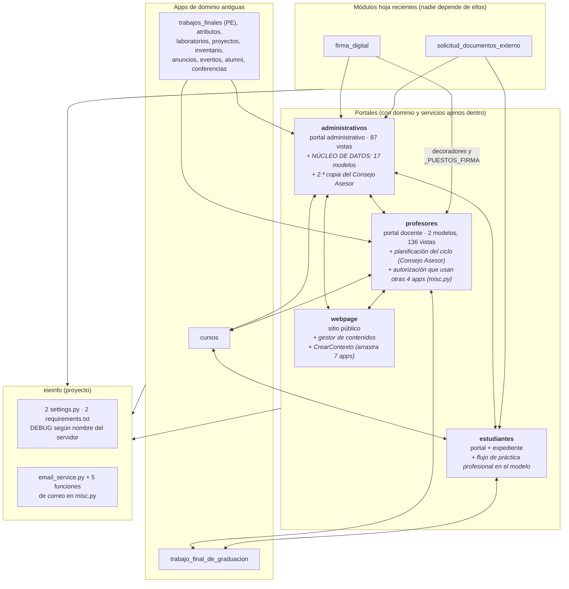
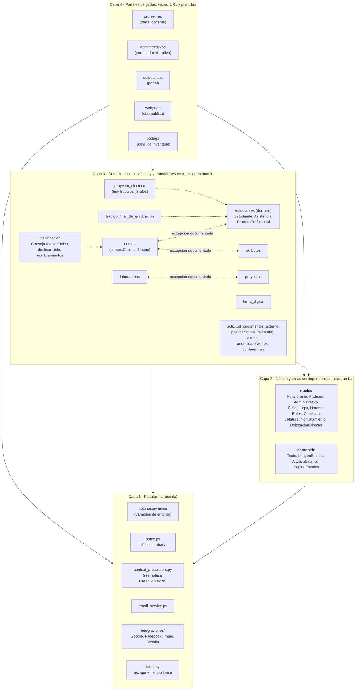
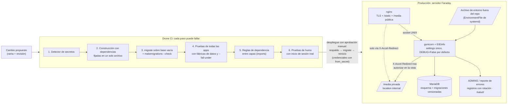
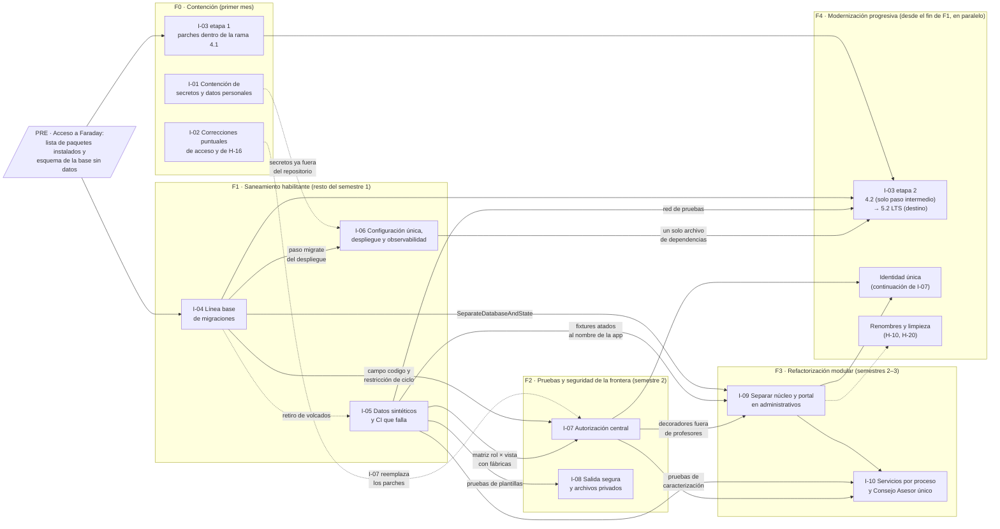

**Universidad de Costa Rica**
**Facultad de Ingeniería — Escuela de Ingeniería Eléctrica**

**IE0417 — Diseño de Software para Ingeniería**

 

# Auditoría de diseño de software del sistema EIEInfo

## Entrega 3: Informe final de auditoría y propuesta de evolución

 

**Estudiante:** Brandon Fuentes Jiménez — C12976

**Profesor:** Esteban Badilla Alvarado

**Ciclo:** II-2026

**Fecha:** 24 de noviembre de 2026

---

## Índice

1. [Resumen ejecutivo final](#1-resumen-ejecutivo-final)
2. [Introducción, alcance y método](#2-introducción-alcance-y-método)
3. [Arquitectura actual y arquitectura objetivo](#3-arquitectura-actual-y-arquitectura-objetivo)
4. [Hoja de ruta de evolución](#4-hoja-de-ruta-de-evolución)
5. [Intervenciones prioritarias](#5-intervenciones-prioritarias)
6. [Matriz de trazabilidad](#6-matriz-de-trazabilidad)
7. [Propuesta de gobierno técnico](#7-propuesta-de-gobierno-técnico)
8. [Respuesta a las preguntas orientadoras](#8-respuesta-a-las-preguntas-orientadoras)
9. [Conclusiones](#9-conclusiones)
10. [Anexos](#10-anexos)

---

## 1. Resumen ejecutivo final

*Sección en redacción.*

---

## 2. Introducción, alcance y método

*Sección en redacción.*

---

## 3. Arquitectura actual y arquitectura objetivo

La Entrega 2 concluyó que el modelo de datos de EIEInfo es razonable y que el problema está en el código que lo rodea (E2 §5.3, §11). Esta sección parte de esa conclusión. La arquitectura objetivo **no cambia de tecnología, de base de datos ni de forma de despliegue**: reorganiza el código existente para que cada pieza esté en la capa que le corresponde y para que esa organización se pueda verificar de forma automática.

### 3.1 Síntesis de la arquitectura actual

EIEInfo es un **monolito Django con patrón MVT**. Las plantillas se renderizan en el servidor, corre en un solo proceso gunicorn (3 *workers*) detrás de nginx en el servidor Faraday y usa una sola base MariaDB (E1 §3). El código se divide en 19 apps instaladas, pero esa división es más nominal que real (E1 §4.3): hay 90 dependencias entre apps y 28 pares mutuos.

Al cruzar los resultados de la E2 se ve que el problema no es que existan muchas apps, sino que **varias responsabilidades están alojadas en una app que no les corresponde**. El diagrama resume la estructura real. El grafo completo está en [`dependencias-apps.mmd`](../diagramas/dependencias-apps.mmd).

*Fuente: [`docs/diagramas/arquitectura-actual.mmd`](../diagramas/arquitectura-actual.mmd).*

La arquitectura actual se puede resumir en seis rasgos:

| # | Rasgo | Evidencia | Hallazgos |
|---|---|---|---|
| A1 | **El núcleo de datos vive dentro de un portal.** `administrativos` tiene los 17 modelos de los que dependen 12 apps y, además, 87 vistas de portal. De sus 9 dependencias salientes, 7 vienen de la capa de portal; las únicas 2 que nacen en `models.py` son relaciones declaradas como cadena de texto | `administrativos/models.py:173-1217`, `:968`, `:1109`; anexo E2 §3.2 | H-06 |
| A2 | **El núcleo está partido entre dos apps.** `Profesor` hereda de `Funcionario`, pero vive en `profesores` y recibe 14 relaciones de 5 apps. Como `profesores.models` importa a `administrativos.models`, el núcleo no puede nombrar a `Profesor` y lo resuelve por el nombre de la clase | `profesores/models.py:5-6,48`; `administrativos/models.py:536-541`; anexo E2 §4.5 | H-06, H-10 |
| A3 | **Los servicios transversales están en apps de dominio.** `profesores/misc.py` contiene la autorización del portal docente, y otras 4 apps la usan también (`atributos`, `firma_digital`, `trabajo_final_de_graduacion` y `postulaciones`). El contexto de las plantillas está en `CrearContexto*`, con 309 llamadas, y `webpage.misc` arrastra 7 apps a quien lo importa. El correo está repartido en 5 mecanismos | `profesores/misc.py:143-543`; `webpage/misc.py:3-11`; anexo E2 §2.4, §4.6 | H-04, H-06, H-09 |
| A4 | **No hay capa de servicios.** Las reglas de negocio están en vistas, formularios, modelos, decoradores y plantillas, y solo `firma_digital` y `postulaciones` usan `transaction.atomic` | `git ls-files \| grep -E "/(services\|selectors)"` → vacío; anexo E2 §5.7 | H-18 |
| A5 | **La identidad está fragmentada.** Hay cuatro almacenes de contraseña y seis marcas de sesión, más un `User` espejo de Django para funcionarios desde 2018 | anexo E2 §4.7 d); `administrativos/models.py:521-553` | H-04, H-17 |
| A6 | **La plataforma no es reproducible.** Las migraciones se regeneran en cada arranque, hay dos `settings.py` y dos `requirements.txt`, el modo producción se decide por el nombre del servidor y el despliegue es manual | `docker/django/migraciones.sh:5-10`; `settings.py:483-493`; `.drone.yml:346-397` | H-03, H-05, H-08 |

Hay un séptimo rasgo, que es positivo: **los módulos recientes ya siguen la forma que se propone como objetivo.** `firma_digital` y `solicitud_documentos_externo` son hojas del grafo (nadie depende de ellas), tienen pruebas con datos propios y `firma_digital/misc.py` concentra la operación de firma en una función de servicio transaccional (`firmar_pdf`, `:33-52`). El problema de EIEInfo no es que el equipo no sepa trabajar de otra forma, sino que esa forma nunca llegó al código de 2016–2018 que sostiene el núcleo.

### 3.2 Principios de la arquitectura objetivo

La arquitectura objetivo se deriva de seis principios. Cada uno responde a un rasgo de la sección anterior:

| Principio | Responde a |
|---|---|
| **P1. El mismo despliegue, la misma base de datos y las mismas tablas.** Los modelos se pueden mover de una app a otra conservando su `db_table`, de modo que la reorganización no migra datos | Restricción de viabilidad: no se puede interrumpir la operación |
| **P2. Capas con dependencia en un solo sentido:** portal → dominio → núcleo → plataforma | A1, A2 |
| **P3. Lo transversal vive en la plataforma y no en un portal:** autorización, contexto de plantillas, correo, integraciones y generación de documentos | A3 |
| **P4. Cada proceso con estado tiene un servicio.** Las transiciones se definen en una tabla y se ejecutan dentro de `transaction.atomic`; la vista solo valida la entrada y responde | A4 |
| **P5. Las reglas se verifican en el CI y no quedan como convención:** dirección de las dependencias, migraciones al día y secretos fuera del repositorio | A6 y la rotación semestral del equipo |
| **P6. Extender lo que ya funciona en el código reciente** en vez de introducir patrones nuevos: `firmar_pdf` como modelo de servicio, `email_service` como modelo de servicio transversal y `firma_digital/tests.py` como modelo de pruebas | Fortaleza observada en §3.1 |

### 3.3 Vista de módulos objetivo

La propuesta es un **monolito modular** de cuatro capas. "Monolito" porque se mantiene un solo proceso, una sola base y un solo despliegue; "modular" porque cada capa tiene responsabilidades y dependencias permitidas explícitas.

*Fuente: [`docs/diagramas/arquitectura-objetivo.mmd`](../diagramas/arquitectura-objetivo.mmd).*

**Contenido de cada capa y de dónde sale**

| Capa | Contenido | De dónde sale en el código actual |
|---|---|---|
| **1. Plataforma** (`eieinfo`) | `settings.py` único que lee variables de entorno; `authz.py` con predicados de acceso ("es director", "pertenece a la comisión X") probados de forma aislada; `context_processors.py`; `email_service.py`; `integraciones/` con adaptadores para Google, Facebook, Imgur y Scholar; `latex.py`; endpoint de salud | Los dos `settings.py` (E1 H-08); los decoradores de `profesores/misc.py:143-543` y `administrativos/misc.py:69-237`; `CrearContexto*`; `eieinfo/email_service.py:16`; `eieinfo/GoogleAPI.py`, `FacebookAPI.py` y las llamadas desde `anuncios/models.py:233` y `proyectos/models.py:190-196`; `GenerarLaTeX` en `eieinfo/misc.py:160-193` |
| **2. Núcleo** (`nucleo`) | Personas internas (`Funcionario`, `Profesor`, `Administrativo`), tiempo (`Ciclo`), espacio (`Lugar`, `Horario`) y organización (`Roles`, `Comision`, `Jefatura`, `Nombramiento`, `DelegacionDirector`) | `administrativos/models.py:173-1217` y `profesores/models.py:48-293`. Los modelos núcleo tienen nombres de tabla explícitos, por ejemplo `funcionarios` y `ciclos_admin` (anexo E2 §3.2) y `profesores` (`profesores/models.py:81`) |
| **2. Base** (`contenido`) | Gestor de contenidos: `Texto`, `ImagenEstatica`, `ArchivoEstatico`, `SeccionesDocs`, `PaginaEstatica` y las funciones `Get*` | `webpage/models.py:7-137` y `webpage/misc.py:40-73`; `models.py` no tiene dependencias externas (anexo E2 §3.6) |
| **3. Dominios** | Una app por proceso de la Escuela, cada una con `services.py` para sus transiciones. La app nueva `planificacion` reúne el Consejo Asesor, que hoy está copiado en dos portales, y los procesos por ciclo. `trabajos_finales` pasa a llamarse `proyecto_electrico` | `profesores/views/consejo_asesor.py` (2117 líneas) y `administrativos/views/consejo_asesor.py` (10 vistas gemelas); `administrativos/duplicar_ciclo.py`, `nombramientos_auto.py`; las transiciones del TFG (`trabajo_final_de_graduacion/views.py:432-627`) y de práctica profesional (`estudiantes/models.py:826-1181`) |
| **4. Portales** | Vistas, URL y plantillas de cada tipo de usuario. No contienen reglas de negocio: llaman servicios y preguntan a `authz` | Lo que queda de `profesores`, `administrativos`, `webpage`, `alumni` e `inventario/views/bodega.py` después de mover lo anterior |

Dos aclaraciones sobre esta tabla:

- **Un portal es un papel, no necesariamente una app.** En `estudiantes` (portal y dominio en el diagrama) y en `alumni`, las vistas del portal pueden quedarse en la misma app que el dominio, siempre que solo llamen servicios. Lo que sí se separa en apps distintas es el caso de `administrativos` y `profesores`, porque ahí la mezcla de papeles es lo que produce los ciclos (A1).
- **Las dos relaciones de modelo de `administrativos` que apuntan hacia fuera no pasan al núcleo.** `ConfirmarCambioEnfasis` (`administrativos/models.py:968`) pertenece al dominio de `estudiantes`, y `LugarCiclo` (`:1109`) es uno de los modelos que el propio código marca como *legacy* (`:1044-1046`). Así el núcleo queda sin dependencias salientes.

**Reglas de dependencia**

| Regla | Contenido | Cómo se verifica |
|---|---|---|
| R1 | Ningún módulo importa a uno de una capa superior | Análisis de imports en el CI (§3.4) |
| R2 | Ningún portal importa a otro portal. Lo que dos portales comparten baja a un dominio o a la plataforma | Análisis de imports |
| R3 | Entre dominios, las dependencias pasan por `services.py` y forman un grafo sin ciclos, salvo los tres ciclos residuales de §3.7 | Análisis de imports contra una **lista cerrada** de tres excepciones (`cursos` ↔ `estudiantes`, `cursos` ↔ `atributos`, `laboratorios` ↔ `proyectos`). Cualquier ciclo nuevo hace fallar el CI. La lista solo se reduce; ampliarla exige una decisión registrada (§7) |
| R4 | El acceso se decide solo con predicados de `eieinfo.authz`. No se comparan nombres de rol o de comisión escritos en el código; se usan constantes asociadas a un `codigo` único | Búsqueda de literales en el CI y pruebas de la matriz rol × vista |
| R5 | Una vista no cambia el estado de un proceso directamente: llama a un servicio que valida la transición y usa `transaction.atomic` | Revisión técnica (§7) |
| R6 | El esquema solo cambia mediante migraciones versionadas | `makemigrations --check` en el CI |

R5 se limita a los procesos con estado o con varias escrituras (TFG, práctica profesional, Proyecto Eléctrico, planificación del ciclo y firma). Exigir un servicio para cada formulario de edición simple agregaría capas sin beneficio.

### 3.4 Vista de operación objetivo

En operación, la propuesta conserva lo que funciona: nginx con TLS y HSTS, gunicorn bajo systemd y el servidor Faraday (E1 §3). Lo que cambia es cómo se configura el sistema, cómo se valida un cambio antes de desplegarlo y cómo se protege lo que se sirve.

*Fuente: [`docs/diagramas/despliegue-objetivo.mmd`](../diagramas/despliegue-objetivo.mmd).*

| Aspecto | Actual | Objetivo |
|---|---|---|
| Configuración | Dos `settings.py`; el de Docker reemplaza al principal; `DEBUG = True` en cualquier equipo que no se llame `faraday` (`settings.py:483-493`) | Un solo `settings.py` que lee variables de entorno, con `DEBUG = False` si la variable no está. En Faraday, los valores se cargan desde un archivo de entorno de systemd que no está en el repositorio |
| Esquema | Migraciones borradas y regeneradas en cada arranque; el CI no ejecuta `migrate` (`.drone.yml:102`) | Migraciones versionadas. El CI aplica `migrate` sobre una base vacía y rechaza el cambio si `makemigrations --check` detecta un modelo sin migración |
| Datos de prueba | Volcados SQL con datos reales cargados ignorando errores (`.drone.yml:95`) y convertidos en *fixtures* con `dumpdata` | Fábricas de datos sintéticos en el código, como ya hace `firma_digital/tests.py` |
| Validación | Las pruebas de humo autenticadas no se autentican y los errores de preparación se descartan (E2 §7.4) | Cada paso del CI puede fallar y bloquear el cambio |
| Despliegue | Manual; el paso `deployment` solo ejecuta `git status` (`.drone.yml:346-397`) | Un paso versionado con aprobación manual: respaldo, `migrate` y reinicio del servicio, con las credenciales en `from_secret` |
| Archivos subidos | nginx sirve todo `/media/` salvo `/media/tfg/` (`conf/etc/nginx/sites-available/eieinfo:76-82`) | Los archivos privados solo se entregan después de que la vista verifica el acceso, por medio de `X-Accel-Redirect` hacia una ubicación `internal`. Es el mismo control que hoy tiene el TFG (`trabajo_final_de_graduacion/views.py:1189-1255`), pero sin que Django tenga que leer el archivo |
| Observabilidad | `ADMINS` vacío, *logger* en `ERROR`, sin rotación ni endpoint de salud (E2 §3.8) | Avisos de error a responsables, registros con rotación y un endpoint `/salud/` que consulte la base |

### 3.5 Diferencias principales entre ambas arquitecturas

| Dimensión | Arquitectura actual | Arquitectura objetivo | ¿Cambia el esquema? |
|---|---|---|---|
| Organización del código | 19 apps con 28 pares mutuos | Cuatro capas con dependencias hacia abajo, verificadas en el CI | No |
| Núcleo de datos | Dentro de `administrativos`, con `Profesor` aparte | App `nucleo` sin dependencias salientes | Solo el estado de las migraciones; las tablas se conservan |
| Autorización | Unos 20 decoradores copiados, que comparan texto | Predicados en `eieinfo/authz.py` y `codigo` único en `Roles` y `Comision` | Agrega un campo |
| Identidad | Cuatro almacenes de contraseña | El `User` de Django como único almacén de credenciales, empezando por los funcionarios (el espejo ya existe) | Sí, en la última fase |
| Lógica de negocio | Repartida entre vistas, formularios, modelos y plantillas | `services.py` por dominio, con transiciones explícitas y transacciones | No |
| Contexto de plantillas | `CrearContexto*`, importado desde cada portal | *Context processors* de la plataforma | No |
| Consejo Asesor | Dos copias, en `profesores` y `administrativos` | Una sola implementación en `planificacion`, con los nombres de ruta `prof_*` y `admn_*` como alias | No |
| Plataforma | No reproducible (A6) | Configuración, dependencias y esquema versionados; CI que falla | No |

**Lo que se conserva a propósito:** Django con plantillas del servidor, MariaDB, todos los nombres de tabla, nginx, gunicorn y systemd en Faraday, `django-polymorphic`, las URL públicas y los nombres de ruta (como alias mientras haga falta). También se conservan sin cambios de fondo los módulos que ya cumplen la forma objetivo: `firma_digital`, `solicitud_documentos_externo` y `email_service`.

### 3.6 Problemas que la arquitectura objetivo busca resolver

La E2 identificó tres cadenas causales (E2 §9.3). La arquitectura objetivo está pensada para cortar cada cadena en su causa y no solo en su síntoma:

| Cadena causal (E2 §9.3) | Dónde se corta | Hallazgos que atiende |
|---|---|---|
| **Esquema → datos de prueba → datos personales** | Migraciones versionadas (R6) y fábricas de datos sintéticos (§3.4). Al dejar de depender de los volcados, se pueden retirar del repositorio | H-03, H-11, H-02 |
| **Acoplamiento → copia → defecto copiado** | Núcleo sin dependencias salientes (A1, A2), contexto en la plataforma y Consejo Asesor único. Al poder importar lo común sin crear ciclos, deja de ser necesario copiarlo | H-06, H-17, H-16, H-09 |
| **Autorización artesanal + reglas por texto → accesos indebidos** | Un solo módulo de políticas con pruebas (R4) y roles identificados por `codigo` | H-04, H-19, H-13 |

Además, la plataforma objetivo atiende la configuración divergente, el CI que no falla y la observabilidad (H-08, H-05, H-12), y es la condición para actualizar Django con seguridad (H-07). La capa de servicios atiende H-18. La entrega controlada de archivos y el escape de LaTeX en `latex.py` atienden parte de H-15 y H-14. El paso a `nucleo`, `proyecto_electrico` y `Bloque` es la oportunidad para corregir los nombres que hoy confunden (H-10, H-20).

**Lo que la arquitectura objetivo no resuelve por sí sola:**

- **La complejidad interna de los módulos recientes.** `firma_digital/views.py` (2918 líneas, CC acumulada 492) ya está en la capa correcta; dividirlo es una tarea interna del módulo, no un cambio de arquitectura.
- **La política de borrado.** 80 de 141 llaves foráneas usan `DO_NOTHING` (E2 §5.4). Mover modelos no decide qué debe pasar con los grupos de un profesor que se va: esa decisión hay que tomarla relación por relación, con criterio de negocio.
- **Los 119 bloques `autoescape off`.** Se retiran plantilla por plantilla (H-14). La arquitectura solo ofrece el lugar donde poner el saneamiento.

### 3.7 Trade-offs y costos de transición

**Alternativas descartadas**

| Alternativa | Por qué se descarta para EIEInfo |
|---|---|
| **Reescritura** | El sistema contiene unos diez años de reglas de la Escuela, muchas sin documentar fuera del código, y 1166 pruebas que se perderían o habría que rehacer. Mientras dure la reescritura habría que mantener dos sistemas, con un equipo que cambia cada semestre |
| **Microservicios** | 81 relaciones de modelo cruzan apps y la mitad termina en cuatro entidades centrales (E2 §5.3). Separar servicios obligaría a partir la base o a compartirla, y a coordinar transacciones entre procesos. Además, la operación es un solo servidor sin contenedores en producción. El costo operativo no corresponde al tamaño del equipo ni del problema |
| **API REST + frontend separado** | Ningún consumidor del repositorio lo necesita: el sistema es coherente en MVT (E2 §3.7). Agregarlo duplicaría la superficie que hay que proteger, justo cuando la autorización es el punto débil |

**Trade-offs de la propuesta**

| Decisión | Se gana | Se paga |
|---|---|---|
| Conservar los `db_table` al mover modelos | La reorganización no toca datos | Quedan nombres de tabla engañosos: el bloque de un plan sigue en la tabla `ciclos` y hay tablas con sufijo `_tfg_v6`. Se documentan en un glosario en lugar de renombrarlas |
| Capa de servicios solo para procesos con estado (R5) | Las reglas importantes se pueden probar sin HTTP ni plantillas | Durante la transición conviven vistas antiguas con lógica y vistas nuevas delgadas. Hay que aceptar esa inconsistencia temporal |
| *Context processors* en lugar de `CrearContexto*` | Las vistas dejan de importar a los portales | Un *context processor* se ejecuta en todas las plantillas. `CrearContextoProfesor` hace al menos 12 consultas por petición (anexo E2 §2.4), así que debe devolver objetos de evaluación perezosa y activarse solo en el portal que lo usa. Si no, el cambio empeora el rendimiento del sitio público |
| Reglas de dependencia en el CI | La modularidad no depende de la memoria del equipo | Al inicio el chequeo bloqueará cambios que hoy pasan, y la lista cerrada de excepciones obliga a justificar por escrito cualquier ciclo nuevo |
| Alias de nombres de ruta `prof_*` y `admn_*` | No se rompen las plantillas ni los enlaces existentes | Dos nombres para la misma vista hasta que se retire el alias |

**Ciclos residuales.** La propuesta elimina los ciclos que nacen de `administrativos` y de `webpage.misc`, pero no todos. E2 §5.4 identificó cinco relaciones de modelo que cierran ciclos. Una se resuelve al sacar `ConfirmarCambioEnfasis` del núcleo y otra desaparece si se elimina `LugarCiclo`. Las otras tres, `cursos` ↔ `estudiantes` (`cursos/models.py:580` frente a `estudiantes/models.py:144`), `cursos` ↔ `atributos` (`cursos/models.py:502`) y `laboratorios` ↔ `proyectos` (`laboratorios/models.py:68`), están en el esquema. Romperlas exige decidir qué dominio es dueño de cada relación. La propuesta las acepta como **excepciones documentadas a R3**, en una lista cerrada que el CI verifica: puede reducirse, pero cualquier ciclo nuevo hace fallar la verificación. No las resuelve en esta etapa porque cambiar una relación muchos a muchos sí toca el esquema. En el diagrama de §3.3 aparecen como líneas punteadas en ambos sentidos.

**Costos de transición**

| Transición | Costo principal | Cómo se acota |
|---|---|---|
| Mover modelos a `nucleo` | Requiere migraciones con `SeparateDatabaseAndState` para cambiar el estado sin tocar las tablas. Por eso exige **antes** una línea base de migraciones (H-03): sin migraciones versionadas no existe un estado que mover | Primero la línea base; luego un movimiento por modelo, empezando por los que tienen menos relaciones entrantes |
| Mover modelos polimórficos | `Funcionario` es un `PolymorphicModel` (`administrativos/models.py:345`). `django-polymorphic` guarda en cada fila el tipo de contenido (`ContentType`) de su clase, que incluye el nombre de la app. Al mover `Funcionario`, `Profesor` y `Administrativo`, hay que actualizar sus filas de `django_content_type` dentro de la misma migración. Esto se deduce de cómo funciona la biblioteca; **no se probó contra EIEInfo** | Hacerlo en una migración de datos, ensayada sobre una copia de producción y con respaldo previo |
| Verificar `db_table` | Se verificó para `Profesor` (`profesores/models.py:81`) y para los modelos núcleo que cita el anexo E2 §3.2. **Pendiente:** revisar uno por uno los modelos que se muevan; si alguno usa el nombre por defecto, moverlo sí cambiaría su tabla | Revisión explícita antes de cada movimiento |
| Unificar la autorización | Mientras conviven decoradores antiguos y predicados nuevos, un error puede abrir o cerrar accesos | La matriz de pruebas rol × vista se escribe **antes** de tocar los decoradores, y cada decorador pasa a ser un envoltorio delgado del predicado |
| Unificar la identidad | Afecta el inicio de sesión de todos los usuarios | Se deja para la última fase y se empieza por los funcionarios, que ya tienen `User` espejo (`administrativos/models.py:521-553`) |
| Costo organizacional | Durante las fases de saneamiento el equipo entrega poca funcionalidad visible | Cada fase se diseña para cerrarse dentro de un semestre y deja beneficios medibles: secretos rotados, un CI que falla y pruebas que no dependen del volcado (§4) |

---

## 4. Hoja de ruta de evolución

La hoja de ruta ordena las diez intervenciones de la §5 en cinco fases. Su lógica viene de la conclusión de la E2: los hallazgos urgentes son síntomas, y antes de reestructurar hay que crear las condiciones para cambiar sin riesgo (E2 §9.3, §11). Por eso se aparta en un punto del ejemplo del enunciado: **pruebas y seguridad (F2) van antes que la refactorización modular (F3)**. La razón es concreta. Mover modelos de app (I-09) rompe las 454 pruebas que cargan *fixtures* atados al nombre de la app. Unificar los decoradores sin una matriz de pruebas puede abrir o cerrar accesos sin que nadie lo note (E2 §7.5). Ambas condiciones se construyen en F1 y F2.

**Escala de esfuerzo.** El esfuerzo es relativo. Supone un equipo pequeño de estudiantes con dedicación parcial que cambia cada semestre, como sugiere el historial (E1 §8). El tamaño real del equipo no se puede determinar desde el repositorio.

| Nivel | Referencia |
|---|---|
| Bajo | Unas semanas; cabe en el primer mes |
| Medio | Alrededor de medio semestre |
| Alto | Alrededor de un semestre |
| Muy alto | Más de un semestre |

### 4.1 Vista general

| Fase | Ventana indicativa | Intervenciones | Hallazgos que atiende | Esfuerzo | Criterio de salida (verificable) |
|---|---|---|---|---|---|
| **F0** Contención | Primer mes | I-01, I-02, I-03 (etapa 1) | H-01, H-02, H-13, H-16, H-07 | Bajo | Credenciales S-1 a S-5 rotadas; `git ls-files` ya no lista los dos CSV; cada defecto de H-13 y H-16 tiene una prueba que falla con el código anterior; producción en Django 4.1.13 |
| **F1** Saneamiento habilitante | Resto del primer semestre | I-04, I-05, I-06 | H-03, H-11, H-05, H-08, H-12, H-02, H-01, H-16 | Alto | `migraciones.sh` ya no borra migraciones; `init.sql` y `testing.sql` fuera del repositorio; se comprueba a propósito que el CI falla ante un error de SQL y ante una prueba rota; un solo `settings.py` |
| **F2** Pruebas y seguridad de la frontera | Segundo semestre | I-07, I-08 | H-04, H-19, H-13, H-14, H-15, H-09, H-17 | Alto | Cada decorador tiene sus casos en la matriz rol × vista (permitido, denegado, sin sesión); `git grep` no encuentra literales de rol en el código; `/media` privada no responde sin pasar por la vista |
| **F3** Refactorización modular | Semestres 2 y 3 | I-09, I-10 | H-06, H-09, H-17, H-18, H-10 | Muy alto | `nucleo` no importa ninguna app de una capa superior; entre las apps solo quedan las 3 excepciones de §3.7 como pares mutuos (medido con un análisis de imports como el de `docs/anexos/scripts/metrics.py`); `resumen_ciclo` existe una sola vez |
| **F4** Modernización progresiva | Desde el cierre de F1, en paralelo con F2 y F3 | I-03 (etapa 2); identidad única; renombres y limpieza | H-07, H-04, H-17, H-10, H-20 | Alto, repartido | Django en una rama LTS con soporte; `Funcionario.contraseña` ya no se usa para autenticar |

F4 no espera a F3, por el calendario de Django. Según el proyecto Django, la rama 4.2 LTS llegó al fin de su soporte extendido el 7 de abril de 2026 [R1], y la 5.2 LTS recibe correcciones de seguridad hasta abril de 2028 [R2]. Por eso **el destino de la migración es 5.2**. La 4.2 aparece en la ruta solo como paso intermedio, ya sin soporte: no es un lugar donde el sistema deba quedarse. Si la etapa 2 de I-03 se dejara para después de F3, el sistema llegaría a 5.2 cuando a esa rama le quede poco soporte. Por eso esa etapa arranca en cuanto F1 entrega la red de pruebas y el archivo único de dependencias. Las otras dos líneas de F4 sí dependen de F2 y F3 (§4.3).

### 4.2 Fases y dependencias

*Fuente: [`docs/diagramas/hoja-de-ruta.mmd`](../diagramas/hoja-de-ruta.mmd).*

### 4.3 Dependencias entre intervenciones

| Intervención | Depende de | Tipo | Motivo |
|---|---|---|---|
| I-03 etapa 1 | PRE: paquetes instalados en Faraday | Fuerte | No se puede determinar con qué lista de paquetes se instaló producción (E2 §8.4). Actualizar sin saberlo puede mover también otras dependencias |
| I-04 | PRE: esquema de la base de Faraday, sin datos | Fuerte | La línea base debe generarse contra un esquema equivalente al de producción (H-03); hoy la coincidencia no se puede determinar |
| I-05 | I-04 | Parcial | Las fábricas pueden empezar antes. Retirar `init.sql` y `testing.sql` exige que el esquema venga de migraciones versionadas |
| I-06 | I-04 | Fuerte, solo para el despliegue | El paso de despliegue ejecuta `migrate`, que necesita migraciones versionadas |
| I-06 | I-01 | Parcial | I-01 saca de los archivos versionados los secretos rotados; I-06 generaliza eso a variables de entorno |
| I-07 | I-04, I-05 | Fuerte | El campo `codigo` y la restricción de ciclo actual son cambios de esquema. La matriz rol × vista necesita fábricas de `Funcionario`, `Roles` y `Comision` |
| I-07 | I-02 | Parcial | I-07 reemplaza con predicados los parches de I-02; las pruebas de I-02 se conservan como regresión |
| I-08 | I-05 | Fuerte | Para retirar `autoescape off` hay que tener pruebas de plantillas con contenido de usuario (E2 §7.5) |
| I-09 | I-04, I-05, I-07 | Fuerte | Usa `SeparateDatabaseAndState`. Los *fixtures* volcados llevan el nombre de la app en cada objeto (`administrativos.funcionario`) y dejarían de cargar. Si los decoradores siguen en `profesores`, el núcleo seguiría arrastrando al portal |
| I-10 | I-09, I-05, I-07 | Fuerte | `planificacion` debe depender de `nucleo` y no del portal `administrativos`. Hacen falta pruebas de caracterización de práctica profesional y Proyecto Eléctrico antes de extraer sus servicios. El Consejo Asesor único necesita un predicado de acceso que acepte las dos sesiones |
| I-03 etapa 2 | I-03 etapa 1, I-04, I-05, I-06 | Fuerte | El salto de rama necesita la red de pruebas, migraciones versionadas para las apps de Django y un solo archivo de dependencias |
| Identidad única | I-07, I-09 | Fuerte | Exige que el acceso ya se decida en `authz` y que `Funcionario` esté en `nucleo` |

### 4.4 Fichas de fase

**F0 · Contención**

| | |
|---|---|
| Objetivo | Cerrar las exposiciones que se pueden explotar hoy, sin tocar la estructura |
| Alcance | I-01 (rotación, CSV, hashes y sesiones de los volcados), I-02 (4 decoradores, redirección abierta, `login_webservice`, `webservice_profesor`, código de postulación, 15 borrados por GET, 5 sitios de H-16), I-03 etapa 1 (3 *widgets* del TFG, Django 4.1.13, gunicorn 22, Pillow, retiro de PyPDF2) |
| Beneficio | Elimina los accesos indebidos conocidos y las vulnerabilidades más expuestas (Pillow ante imágenes subidas, *request smuggling* en gunicorn). Deja de importar si S-1 sigue vigente |
| Riesgos | Si no se coordina, la rotación puede cortar el correo o el CI (no se sabe cuál de S-3 y S-4 está vigente). Hay que actualizar sin un CI que falle (mitigación en I-03, §5). Corregir un decorador puede cerrar accesos que hoy se usan gracias al defecto |
| Dependencias | PRE para I-03. Acceso a las cuentas de los servicios externos para I-01 |
| Esfuerzo | Bajo |

**F1 · Saneamiento habilitante**

| | |
|---|---|
| Objetivo | Que el sistema pueda cambiar de forma reproducible y que un error haga fallar el CI |
| Alcance | I-04 (migraciones iniciales, `--fake-initial`, `migraciones.sh` sin borrado); I-05 (fábricas, *fixture* sintético de transición, retiro de volcados, CI sin `-f` ni `2> /dev/null`, todas las apps y las pruebas JS, `--fail-under`, humo con login real); I-06 (`settings.py` y dependencias únicos, despliegue desde el CI, `ADMINS`, *logger*, rotación, `/salud/`, tiempo límite de `pdflatex`) |
| Beneficio | Corta la cadena esquema → datos de prueba → datos personales (E2 §9.3). Desde aquí, todo cambio de modelo se revisa como una migración |
| Riesgos | El esquema de producción puede no coincidir con los modelos. Rehacer los datos de 454 pruebas es la tarea más larga del plan. Cambiar la configuración de producción puede impedir que el servicio arranque |
| Dependencias | PRE para I-04; I-04 antes del retiro de volcados y del paso de despliegue |
| Esfuerzo | Alto |

**F2 · Pruebas y seguridad de la frontera**

| | |
|---|---|
| Objetivo | Atacar la causa de H-13 y cerrar la frontera por donde entran y salen datos |
| Alcance | I-07 (`eieinfo/authz.py`, matriz para los unos 20 decoradores, `codigo` en `Roles` y `Comision`, un solo ciclo actual, permisos fuera de la sesión, límite de intentos); I-08 (`sanear_html()` con una biblioteca mantenida, retiro de `autoescape off` por prioridad, filtro de escape LaTeX, `/media` privada con `X-Accel-Redirect`) |
| Beneficio | La autorización se revisa y se prueba en un solo lugar, y renombrar un rol desde `/admin/` deja de cambiar quién tiene acceso |
| Riesgos | Convivencia temporal de decoradores viejos y predicados nuevos. Si se escapa sin sanear antes, el HTML legítimo de los contenidos editados aparece como texto. El cambio de nginx hay que coordinarlo con quien administra Faraday |
| Dependencias | I-04 e I-05 |
| Esfuerzo | Alto (I-07 e I-08 son de esfuerzo medio cada una) |

**F3 · Refactorización modular**

| | |
|---|---|
| Objetivo | Llevar el código a la arquitectura objetivo de §3.3 |
| Alcance | I-09 (`nucleo`, `contenido`, *context processors*, reglas de imports en el CI); I-10 (`planificacion`, servicios de práctica profesional, TFG y Proyecto Eléctrico, procesos por lotes dentro de `atomic`); eliminar los pares mutuos de código que no están en la lista de excepciones |
| Beneficio | Se elimina el origen de la mayoría de los 28 pares mutuos, y una corrección se hace una sola vez en lugar de copiarse |
| Riesgos | Mover los modelos polimórficos (`django_content_type`, §3.7). Regresiones en las vistas más complejas (`editar_grupo`, CC 33). Conflictos con otros grupos que trabajen sobre `consejo_asesor.py` (14 commits en 12 meses) |
| Dependencias | F1 completa e I-07 |
| Esfuerzo | Muy alto |

**F4 · Modernización progresiva**

| | |
|---|---|
| Objetivo | Volver a una pila con soporte y saldar la deuda que queda |
| Alcance | I-03 etapa 2 (4.1 → 4.2, solo como paso intermedio y ya sin soporte [R1] → 5.2 LTS como destino [R2], imagen base en lugar de `python:buster`, reemplazo de `oauth2client`, fin del parche con `sed` de `django-tagging`, imágenes Docker con versión fija). Identidad única, primero para funcionarios y luego para estudiantes y egresados. Renombres (`proyecto_electrico`, `Bloque`) y limpieza de código comentado y modelos *legacy*, esta última después de confirmar con datos de producción que no se usan |
| Beneficio | El sistema vuelve a recibir parches de seguridad y queda un solo almacén de credenciales |
| Riesgos | Cada salto de versión de Django trae cambios incompatibles. La identidad única cambia el inicio de sesión de todos los usuarios |
| Dependencias | §4.3 |
| Esfuerzo | Alto, repartido en el tiempo |

### 4.5 Reglas para ejecutar la hoja de ruta

- **Una fase se cierra con su criterio de salida, no por fecha.** Si una fase se atrasa, se recorta su alcance, no el orden. F3 no empieza hasta que se cumplen los criterios de F1 y existe la matriz de I-07.
- **Cada intervención se divide en cambios pequeños que se pueden desplegar por separado.** Ninguna exige detener el sistema más allá del reinicio habitual de gunicorn. Las que tocan el esquema (I-04, I-07, I-09) se ensayan antes sobre una copia de la base de producción.
- **Lo que tiene prioridad P4 no tiene fase propia:** se hace cuando se toca la zona por otro motivo (regla de §7).

---

## 5. Intervenciones prioritarias

Las diez intervenciones convierten la arquitectura objetivo (§3) en trabajo concreto. Cada una nombra los archivos y mecanismos de EIEInfo que cambia.

La prioridad sigue la regla de §2: **una intervención toma la prioridad del hallazgo más urgente que atiende**. Algunos hallazgos P1 se reparten entre una intervención que contiene el síntoma y otra que ataca la causa. En esos casos el P1 lo lleva la de contención, y la estructural queda en P2: lo urgente ya está contenido, pero la intervención sigue siendo la condición para que el hallazgo no reaparezca. Por eso I-07 es P2 aunque ataca la causa de H-13, que es crítico. Ninguna prioridad de hallazgo cambia respecto a la E2.

### 5.1 Resumen

| ID | Intervención | Atiende | Fase | Prioridad | Esfuerzo | Riesgo de implementación |
|---|---|---|---|---|---|---|
| I-01 | Contención de secretos y datos personales | H-01, H-02 | F0 | P1 | Bajo | Medio |
| I-02 | Correcciones puntuales de acceso y del defecto copiado | H-13, H-16 | F0 | P1 | Bajo | Bajo |
| I-03 | Ruta de actualización de Django y dependencias | H-07 | F0 / F4 | P1 / P3 | Bajo / Alto | Medio / Alto |
| I-04 | Línea base de migraciones | H-03 | F1 | P2 | Alto | Alto |
| I-05 | Datos de prueba sintéticos y CI que falla | H-11, H-05, H-02, H-16 | F1 | P2 | Alto | Medio |
| I-06 | Configuración única, despliegue reproducible y observabilidad | H-08, H-12, H-05, H-01 | F1 | P2 | Medio | Medio |
| I-07 | Autorización central | H-13, H-04, H-19, H-09, H-17 | F2 | P2 | Medio | Medio |
| I-08 | Salida segura y archivos privados | H-14, H-15 | F2 | P2 | Medio | Medio |
| I-09 | Separar núcleo y portal en `administrativos` | H-06, H-09, H-10 | F3 | P3 | Alto | Alto |
| I-10 | Servicios por proceso y Consejo Asesor único | H-18, H-17, H-09 | F3 | P3 | Alto | Alto |

El riesgo de implementación mide la probabilidad de romper algo al aplicar la intervención, no la gravedad del problema que resuelve.

### 5.2 Fichas

#### I-01 · Contención de secretos y datos personales

**Atiende:** H-01, H-02 (parte urgente) · **Prioridad:** P1 · **Fase:** F0 · **Esfuerzo:** Bajo · **Riesgo:** Medio · **Depende de:** acceso a las cuentas de servicio y a Faraday

- **Qué se hace:**
  1. Rotar S-1 a S-5 dando por hecho que están comprometidas, empezando por S-1, la contraseña SSH de producción (anexo E2 §7.1). S-7, la llave de Google Maps, es pública por naturaleza: basta con restringirla por dominio.
  2. Guardar los valores nuevos fuera de los archivos versionados con mecanismos que ya existen: `from_secret` en el CI, como hace el paso de correo (`.drone.yml:334-343`), y la carpeta `src/server/eieinfo/secret/` en el servidor, ya ignorada (`.gitignore:3`).
  3. Sacar del índice `src/server/OwncloudProfesores.csv` y `src/server/scripts/TODO_ACTUALIZADO.csv` con `git rm --cached`.
  4. Forzar el cambio de contraseña de las cuentas cuyos hashes están en los volcados (30 y 16), y vaciar `django_session` en producción para invalidar cualquier sesión copiada.
  5. Agregar al CI un detector de secretos que bloquee los commits nuevos (paso 1 de §3.4).
- **Beneficio:** los valores filtrados dejan de servir aunque sigan en el historial.
- **Riesgo de implementación:** si no se coordina, la rotación puede cortar el correo o las notificaciones del CI. No se sabe cuál de S-3 y S-4 es la contraseña SMTP vigente. Vaciar las sesiones obliga a todos los usuarios a volver a iniciar sesión.

**Trade-off: ¿reescribir el historial de Git?**

| | Reescribir (`git filter-repo`) | No reescribir |
|---|---|---|
| Beneficio | Los clones nuevos del repositorio canónico ya no traen los secretos, los CSV ni los volcados. Para los **datos personales** (H-02) es la única medida disponible: un carné o una cédula no se pueden rotar | Ningún costo de coordinación |
| Costo | Cambia el identificador de todos los commits desde el primero afectado (S-3 y `TODO_ACTUALIZADO.csv` vienen de 2016), así que en la práctica cambia casi todo el historial. Hay que volver a clonar o rebasar cada clon y cada fork, y las 47 ramas remotas. Se rompen las referencias a commits, incluidas las de esta auditoría (`0b3c575c`, `8609b97b`, `ef215199`). Exige coordinarse con quien administra `git.ucr.ac.cr` para purgar objetos que ya no son alcanzables | Los valores siguen en todos los clones existentes y futuros |
| Lo que **no** logra | Borrar las copias que ya existen en los clones de los estudiantes de semestres anteriores. No se puede determinar desde el repositorio si hay forks o espejos | — |

**Por qué lo que mitiga es la rotación.** Un secreto queda comprometido desde que alguien lo empuja, y reescribir el historial no alcanza las copias ya hechas. La rotación, en cambio, deja sin valor lo filtrado sin importar cuántas copias existan. Por eso la rotación es obligatoria en F0. Reescribir el historial es una decisión institucional aparte, justificada sobre todo por los datos personales. Si se toma, conviene hacerla **una sola vez**, entre semestres y después de I-05, cuando los volcados ya no estén en `HEAD`, para no tener que repetirla.

#### I-02 · Correcciones puntuales de acceso y del defecto copiado

**Atiende:** H-13 (síntomas), H-16 · **Prioridad:** P1 · **Fase:** F0 · **Esfuerzo:** Bajo · **Riesgo:** Bajo · **Depende de:** —

| Corrección | Dónde |
|---|---|
| Quitar la comparación suelta y exigir el rol correcto en `comisiones_login_required` | `profesores/misc.py:393-397` |
| Manejar `roles = None` en tres decoradores y hacer que `ObtenerRolesFuncionario` devuelva `[]` | `profesores/misc.py:186-189`, `:305`, `:350-355`; `administrativos/misc.py:50-56`, `:107` |
| Validar `next` con `url_has_allowed_host_and_scheme`, revisando primero la rama `origin/fix/open-redirect-login`, que no se integró | `profesores/views/publico.py:96`, `administrativos/views/publico.py:80`, `profesores/views/consejo_asesor.py:277-278` |
| Retirar `login_webservice`. **Pendiente:** confirmar que ningún sistema externo lo usa | `webpage/views.py:386-395` |
| Hacer que `webservice_profesor` no entregue la cédula ni el correo de terceros | `profesores/views/home.py:55-64` |
| Código de postulación de alta entropía, por ejemplo el `uuid4` completo en lugar de 8 caracteres hexadecimales, y límite de intentos | `postulaciones/models.py:41-46` |
| Exigir POST con formulario en los 15 borrados que hoy aceptan GET | `scripts/vistas-eieinfo-0b3c575c.txt` |
| Corregir los 5 sitios del patrón `Roles.objects.filter(...)` seguido de `.funcionarios`, y el `redirect` sin `return` | `estudiantes/models.py:1017-1018`; `trabajos_finales/misc.py:20-25`; `inventario/forms.py:353-354`, `:411-412`; `inventario/misc.py:34-35` |

- **Regla:** cada corrección lleva una prueba que falla con el código anterior, con los casos permitido, denegado y sin sesión. La prueba construye sus propios datos en `setUp`, como `firma_digital/tests.py`, y no usa el volcado.
- **Beneficio:** cierra los accesos indebidos conocidos y recupera tres flujos que hoy fallan: las notificaciones de práctica profesional, las 4 vistas del coordinador de Proyecto Eléctrico y el inicio de sesión de bodega.
- **Riesgo de implementación:** corregir `comisiones_login_required` deja sin acceso a profesores que hoy entran gracias al defecto. Hay que avisarlo antes de desplegar.

#### I-03 · Ruta de actualización de Django y dependencias

**Atiende:** H-07 · **Prioridad:** P1 (etapa 1) / P3 (etapa 2) · **Fase:** F0 / F4 · **Esfuerzo:** Bajo / Alto · **Riesgo:** Medio / Alto · **Depende de:** PRE (etapa 1); I-03 etapa 1, I-04, I-05 e I-06 (etapa 2)

- **Etapa 1 (F0), dentro de la rama 4.1:**
  1. Cambiar los tres *widgets* de subida múltiple (`trabajo_final_de_graduacion/forms.py:169,537,637`) al patrón que Django documenta para subir varios archivos: un *widget* con `allow_multiple_selected = True` y, si el campo recibe la lista de archivos, un campo propio que la valide. El cambio se despliega **solo y primero**, todavía sobre Django 4.1.3.
  2. Subir a Django 4.1.13, gunicorn 22.0.0 y una versión de Pillow que corrija los decodificadores que alcanza el sistema, revisando su compatibilidad con `sorl-thumbnail`. Retirar PyPDF2, que nadie importa.
- **Etapa 2 (F4):**
  1. Pasar de 4.1 a 4.2, solo como paso intermedio y ya sin soporte [R1], y después a 5.2 LTS, que es el destino [R2].
  2. Reemplazar `oauth2client`, declarada obsoleta (anexo E2 §7.4).
  3. Eliminar el parche con `sed` sobre `django-tagging` (`docker/django/Dockerfile:45`, `.drone.yml:225`) y el *monkeypatch* (`settings.py:19-20`).
  4. Cambiar `python:buster` por una imagen base con soporte y fijar la versión de `mariadb`.
  5. **Pendiente:** verificar la compatibilidad de `django-polymorphic`, del fork de `django-wiki`, de `martor` y de `django-ckeditor` con 5.2.
- **Beneficio:** la etapa 1 cierra 2 de las 3 vulnerabilidades aplicables de Django, la exposición de Pillow ante imágenes subidas y el *request smuggling* de gunicorn. La etapa 2 devuelve el sistema a una rama con soporte.

**Cómo se mitiga actualizar en F0, sin un CI que falle**

| Medida | Por qué basta en esta etapa |
|---|---|
| **Quedarse en la misma rama (4.1.x)** | Al revisar el código fuente de 4.1.13, la E2 solo encontró una incompatibilidad que afecte a EIEInfo: el patrón `multiple` (anexo E2 §7.4). El cambio está acotado y es conocido |
| **Formularios primero, versión después** | Si el cambio de los formularios funciona sobre 4.1.3, la subida de versión ya no toca código de EIEInfo. Cada paso se puede revertir por separado |
| **Verificación manual acotada** | (1) El sitio arranca: el fallo, si ocurre, es total y visible, porque `eieinfo/urls.py:68` importa el módulo. (2) En los tres formularios del TFG: subir un archivo, subir varios, que un archivo no PDF se rechace y que el `clean()` revise cada archivo (`:275`, `:612`, `:668`). (3) Descargar archivos del TFG (`views.py:1189-1255`). (4) Subir una imagen a un `ImageField` y ver su miniatura (Pillow y `sorl-thumbnail`). (5) Iniciar sesión en cada portal. (6) Cargar y firmar un PDF en `firma_digital` |
| **Correr a mano las suites que no dependen del volcado** | `firma_digital` (456 pruebas) y la mayoría de las 74 del TFG construyen sus propios datos (E2 §7.1), así que son confiables justo en los módulos más expuestos al cambio |
| **Reversa preparada** | Guardar la lista de paquetes anterior (PRE) para poder reinstalarla en minutos, y actualizar en un momento de baja carga |

- **Riesgo de implementación:** en la etapa 1, la lista de paquetes de producción no se conoce (H-08), y la versión de Python del servidor tampoco, lo que condiciona qué versión de Pillow se puede instalar. Por eso existe PRE. En la etapa 2, cada salto de rama trae cambios incompatibles: por eso depende de la red de pruebas de I-05.

#### I-04 · Línea base de migraciones

**Atiende:** H-03 · **Prioridad:** P2 · **Fase:** F1 · **Esfuerzo:** Alto · **Riesgo:** Alto · **Depende de:** PRE (esquema de producción, sin datos)

- **Qué se hace:**
  1. Tomar un respaldo completo de producción.
  2. Generar **una sola vez** las migraciones iniciales desde los modelos actuales, aplicarlas sobre una base vacía y comparar el resultado tabla por tabla y columna por columna con el esquema de producción, resolviendo las diferencias.
  3. Versionar las migraciones: quitar la exclusión de `.gitignore:45-48`.
  4. En producción, ejecutar `migrate --fake-initial`.
  5. Quitar el borrado de `docker/django/migraciones.sh:5-10` y de `.drone.yml:98-100`, reactivar `migrate` (`.drone.yml:102`) y agregar `makemigrations --check`.
  6. Corregir `README.md:104-116`, que hoy recomienda regenerarlas. Las tablas `…_tfg_v6` conservan su nombre.
- **Por qué la comparación del paso 2 no es opcional:** `--fake-initial` da por aplicada una migración inicial si las tablas que crea ya existen, pero, según la documentación de `migrate`, no comprueba que el esquema coincida más allá de los nombres de tabla [R3]. Si el esquema de producción y los modelos no coinciden, el historial de migraciones quedaría desalineado sin que nada avise.
- **Beneficio:** cada cambio de esquema se puede revisar, reproducir y revertir. Es la condición de I-05, I-07 e I-09.
- **Riesgo de implementación:** **no se puede determinar desde el repositorio** si el esquema de producción coincide con los modelos. Se mitiga ensayando todo el procedimiento sobre una copia restaurada del respaldo.

#### I-05 · Datos de prueba sintéticos y CI que falla

**Atiende:** H-11, H-05, H-02 (retiro de los volcados), H-16 (que el patrón no vuelva a entrar) · **Prioridad:** P2 · **Fase:** F1 · **Esfuerzo:** Alto · **Riesgo:** Medio · **Depende de:** I-04 (solo para retirar los volcados)

- **Datos:**
  1. Fábricas de datos por app (por ejemplo, con `factory_boy`), empezando por `Funcionario`, `Profesor`, `Ciclo`, `Roles`, `Comision` y `Estudiante`.
  2. Migrar las pruebas en orden de dependencia del volcado: `estudiantes` (36 de 36), `administrativos` (75 de 84), `profesores` (186 de 210), `webpage` (78 de 91) y `postulaciones`, cuyas 26 pruebas cargan el fixture de `profesores`.
  3. Mientras dura la migración, un **fixture sintético de transición**, generado con las fábricas y con los mismos nombres que los actuales. Las pruebas que afirman datos reales se reescriben (`profesores/tests.py:91-95`, `estudiantes/tests.py:35`).
  4. Una herramienta para fijar la fecha en las pruebas (hoy hay 58 usos de la fecha actual).
  5. Pruebas de caracterización de práctica profesional y de Proyecto Eléctrico, que I-10 necesita.
  6. Retirar `docker/db/init.sql` y `docker/django/testing.sql`, y sembrar el entorno de desarrollo con las fábricas.
- **CI (`.drone.yml`):**
  1. Quitar `-f` y `2> /dev/null` (`:95`) y los `dumpdata` (`:228-258`).
  2. Ejecutar todas las apps, incluidas las 30 pruebas que hoy no corren (`:275`), y las 3 pruebas JS de `firma_digital/tests_js/`.
  3. Fijar `--fail-under` en la cobertura medida al activarlo, que solo puede subir.
  4. Pruebas de humo con un inicio de sesión real por formulario con CSRF y con `-f` (`:167-191`), o eliminarlas.
  5. Una búsqueda que rechace el patrón de H-16.
- **Beneficio:** un CI en verde pasa a significar algo, los datos personales salen del árbol del repositorio y las refactorizaciones de F2 y F3 tienen una red de seguridad.
- **Riesgo de implementación:** al migrar las 454 pruebas se pueden perder aserciones. Se mitiga cambiando solo la preparación de los datos y no las aserciones. Además, el CI empezará a fallar por pruebas que hoy están rotas y ocultas (`docker/django/run-ut.sh:35`, "Fallan"). Se registran como defectos conocidos, no con `skip` silencioso.

#### I-06 · Configuración única, despliegue reproducible y observabilidad

**Atiende:** H-08, H-12, H-05 (despliegue), H-01 (resto) · **Prioridad:** P2 · **Fase:** F1 · **Esfuerzo:** Medio · **Riesgo:** Medio · **Depende de:** I-04 (paso de despliegue); I-01 (parcial)

- **Configuración:**
  1. Un solo `src/server/eieinfo/settings.py` que lee variables de entorno. Se eliminan `docker/django/settings.py` y su reemplazo dentro de la imagen (`Dockerfile:33-34`, `.drone.yml:87-88`).
  2. `DEBUG = False` por defecto, `ALLOWED_HOSTS` explícito y sin `socket.gethostname()` (`settings.py:483-493`).
  3. Las rutas fijas `/var/info/…` pasan a ser variables.
  4. Los 6 archivos que hacen `from eieinfo.settings import …` pasan a `django.conf.settings`.
  5. En Faraday, las variables se cargan desde un `EnvironmentFile=` de systemd en `conf/etc/systemd/system/eieinfo.service`.
- **Dependencias:** un solo archivo con las versiones fijadas, que declare `django-countries` y la biblioteca de saneamiento que se elija en I-08 (hoy `bleach` llega solo como dependencia transitiva) y quite PyPDF2, y un documento que diga cómo se instala producción.
- **Despliegue:**
  1. Reactivar el paso `deployment` (`.drone.yml:346-397`) sin `failure: ignore` y con aprobación manual: respaldo, `migrate`, `collectstatic` y reinicio.
  2. Las credenciales van en `from_secret`.
  3. Registrar las tareas de `django-crontab` en el despliegue, porque no se puede determinar si hoy están activas.
- **Observabilidad:**
  1. Llenar `ADMINS` (`settings.py:369-373`) o usar un servicio de reporte de errores.
  2. *Logger* `eieinfo` en `WARNING` (`:293-297`) y registros con rotación.
  3. Endpoint `/salud/` que consulte la base.
  4. Tiempo límite para `pdflatex` (`eieinfo/misc.py:160-167`).
  5. Cambiar por excepciones concretas, que se registren, los `except:` de `CrearContextoProfesor` (`profesores/misc.py:69,90,116,126,137`).
- **Beneficio:** el CI prueba la misma configuración que corre en producción, el modo depuración ya no se puede activar por accidente y los errores le llegan a alguien.
- **Riesgo de implementación:** una variable mal definida puede impedir que el servicio arranque. Se conserva el archivo anterior para volver atrás y se ensaya antes en el contenedor con las mismas variables (sin valores reales).

#### I-07 · Autorización central

**Atiende:** H-13 (causa), H-04 (primer paso), H-19, H-09 (decoradores), H-17 (decoradores duplicados) · **Prioridad:** P2 · **Fase:** F2 · **Esfuerzo:** Medio · **Riesgo:** Medio · **Depende de:** I-04, I-05; I-02 (parcial)

- **Qué se hace:**
  1. **Primero las pruebas:** una matriz rol × vista para los unos 20 decoradores, con los casos permitido, denegado y sin sesión, construida con las fábricas de I-05. La matriz fija el comportamiento esperado, incluidos los cambios intencionales de I-02, antes de tocar el código.
  2. Crear `eieinfo/authz.py` con predicados que se evalúan en cada petición en lugar de guardarse en la sesión (`administrativos/misc.py:102-111`, `:173-182`, `:212-221`). Uno de ellos reemplaza las cinco definiciones de "director o firmante" (E2 §5.6), y `firma_digital` deja de importar `_PUESTOS_FIRMA` (`firma_digital/misc.py:10`).
  3. Los decoradores existentes pasan a ser envoltorios delgados de los predicados y salen de `profesores/misc.py`.
  4. Agregar un campo `codigo`, único y no editable, a `Roles` y `Comision`, con constantes en el código que reemplazan los literales de 16 archivos. **Pendiente:** asignar los códigos con los nombres reales de producción, porque 10 de los 16 nombres que busca el código no están en los datos semilla.
  5. Garantizar en la base un solo ciclo actual, con un mensaje claro si falta (`administrativos/models.py:252-255`). Una restricción única condicional (`UniqueConstraint` con `condition`) no sirve en MariaDB: Django emite el aviso `models.W036`, porque la base no admite restricciones únicas con condiciones, y no la aplica [R4]. Por eso se propone una tabla de configuración de una sola fila que apunte al ciclo actual.
  6. Limitar los intentos en los 5 formularios de inicio de sesión (`profesores/forms.py:67`, `administrativos/forms.py:53`, `estudiantes/forms.py:102`, `alumni/forms.py:94`, `inventario/forms.py:372`).
- **Beneficio:** la autorización se revisa y se prueba en un solo lugar, renombrar una fila en `/admin/` deja de cambiar accesos y `profesores` deja de autorizar a otras 4 apps.
- **Riesgo de implementación:** durante la transición conviven dos mecanismos, y un código mal asignado puede cerrar el acceso de una comisión. La matriz de pruebas se escribe antes justamente para detectarlo.

#### I-08 · Salida segura y archivos privados

**Atiende:** H-14, H-15 · **Prioridad:** P2 · **Fase:** F2 · **Esfuerzo:** Medio · **Riesgo:** Medio · **Depende de:** I-05

- **HTML:**
  1. Crear una función `sanear_html()` en la plataforma que se aplique al guardar los campos de texto enriquecido, generalizando lo que ya hace `alumni/forms.py:139-140`. La implementación **no** debería ser `bleach`, aunque el sistema ya lo usa sin declararlo (`alumni/forms.py:13`). Sus mantenedores lo declararon obsoleto en 2023 y, desde el 5 de junio de 2026, su documentación indica que ya no recibe mantenimiento ni tendrá versiones nuevas, tampoco de seguridad [R5]. Adoptarlo ahora repetiría el patrón de H-07: una dependencia sin soporte, y además en un punto de seguridad. `sanear_html()` aísla esa decisión del resto del código. `nh3` es una alternativa mantenida, pero la elección queda abierta.
  2. Retirar `` por orden de riesgo: primero los campos que escriben estudiantes y egresados (`observaciones`, `justificacion`, `biografia`), después `texto.contenido` (29 usos, una vez que se sanea al guardar) y por último el resto de los 119 bloques.
- **LaTeX:** un filtro de escape en `latex.py`, aplicado a los campos de usuario de `CartaPracticaProfesional.tex:27-29,50`, y el tiempo límite de I-06.
- **Archivos:**
  1. Clasificar los destinos de subida (`upload_to`) en públicos y privados. **Pendiente:** el anexo E2 §7.2 no revisó todas las funciones `Path*`.
  2. Los privados se sirven desde una vista que verifica el acceso y responde con `X-Accel-Redirect` hacia una ubicación `internal` de nginx (`conf/etc/nginx/sites-available/eieinfo:76-82`). El modelo a seguir es `trabajo_final_de_graduacion/views.py:1189-1255`.
  3. Nombres aleatorios para los archivos nuevos. Los existentes siguen siendo predecibles, así que lo que protege de verdad es el bloqueo en nginx.
- **Beneficio:** cierra el XSS almacenado en los portales autenticados y la descarga directa de documentos personales.
- **Riesgo de implementación:** si se escapa sin sanear antes, el HTML legítimo de los contenidos se ve como texto. Además, los enlaces directos a `/media` que ya circulan, por ejemplo en correos enviados, dejan de funcionar.

#### I-09 · Separar núcleo y portal en `administrativos`

**Atiende:** H-06, H-09 (núcleo partido), H-10 (oportunista) · **Prioridad:** P3 · **Fase:** F3 · **Esfuerzo:** Alto · **Riesgo:** Alto · **Depende de:** I-04, I-05, I-07

- **Qué se hace:**
  1. Crear la app `nucleo` con los modelos de §3.3, conservando su `db_table`. Se mueve un grupo de modelos a la vez, empezando por los que tienen menos relaciones entrantes. Cada movimiento usa migraciones `SeparateDatabaseAndState` y, para los polimórficos (`administrativos/models.py:345`), una migración de datos sobre `django_content_type`, ensayada antes en una copia de producción (§3.7).
  2. Mover `Profesor` (`db_table = 'profesores'`, `profesores/models.py:81`) y `DelegacionDirector` a `nucleo`, y reemplazar `self.__class__.__name__ == 'Profesor'` (`administrativos/models.py:536-541`) por polimorfismo.
  3. Pasar `ConfirmarCambioEnfasis` a `estudiantes`. Los modelos *legacy* (`:1044-1046`) se eliminan si los datos de producción confirman que no se usan; si se usan, van a `planificacion`.
  4. Crear la app `contenido` con `webpage/models.py:7-137` y `webpage/misc.py:40-73`. Mover `include('webpage.urls')` al final del enrutador y anclar `tramites_graduacion` (`webpage/urls.py:36`).
  5. Convertir `CrearContexto*` en *context processors* perezosos por portal.
  6. Activar en el CI las reglas R1–R3 con la lista cerrada de excepciones.
  7. De forma oportunista, renombrar `cursos.Ciclo` a `Bloque` conservando la tabla `ciclos`.
- **Beneficio:** desaparece el origen de la mayoría de los 28 pares mutuos y el núcleo se puede probar por sí solo.
- **Riesgo de implementación:** es la intervención más delicada del plan, porque toca el esquema (estado de migraciones y tipos de contenido) y los imports de decenas de archivos. Por eso va después de que existan migraciones, fábricas y la matriz de autorización.

#### I-10 · Servicios por proceso y Consejo Asesor único

**Atiende:** H-18, H-17, H-09 · **Prioridad:** P3 · **Fase:** F3 · **Esfuerzo:** Alto · **Riesgo:** Alto · **Depende de:** I-09, I-05, I-07

- **Qué se hace:**
  1. **Crear la app `planificacion`.**
     - Una sola implementación de las 10 vistas gemelas del Consejo Asesor; por ejemplo, `resumen_ciclo` en `profesores/views/consejo_asesor.py:289-446` frente a `administrativos/views/consejo_asesor.py:129-286`.
     - Las protege un predicado de `authz` que acepta las dos sesiones, y los nombres de ruta `prof_*` y `admn_*` quedan como alias.
     - Unificar también las 4 vistas duplicadas de delegación de director.
     - La regla de cupo contra la capacidad del aula, hoy copiada (`consejo_asesor.py:153-164` y `:1535-1540`), pasa a un servicio.
     - `duplicar_ciclo.py` y `nombramientos_auto.py` pasan a la app y se ejecutan dentro de `transaction.atomic`.
  2. **Servicio de práctica profesional:**
     - Concentrar las transiciones, que hoy están en `estudiantes/forms.py:544-563` y en vistas de dos portales.
     - Las 9 notificaciones pasan por `email_service`.
     - El número de oficio se calcula dentro de una transacción con bloqueo y ya no al renderizar la plantilla (`CartaPracticaProfesional.tex:24`, `estudiantes/models.py:989-999`).
  3. **Servicios del TFG y de Proyecto Eléctrico:** una tabla estado → estados permitidos para los 13 estados del TFG, que hoy se asignan en 10 lugares de `views.py`, dentro de `atomic`. `enviar_revision_propuesta_tfg` (CC 29) queda como una vista delgada.
  4. **Plantillas:** las comparaciones contra la etiqueta visible del estado pasan a propiedades `puede_*` calculadas en Python, empezando por práctica profesional y TFG.
- **Modelo a seguir:** `firmar_pdf` (`firma_digital/misc.py:17-64`) para las transiciones con concurrencia, y `email_service` para las notificaciones.
- **Beneficio:** cada corrección se hace una sola vez, los procesos ya no quedan a medias ante un fallo y las reglas se pueden probar sin HTTP.
- **Riesgo de implementación:** puede haber regresiones en flujos que hoy casi no tienen pruebas; por eso las pruebas de caracterización de I-05 son condición previa. También puede haber conflictos con otros grupos que trabajen sobre `consejo_asesor.py`, el archivo con más cambios del portal docente.

---

## 6. Matriz de trazabilidad

*Sección en redacción.*

---

## 7. Propuesta de gobierno técnico

*Sección en redacción.*

---

## 8. Respuesta a las preguntas orientadoras

*Sección en redacción.*

---

## 9. Conclusiones

*Sección en redacción.*

---

## 10. Anexos

| Anexo | Contenido |
|---|---|
| [`docs/diagramas/arquitectura-actual.mmd`](../diagramas/arquitectura-actual.mmd) | Capas reales de la arquitectura actual y sus ciclos principales |
| [`docs/diagramas/arquitectura-objetivo.mmd`](../diagramas/arquitectura-objetivo.mmd) | Monolito modular objetivo en cuatro capas |
| [`docs/diagramas/despliegue-objetivo.mmd`](../diagramas/despliegue-objetivo.mmd) | Operación objetivo: CI y producción |
| [`docs/diagramas/hoja-de-ruta.mmd`](../diagramas/hoja-de-ruta.mmd) | Fases de la hoja de ruta y dependencias entre intervenciones |
| [`docs/entrega-2/entrega-2.md`](../entrega-2/entrega-2.md) y [`docs/anexos/levantamiento-e2.md`](../anexos/levantamiento-e2.md) | Registro de hallazgos H-01 a H-20 y evidencia en la que se basa esta entrega |
| [`docs/diagramas/dependencias-apps.mmd`](../diagramas/dependencias-apps.mmd), [`dominio.mmd`](../diagramas/dominio.mmd), [`relaciones-hallazgos.mmd`](../diagramas/relaciones-hallazgos.mmd) | Diagramas de las entregas anteriores |

**Referencias externas**

| Ref. | Fuente | Dato que respalda |
|---|---|---|
| [R1] | Django Software Foundation, "Django security releases issued", 7 de abril de 2026. <https://www.djangoproject.com/weblog/2026/apr/07/security-releases/> | Fin del soporte extendido de Django 4.2 LTS |
| [R2] | Django Software Foundation, página de descargas y calendario de soporte. <https://www.djangoproject.com/download/> | Django 5.2 LTS recibe correcciones de seguridad hasta abril de 2028 |
| [R3] | Django Software Foundation, documentación de `django-admin` (5.2), opción `migrate --fake-initial`. <https://docs.djangoproject.com/en/5.2/ref/django-admin/> | `--fake-initial` "does not check for matching database schema beyond matching table names" |
| [R4] | Django Software Foundation, *System check framework* (aviso `models.W036`) y referencia de restricciones de modelos (5.2). <https://docs.djangoproject.com/en/5.2/ref/checks/>, <https://docs.djangoproject.com/en/5.2/ref/models/constraints/> | En MySQL/MariaDB, Django emite `models.W036` ("<database> does not support unique constraints with conditions") |
| [R5] | Documentación de `bleach` y aviso de obsolescencia (issue #698). <https://bleach.readthedocs.io/>, <https://github.com/mozilla/bleach/issues/698> | `bleach` se declaró obsoleto en 2023 y, desde el 2026-06-05, no recibe mantenimiento ni tendrá versiones futuras, tampoco de seguridad |
